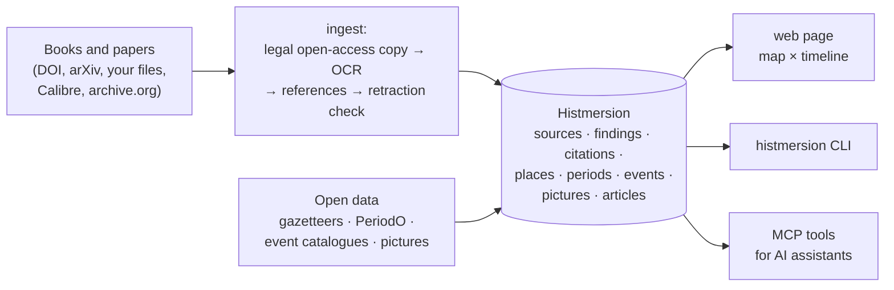

# Histmersion

**A research library for the past that runs on your own computer.** You bring books and papers.
Histmersion reads each one once (text recognition on your machine), keeps its full text, and places
what it says — its *findings*, each with a place and a range of years — on a **map crossed with a
timeline**. Sources are linked by their citations and carry a status (current, contested,
superseded, retracted…), and **articles** written across sources cite every claim back to its source.

You use it through a web page, a command line, or an AI assistant connected over MCP — three doors to
one server and one database, running the same code.



It was built for comparative mythology, folklore, Bronze-Age history and Indo-European origins, but
nothing in it is specific to those subjects. AI is **optional**: everything above works without a
model; the built-in agents that enrich sources and compile and review articles are off by default.

## Quick start

macOS on Apple Silicon or Linux; needs [sdkman](https://sdkman.io), [uv](https://docs.astral.sh/uv/),
[pixi](https://pixi.sh) and [just](https://just.systems).

```bash
sdk env install          # the pinned GraalVM and sbt
just install             # build the native bundle, install it as a user service, start it
histmersion health
open http://localhost:8000
histmersion ingest 10.1234/example-doi    # a paper by DOI (legal open access only)
```

Connect an AI assistant: point it at `http://localhost:8000/mcp`.

## Documentation

The full documentation is a site built from [`docs/user-guide/`](docs/user-guide/index.md):

```bash
just docs-serve          # http://localhost:8001, live reload
just docs-build          # docs/site, every link checked
```

Start with [What Histmersion is](docs/user-guide/getting-started/what-is-histmersion.md),
[Installing](docs/user-guide/getting-started/install.md),
[Do I need AI?](docs/user-guide/getting-started/ai-optional.md) and
[Using your AI assistant](docs/user-guide/ai-assistant.md). Reference: [CLI](docs/user-guide/reference/cli.md) ·
[MCP tools](docs/user-guide/reference/mcp-tools.md) · [REST API](docs/user-guide/reference/rest-api.md) ·
[Configuration](docs/user-guide/reference/configuration.md). Contributing:
[the developer guide](docs/user-guide/contributing/index.md) and [`AGENTS.md`](AGENTS.md); design
notes are in [`docs/`](docs/).

## Responsible use

Read [Responsible use](docs/user-guide/responsible-use.md) before you start. In short:

- **Legal, acceptable use only.** Histmersion fetches only legal open-access copies; buy or borrow
  what is paid. Respect every site's terms of use and rate limits, and honour picture and dataset
  licences.
- **AI makes mistakes.** Model-written summaries, findings and articles can be wrong or misattributed;
  the review panel reduces errors but does not remove them.
- **Articles are an entry point for your own research.** Check every claim against the cited source.
  Do not use Histmersion to generate scientific papers for publication; cite only sources you have
  read yourself.
- **Absence is not evidence.** Your collection and the datasets are incomplete; a missing source,
  event or place proves nothing.

## Licence

Not decided yet.
