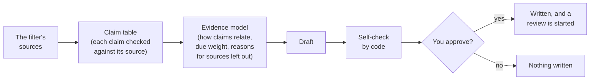

# Compiling and reviewing with agents

With the built-in agents switched on (`agents.enabled = true`, see
[AI providers](../how-to/ai-providers.md)), the server can draft articles and check them. Every
agent run is **checkpointed** (it can be paused and resumed), **budgeted** (it stops at its cost
cap), and **traced** (you can read every step afterwards).

!!! warning
    A model writes the draft and models review it. Both make mistakes. Read the article and check
    its claims against the sources before you rely on it — see [Responsible use](../responsible-use.md).

## Compiling an article

```bash
histmersion agent run compile-article steppe-hypothesis \
  --title "The steppe hypothesis" --kind concept --topic steppe_hypothesis --follow
```

`compile-article` writes a **new** article, or a new section appended to an existing one, from the
sources a filter returns (`--query`, `--topic`, `--tag`). It follows the five phases of the writing
rules:



By default the run **waits** for you before it writes anything (`agents.approvals.article-publish =
manual`). Approve or reject it in the **approvals** window or with `histmersion agent approve <id>` /
`agent reject <id>`. A new article never overwrites an existing slug.

## Reviewing an article: the review panel

```bash
histmersion agent run review-article steppe-hypothesis --fix --follow
```

Three reviewers read the article **in parallel**, each with a different job:

| reviewer | reads | looks for |
|---|---|---|
| **rules reviewer** | the article and the database | breaks of the writing rules; it spot-checks cited claims against the sources |
| **cold reader** | the article alone, like a newcomer | undefined terms, unclear sentences, questions raised and not answered |
| **skeptic** | the article and the database, as a specialist | claims stated as settled that the collection contests, lost distinctions, ignored critiques, wrong dates |

Their findings are merged by code into the article's **review ledger**, each rated MAJOR or minor.
With `--fix`, a **fixer** revises the article: it checks each finding against the database first,
rejects the ones it cannot confirm, and resolves a conflict between the cold reader and the skeptic
by **defining** a term rather than deleting the distinction. The reviewers then check the passages
that changed, and a full panel confirms. `--rounds` caps the passes (default 3).

The run ends with no MAJOR finding left, or with the remaining MAJOR findings listed as one item on
the `tasks` list for that article.

**A passed review is not a guarantee.** It means three automated readers found no major problem.

### Seeing where an article stands

Every article carries a coloured **review badge**: in the Articles tab, under its title in the
article window, and on its page. Hover over it for what it means.

| badge | meaning |
|---|---|
| **not reviewed** (grey) | no review of the article is recorded and none is queued |
| **queued** (purple) | the review manager will run the panel when a run slot is free — or again after a cooldown, when the last run left MAJOR findings open |
| **in review · round n** (blue) | the panel is working on it now, in pass *n* of the run |
| **passed** (green) | reviewed, and no MAJOR finding is open (minor ones may be) |
| **n majors open** (red) | reviewed, and *n* MAJOR findings are still open |
| **review stopped** (yellow) | the review manager gave up (the MAJOR findings did not go down over two runs, or a finding kept coming back); a person decides what happens next |

The hover text also names any approval about the article that waits for you (a coverage filter to
approve, for example). Beside the badge, the article lists the **research goals** that link it, each
with its stage badge; click one to open the goal.

At the end of the article, **Review history** (closed until you open it) lists every finding the
panel ever raised, run by run and round by round: which reviewer raised it, what kind of problem,
where, and what became of it — *fixed*, *rejected* with the sentence of the record that answered it,
*won't fix*, or still *open*. From a terminal: `histmersion article review <slug>`; for an assistant,
the `article_review` tool.

## Other pipelines

| run | does |
|---|---|
| `agent run enrich-source <citekey>` | summary, classification, period, findings with verbatim quotes and notes for one source; details checked against OpenAlex and Crossref; one verified patch |
| `agent run infer-filter <slug>` | proposes the filter an article is about (checked by code, then an approval) |
| `agent run propose-articles <goal>` | proposes the articles a goal should have (an approval) |
| `agent run plan-goal <goal>` | proposes sub-goals, searches and works (an approval) |
| `agent run currency-check <goal>` | re-checks a goal's sources for retractions and critiques; no model |
| `agent run acquisition-sweep <goal>` | searches for new literature and ranks it; what to acquire goes on the acquisition list (a watcher with auto-ingest on ingests the legal open-access finds instead) |

## Watching and steering runs

```bash
histmersion agent runs                     # newest first
histmersion agent runs --pipeline review-article --status failed --since 7d
histmersion agent runs --manager seed:bronze-age-tin --provider codex
histmersion agent show <run-id> --messages # every step, its tokens and cost, and the full trace
histmersion agent pause <run-id>           # before its next step
histmersion agent resume <run-id> --budget-usd 3.0   # finished steps are replayed, not re-run
histmersion agent cancel <run-id>
histmersion agent compare <run-id> <run-id>          # two runs on one target side by side
```

Useful flags of `agent run`: `--dry-run` (every read and model step, but nothing written — each write
is recorded on its step instead), `--budget-usd` / `--budget-tokens` (this run's cap), `--model` and
`--model-for role=provider:model` (a different model for this run).

`agent runs` narrows the list on the server: `--status`, `--pipeline`, `--origin` (who started the
run: `person`, `manager`, `run`, `ingest`, `scheduler`) and `--manager` take one value or several
(repeat the option, or comma-separate); `--model` / `--provider` find the runs a step of which used
that model or provider; `--goal`, `--subject` (text in the target), `--since` / `--until`
(`2026-10-01`, or `7d` / `12h` ago) and `--json` (the raw list) complete it. The listing ends with how
many runs each pipeline, origin, manager, provider and model has under the other filters.

The web page shows the same under **agent runs**: the state buttons, a chip per pipeline and per
origin with its count, pickers for the manager, the provider and the model, and boxes for a goal, the
target and the dates. The **jobs** window lists every background job the same way — a chip per kind
(text recognition, imports, agent runs, …), the state, a text box and the dates — and
`histmersion jobs --kind ingest --status failed --since 2026-10-01` does it on the command line.

## The same with your own assistant

If you work with Claude Code, the `review-article` skill runs the same three reviewers and the fixer
as sub-agents of your own session — see [Using your AI assistant](../ai-assistant.md).
