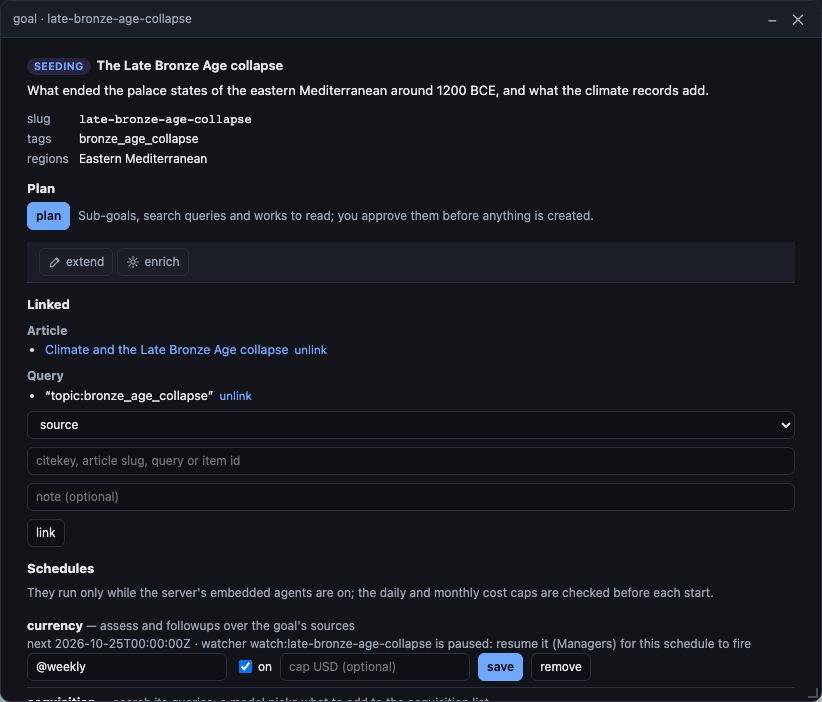

# Research goals

A **research goal** (a *research area* on the web page) is a subject you want your collection to
cover, such as "the Late Bronze Age collapse". A goal keeps together:

- a title, a slug (its short name), notes on what it should establish, and tags;
- **sub-goals**, as a tree;
- **links** to the sources, articles, literature searches and acquisition items that belong to it;
- a **plan** (sub-goals, searches, works to acquire), once you approved one;
- **schedules** for checking it again later;
- a **cost cap** for the agent runs it starts;
- a **status**: `planned` → `seeding` → `compiled` → `reviewed` → `done`.

Goals are useful without AI as a way to organise work: link the sources and articles of a subject
to it and use it as a to-do list. With the built-in agents switched on, a goal is also what they
work through.

<figure markdown="span">
  { loading=lazy }
  <figcaption>A goal's window: its status and notes, what is linked to it, its plan, and its schedules.</figcaption>
</figure>

## Creating a goal

On the web page, open **research goals** in the toolbar and use **New research area**: a title,
optional notes and tags, and three options:

| option | creates |
|---|---|
| plan | a `plan-goal` run: a model proposes sub-goals, searches and works; nothing is created before you approve it |
| seed | a seeding manager, created paused, that will propose and compile the goal's articles |
| watch | a watcher, created paused, that runs a weekly literature sweep and currency check; optionally it also ingests the **legal open-access** works it finds (off by default, with a daily cap) |

An AI assistant can create one with the `put_goal` MCP tool.

## Working with goals from the command line

```bash
histmersion goals list
histmersion goals get bronze-age-collapse                  # sub-goals, links, schedules, the plan
histmersion goals update bronze-age-collapse --status seeding --notes "…"
histmersion goals link bronze-age-collapse --source cline2014
histmersion goals link bronze-age-collapse --article sea-peoples
histmersion goals link bronze-age-collapse --query "Late Bronze Age collapse drought"
histmersion goals unlink bronze-age-collapse <kind> <ref>
```

## Planning (needs the agents)

```bash
histmersion goals plan bronze-age-collapse --budget-usd 1.0 --follow
histmersion agent approvals                 # the plan waits here
histmersion agent approve <approval-id>     # only now are the sub-goals, links and items created
```

The planner checks every work it proposes against the publishers' registries (DOIs looked up
upstream) before it lists it. See [Approvals](approvals.md).

## Schedules

A goal can be checked again on a schedule — a **currency** check (are its sources still accepted?)
and an **acquisition** sweep (is there new literature?). Both are run by the goal's watcher
`watch:<goal>`, which is created paused:

```bash
histmersion goals schedule bronze-age-collapse currency --cron @monthly
histmersion goals schedules
histmersion agent manager watch:bronze-age-collapse resume
```

Schedules run only while the server's agents are on.

Next: [Compiling and reviewing with agents](compile-and-review.md).
