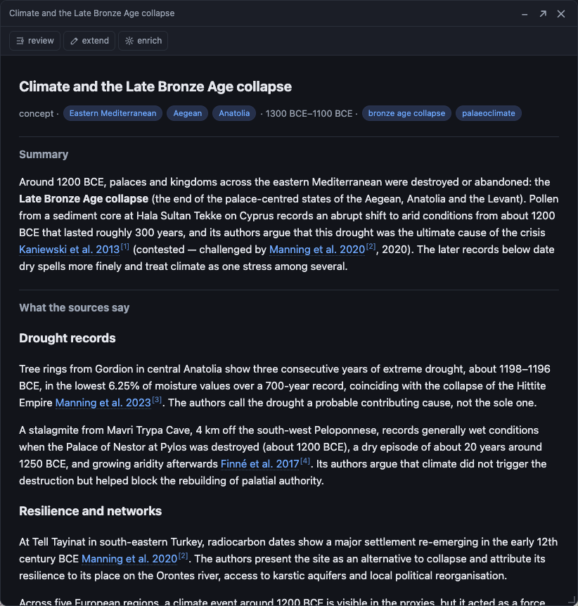

# Articles

An **article** is a page written *across* sources: what your collection says about a concept, a
myth, a culture, a region, a stretch of time, or the answer to one question. It lives in the same
database as the sources, and every claim in it points to the source it rests on.

!!! danger "An article is an entry point, not a conclusion"
    Articles — above all those drafted by an AI model — **can be wrong**: a claim given to the wrong
    source, a nuance lost, a disagreement smoothed over. The review panel catches many such errors
    and misses some. **Check every claim against the cited source yourself before you rely on it,**
    and never use an article as a paper for publication. If you use one while writing your own text,
    cite the sources you read yourself, not the article. See [Responsible use](../responsible-use.md).

## Kinds

| kind | for |
|---|---|
| `concept` | an idea or a debate ("the steppe hypothesis") |
| `myth` | a myth or motif across cultures |
| `culture` | a people or an archaeological culture |
| `region` | a region through time |
| `timeline` | a sequence of events |
| `report` | the answer to one research question |
| `index` | a page that lists other articles |

## How to read one

Open it from the **articles** tab on the web page (or at `http://localhost:8000/article/<slug>`), or
with `histmersion article get <slug>`.

<figure markdown="span">
  { loading=lazy }
  <figcaption>An article: every citation links to its source, and the first citation of a contested source says
  so, with the source that challenges it.</figcaption>
</figure>

- **Citations.** `[[cline2014]]` is a link to a source; `[[bronze-age-collapse]]` a link to another
  article. Follow them. Every paragraph cites at least one source.
- **Statuses in the text.** When an article relies on a source that is not simply `current`, it says
  so where the source is first cited — for example that it is `contested`, by whom and since when.
- **The usual sections.** Summary · What the sources say · Disagreements · Open questions (what the
  collection cannot answer, and what kind of source would) · Glossary. A report has Question · What
  the sources say · Disagreements · Unresolved.
- **Sources cited** — generated at the foot of the page from the `[[citekey]]` links, with each
  source's title, year and status.
- **Backlinks** — the articles that link here.

### The coverage notes: *Not used* and *Method*

An article can record its **filter**: the search that defines which sources it is about (for
example "topic: steppe_hypothesis"). From that filter, the page **generates** two sections every
time you open it. Nobody writes them by hand:

- **Not used** — every source the filter finds that the article does *not* cite, each with the
  reason it was left out ("a different region", "only restates [[x]]"), or *not yet assessed* when
  nobody gave one. This is where to look for what the article might be missing.
- **The _Method_ note** — one line at the end, for example:

    > _Method: search {topics: ["steppe_hypothesis"]} → 16; statuses: 11 current, 5 contested; none
    > superseded, debunked or retracted; disagreement edges touching the cited sources: [[a]]
    > challenges [[b]]; disagreements checked: 1 pair — 1 addressed, 0 reasoned, 0 open._

    It says how many sources the filter found (16), their statuses, which disagreement links touch
    the cited sources, and whether each disagreement was **addressed** (both sides cited in one
    paragraph), **reasoned** (a stored reason why it does not bear on the article) or still **open**.

Because these are computed from the live collection, they change when you add sources: a new source
that matches the filter shows up under *Not used* until someone cites it or gives a reason.

<figure markdown="span">
  { loading=lazy }
  <figcaption>The generated end of an article: <em>Not used</em> with a reason per source, the <em>Method</em>
  line, and <em>Sources cited</em> with each source's status.</figcaption>
</figure>

```bash
histmersion article coverage <slug>      # the same, in detail: cited, not used, reasons, drift
```

### Other things on the page

- A folded note "This article may not display correctly" lists Markdown problems, if any
  ([Formatting lint](../reference/formatting-lint.md)).
- `histmersion article versions <slug>` lists every earlier version; `article version <slug> <id>`
  shows one.

## Where articles come from

- **You write them** — [Writing an article yourself](writing-by-hand.md). No AI needed.
- **Your AI assistant writes them** with the MCP tools, following the bundled writing rules —
  [Using your AI assistant](../ai-assistant.md).
- **The built-in agents compile them** from a research goal, and the review panel checks them —
  [Research goals](goals.md), [Compiling and reviewing with agents](compile-and-review.md),
  [Process managers and the autopilot](autopilot.md).

All three follow the same writing rules, in {{ repo_file("docs/writing-guide.md") }}: every claim
traceable to one source, no comparison that no single source makes, disagreements given space by
their standing in the collection, specialist terms defined on first use, gaps stated instead of
filled from memory.
