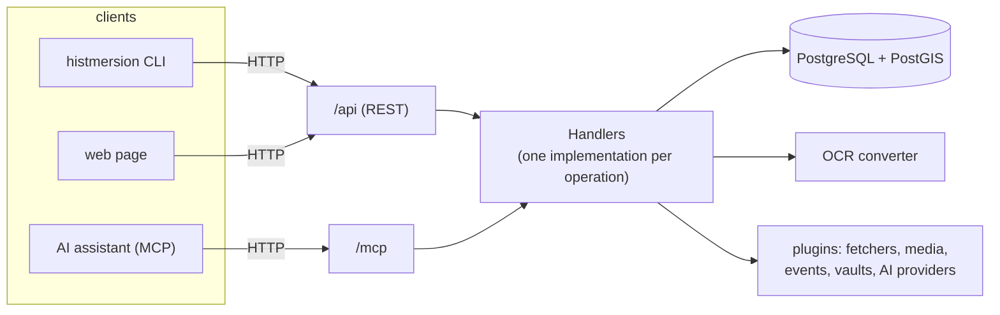

# Architecture

## The pieces

```
  host                                      histmersion-server and its child processes
┌──────────────────┐                  ┌──────────────────────────────────────────────────┐
│ histmersion (CLI)│                  │  server            (GraalVM native image, 78 MB)  │
│ native binary    │───── HTTP ──────►│    /mcp     MCP tools (Chimp)      ─┐              │
│ pure HTTP client │   (127.0.0.1)    │    /api     REST (Tapir)           ─┼─► Handlers   │
└──────────────────┘                  │    /source/ + /article/ pages      ─┘     │        │
                                      │    /        web UI: map × timeline        │        │
┌──────────────────┐                  │                                           │        │
│ agent (MCP)      │───── HTTP ──────►│                            Magnum (JDBC) ─┤        │
│ Claude Code /    │                  └──────────────────┬───────────────────────┬┴────────┘
│ OpenCode         │                                     ▼                       ▼
└──────────────────┘                          ┌────────────────────┐   ┌────────────────────┐
                                              │ postgres (child)   │   │ converter (child)  │
┌──────────────────┐                          │ PostGIS · int8range│   │ docling /          │
│ browser → web UI │───── HTTP ──────────────►│ GiST · Flyway      │   │ pymupdf4llm  (OCR) │
└──────────────────┘                          └────────────────────┘   └────────────────────┘

corpus dir (HISTMERSION_CORPUS_DIR) ──read by──► server   (`seed` with no argument)
```

The **server** is the only program that touches the database. It supervises the bundled PostgreSQL
and the OCR converter as child processes, and serves four surfaces from one set of handlers: the MCP
tools (`/mcp`), the REST API (`/api`), the server-rendered source and article pages, and the web page
(`/`).

## Modules

| module | what | depends on | binary |
|---|---|---|---|
| `values` | the newtypes every layer speaks of: `Citekey`, `Year`, `Period`, `Doi`, `WikidataId`, `LatLon` (JVM and Scala.js) | Iron only | — |
| `api` | **the contract on the wire**: wire records · `Filter` · Tapir endpoint definitions · their codecs and schemas · Markdown rendering (JVM and Scala.js). No database code, no side effects. | `values` | — |
| `config` | the config model: `AppConfig`, its readers, `reference.conf`, the reload plan | `values` | — |
| `files` | the local files a client and the server exchange or keep: the `.hmx` bundle's container and canonical JSON · the merge resolution file · the source and article notes of the Markdown mirror (frontmatter parsing, export) · the plugin set and relink kit records · a directory's size | `api` | — |
| `core` | **the domain**: the logic the server and the store run on. No database code, no side effects. | `values`, `api`, `config`, `files` | — |
| `db` | **the store**: Magnum repos over Postgres/PostGIS · Flyway migrations · the seed importer | `config`, `core` | — |
| `server` | MCP (Chimp) + REST (Tapir/netty-sync) + article pages + the web UI. **The only database client.** | `core`, `db`, `plugin-api`, `plugin-host`, `plugin-vaults` | native image |
| `cli` | **a pure HTTP client** of the server — sttp client derived from `api`'s endpoints. No pgjdbc, no DB credentials on the host. | `api`, `config`, `files` — **never** `core` or `db` | native image |
| `web` | the web page (Scala.js, Laminar; the map drawn by MapLibre GL JS behind its own interface) | `api` (Scala.js) **only** | served by the server |
| `plugin-api` | the plugin SPI: `Plugin`, `PluginContext`, the registries, `Secret` | sconfig, kindlings only | — |
| `plugin-vaults` | the built-in secret vaults (KeePassXC, 1Password, Bitwarden), compiled as a third-party plugin would be | `plugin-api` only | — |
| `plugin-fixtures/hello`, `hello-ai` | test plugins, packaged as their own jars; never on the server's class path | `plugin-api` only | — |

Because `api` defines each endpoint once and `server` implements it once in `Handlers`, the REST
route, the MCP tool and the CLI command are the *same* operation with the *same* Markdown output.
They agree by construction, not by discipline.

Adding an operation therefore touches, in order: `api/Dto.scala` (input and output types),
`api/Api.scala` (the endpoint, added to `Api.all`), `api/Markdown.scala` (how it renders), the
repo in `db` if it needs the database, `server/Handlers.scala` (the one implementation),
`server/HttpApi.scala` **and** `server/McpTools.scala` (both wired), then `cli/Client.scala` and
`cli/Main.scala`. Details in {{ repo_file("AGENTS.md") }}.



## The map

The page's map is drawn by [MapLibre GL JS](https://maplibre.org) (vendored, pinned, BSD-3), but no
code of the page talks to MapLibre. Everything goes through a small interface of the app's own, in
`modules/web/.../web/map/`, so that a change of map library touches one package:

| part | what |
|---|---|
| `MapSurface` · `MapEngine` | one map: the view (centre, zoom, bounds, project/unproject), events (`MapEventKind`: move, zoom, click, hover, base map drawn), the base map (`BaseMapSpec`: blank, a vector style, a raster template), shape sets, popups, the corners for controls, the drawn base-map names, `Capabilities` (WebGL, WebGL 2, software rendering by the renderer's name). `Engines.default` names the one real engine; `Engines.surface` makes the page's map, or a `NoMapSurface` (draws nothing, says why in the map's place) when `MapEngine.unsupported` refuses the browser or the engine fails to start |
| `LatLon` · `ScreenPt` · `GeoBounds` · `Corner` · `VectorStyle` | value types; zooms are always the 256-pixel raster grid's, whatever the library counts |
| `ShapeSet` · `ShapeFeature` · `ShapeStyle` · `ShapeHits` | GeoJSON shapes (states, event outlines, a place's area) with per-feature colour and alpha changed in place — `set` diffs by id, `restyle` touches one feature — and hit testing by geometry, not by what the library happened to render |
| `PointTiles` · `TilePointFeature` | one of the server's point layers read as vector tiles (`/api/tiles`): the library fetches, caches and decodes the tiles of the view, the app reads the features of the view's zoom (each once) and draws them as its own markers; `NoMap.Tiles` asks for nothing |
| `MarkerPane` · `DomMarker` · `PointSet` · `Clustering` | the HTML markers (the corpus's dots, events, labels) in named panes, positioned by CSS custom properties with one delegated listener per pane; the cluster layer (a pure greedy grid) with its animations |
| `map.maplibre` | **the only adapter**: the Scala.js facade over MapLibre's ESM build (`MapLibre.scala`), `MapLibreEngine` (the `MapSurface`), the two style documents' loading (`web/styles/readable.json`, `physical.json`: placeholders for the server's tile versions and the names' language), the contours (maplibre-contour) |

The tests use a fake surface (`FakeSurface` in the web tests) that records what the layers asked for,
so the overlays' behaviour is tested without a browser. `MapEngineBoundarySuite` (core's JVM tests)
fails the build when a MapLibre name — the facade's types, `maplibregl`, `mlcontour` — appears in a
web source outside `web/map/maplibre/` (and `Engines.scala`, which picks it). The browser regressions
reach the map through `window.histmersionMap` (`MapHandle`), in the same terms. Why this shape, and
what it cost: {{ repo_file("docs/research-map-styles.md") }}, "As built".

## Design notes

The design records in `docs/` say why things are as they are. Each *research* note ends with
**as-built** sections that record what was implemented and where it differs from the proposal; read
those first.

| note | about |
|---|---|
| {{ repo_file("docs/design.md") }} | the overall design: what is built, the stack |
| {{ repo_file("docs/plan.md") }} | the product plan and its waves |
| {{ repo_file("docs/research-module-layout.md") }} | how the modules are split today and a proposed domain / API / store / plugin layout |
| {{ repo_file("docs/writing-guide.md") }} | the rules for prose compiled from the collection (also bundled into the agents) |
| {{ repo_file("docs/visualization-guide.md") }} | rules for the map and timeline: honest uncertainty, every dot traceable |
| {{ repo_file("docs/map-layers.md") }} | the map's point layers and how they share one implementation |
| {{ repo_file("docs/research-map-styles.md") }} | the two base maps (Readable, Physical), MapLibre as the map, the map interface |
| {{ repo_file("docs/media-providers.md") }} | each picture provider: what it is asked, licence and match rules |
| {{ repo_file("docs/research-embedded-agents.md") }} | the built-in agents: engine, pipelines, budgets, tracing (P0–P3 as built) |
| {{ repo_file("docs/research-agent-runtimes.md") }} | one set of agent definitions for Claude Code, Codex and opencode; the generator; run tokens |
| {{ repo_file("docs/research-model-providers.md") }} | which model providers may be used and on what terms; local models |
| {{ repo_file("docs/research-plan-quotas.md") }} | governing agents on a subscription: plan pools, floors, readings |
| {{ repo_file("docs/research-process-managers.md") }} | the process managers, the autopilot and the ingest backlog |
| {{ repo_file("docs/research-review-convergence.md") }} | why reviews did not converge, and the review ledger built from it |
| {{ repo_file("docs/research-plugins.md") }} | the plugin SPI, configuration, secrets, relink kit, signing, AI providers as plugins |
| {{ repo_file("docs/research-merge-import.md") }} | portable bundles and merging two collections |
| {{ repo_file("docs/research-interactive-performance.md") }} | server-side speed of every interactive path |
| {{ repo_file("docs/research-web-perf.md") }} | the web page's speed, memory and leaks in the browser |
| {{ repo_file("docs/research-web-ui-mobile-sources-upload.md") }} | the phone layout, the sources toggle, uploads from the acquisition list |
