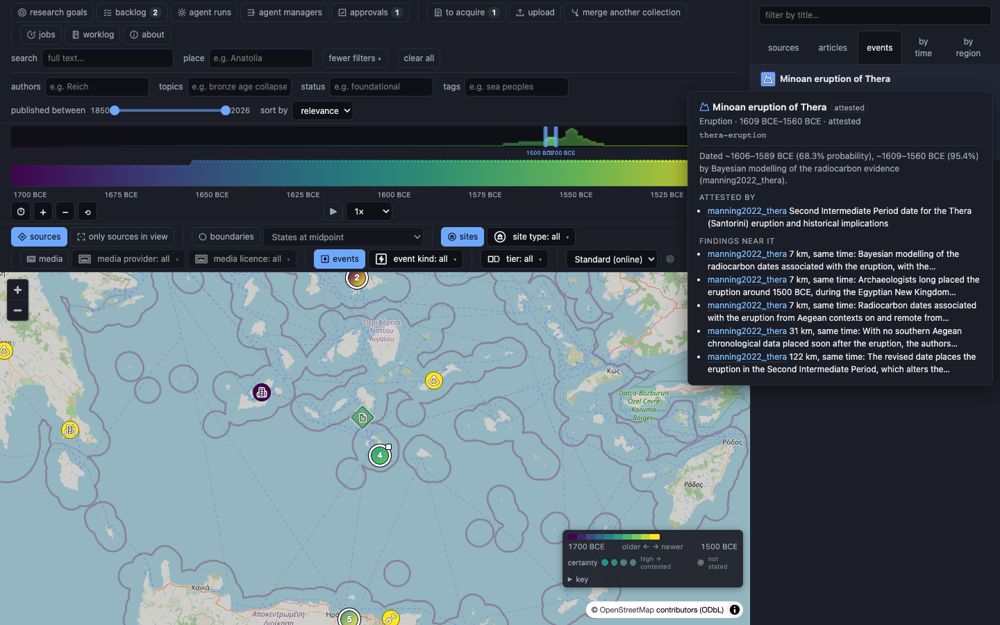

# Events

An **event** is something that happened at a place over a span of time: a battle, a siege, a
destruction, an eruption, an earthquake, a treaty, a migration. Each event has:

- a **label** and a **kind**;
- a **time span** that can be fuzzy at both ends (it began no earlier than X and no later than Y);
- a **place**, or a point or shape of its own;
- a **scale**: `local` (one place — a battle) or `regional` (a region — a war, an era);
- a **historicity**: `attested`, `inferred`, `contested`, `legendary` or `mythic`;
- links to other events (before, during, overlapping) and to the sources that discuss it.

## Looking at events

On the web page, switch on the events layer and open the **events** tab. Play the timeline to watch
them appear and fade.

<figure markdown="span">
  { loading=lazy }
  <figcaption>An event's card: its kind, span and historicity, the source that <strong>attests</strong> it (a
  confirmed quote), and the findings near it — proposals, not yet evidence.</figcaption>
</figure>

```bash
histmersion events search "siege" --from -1300 --to -1100
histmersion events search --kind eruption --place-id <place-id>
histmersion events show <event-id>
```

## Where events come from

Some events are written by hand, or by the agents from the sources. Many come from public
**catalogues**:

| catalogue | `events import …` | what it lists | licence |
|---|---|---|---|
| Smithsonian Global Volcanism Program | `gvp` | Holocene volcanic eruptions | Smithsonian Terms of Use (non-commercial use with attribution) |
| NOAA NCEI Natural Hazards | `noaa` | significant earthquakes, eruptions, tsunamis | public domain (a U.S. federal work) |
| Wikidata | `wikidata` | battles, sieges, wars, treaties, revolts, disasters | CC0 |

`histmersion events catalogues` lists the catalogues your server has (plugins can add more), with
their licences and how to cite them. Importing is described in [Open data](../how-to/open-data.md).

## A catalogue event is a lead, not evidence

A catalogue says *an eruption happened here, then*. It does not say that any of your sources
discusses it. Histmersion keeps the two apart:

```bash
histmersion events leads --from -1700 --to -1500        # catalogue events no source discusses yet
histmersion events links <event-id>                      # sources that MAY discuss it — proposed, unconfirmed
histmersion events links <event-id> --apply <citekey>    # confirm one: an attestation from a passage naming it
histmersion events links <event-id> --reject <citekey>   # stop proposing one
histmersion events candidates                            # compute the proposals for events not checked yet
```

The proposals are scored by code — findings near the event in time and space, passages that name it
— with no AI model. A link becomes evidence only when you confirm it from a passage that names the
event; that creates an **attestation** (a link to the exact quote and its position in the source).

## Correcting an event

```bash
histmersion events patch <event-id> --scale regional --place-id <place-id>
histmersion events corrections         # your corrections to catalogue events, conflicts first
```

A correction to a catalogue event is kept every time the catalogue is imported again. When the
catalogue later says the same thing, the correction retires itself; when it says something else,
it is flagged as a conflict for you to decide.

!!! note
    The catalogues are incomplete, and much better for some regions and centuries than others. An
    empty stretch of the timeline does not mean nothing happened there
    ([Responsible use](../responsible-use.md#5-absence-is-not-evidence)).
