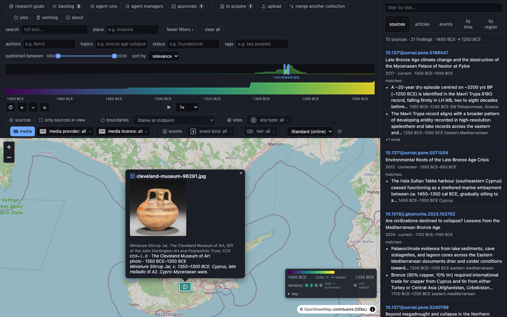

# Pictures

Histmersion can show pictures of places and events: photographs, plans, maps, museum objects,
excavation drawings. It stores a picture **only when its licence allows reuse**, and keeps with it:

- the **licence** (read from the provider's own record, never assumed);
- the **credit line**, in the provider's own form;
- the page it comes from, and the address of the original.

The stored file is the provider's own web-sized copy; the original stays with the provider.

## Seeing them

Switch on the pictures layer on the map, or open a place's or an event's card.

<figure markdown="span">
  { loading=lazy }
  <figcaption>A museum picture opened from the pictures layer: the credit line in the provider's own form, the
  licence (CC0), the years and the caption, under the picture.</figcaption>
</figure>

From the command line:

```bash
histmersion media list --place <place-id>          # pictures of one place, with licence and credit
histmersion media list --licence cc-by --facets    # by licence, with counts
histmersion media show <uid>                       # one picture: origin, licence, credit, what it shows
```

Sources have pictures too: their own **figures** (kept from the original) and, on hover cards, a
book's **cover** — from your local Calibre library, or from Open Library by ISBN — or a paper's
illustration chosen among its figures (`histmersion media covers`). Covers are shown in your own
page only; they carry no reuse licence and never travel in a bundle.

## Which licences are accepted

By default the providers store pictures under these licence families:

| family | means |
|---|---|
| `public-domain` | no copyright, or expired |
| `cc0` | the author waived all rights |
| `cc-by` | reuse with credit |
| `cc-by-sa` | reuse with credit, under the same licence |

Some providers accept fewer (the museum collections take public domain and CC0 only; the Library of
Congress maps take public domain only, dated before 1929). **Non-commercial** (`cc-by-nc`…) licences
are stored only if you add them to a provider's list yourself. A picture with no readable licence,
or "all rights reserved", is never stored.

If a later check finds that a stored picture's licence no longer allows it, the picture is kept but
listed as **revoked** for you to review.

## Reusing a picture

**When you reuse a picture outside Histmersion, follow its licence.** For `cc-by` and `cc-by-sa`,
show the credit line exactly as stored, link the licence, and say if you changed the picture; for
`cc-by-sa`, share your version under the same licence. The credit line and the licence are on every
picture's card and in `histmersion media show`.

Importing pictures: [Open data](../how-to/open-data.md#pictures).
