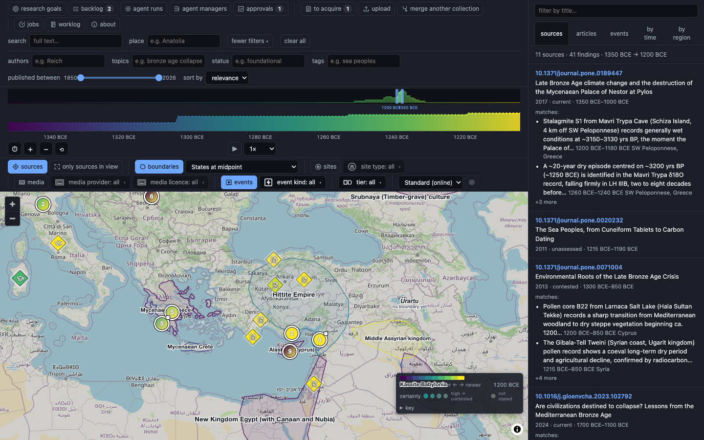

# Places, periods and the map

## Places: the gazetteer

A **gazetteer** is a list of places. Each place in Histmersion has:

- an **id** (`pleiades_678430`, `continent_asia`, `ne_country_tur`) — the key every filter uses;
- its **names**, in several languages and spellings;
- a **kind**: `site`, `region`, `polity` (a state), `people`, `feature` (a river, a mountain);
- a **shape** (a point, or an outline) and the **years** it existed;
- its **parents**: what it lies inside — a city inside a region inside a continent, as it stood in a
  given year.

<figure markdown="span">
  { loading=lazy }
  <figcaption>A place's card (rest the pointer on a state, a region or a site): its kind and years, its id, what
  it lies inside, where its shape comes from, and what the collection holds about it.</figcaption>
</figure>

### Finding a place's id

A name you write ("Anatolia", "Ugarit") is only text. A place **id** matches everything inside the
place's shape **and** everything below it in the hierarchy, which a name never does:

```bash
histmersion places search Anatolia                 # → ids, kinds, years
histmersion search --place anatolia --from -1500 --to -1200
histmersion places show continent_asia --as-of -1400   # its parts as they stood in 1400 BCE
histmersion places children ne_country_tur --as-of -1400
```

`--as-of` reads the hierarchy at one year: borders and states change.

### Fixing and extending the gazetteer

Gazetteers are wrong sometimes, and never complete. Changes you make by hand are kept when the data
is imported again:

```bash
histmersion places name add pleiades_678430 'Lake Kinneret' --lang en   # another name
histmersion places set pleiades_886355306 --kind region --reason 'one of the 14 Augustan regiones'
histmersion places merge <place-id> <into-id> --reason 'the same place twice'
histmersion places add 'My site' --kind site --lon 35.2 --lat 33.1 --source 'Survey report, fig. 4'
histmersion places overrides                        # what you changed, against what the source says
```

`places add` requires `--source`: say where the point comes from. Never guess a location.

## Periods

"The Bronze Age" is not one span of years. Authorities date it from 3600 BCE in the Levant to
1800 BCE in Norway, and the same holds for most named ages. Histmersion uses **PeriodO**, a public
collection of period definitions, each stated by one published authority for one region.

```bash
histmersion periods search Minoan             # ids, spans, regions, authorities
histmersion periods show p0ds9qjh4dh          # one period: its span, authority, parts
histmersion periods search --region Greece --from -2000 --to -1000
```

Use a period to choose the years to search, then **cite the authority** when you write about it:
two authorities can date the same name differently.

The timeline's **presets** are such periods, grouped by region. The bundled set is a curated part of
PeriodO; [Open data](../how-to/open-data.md) shows how to import more.

<figure markdown="span">
  { loading=lazy }
  <figcaption>The preset <em>Hittite Empire</em> (1350–1200 BCE, as one authority dates it for Anatolia) chosen:
  the timeline, the map's states and events, and the lists all follow.</figcaption>
</figure>

## The map's layers

The map draws, for the years on the timeline:

- **findings** — where your sources make claims;
- **sites** — every gazetteer place of kind `site` alive at some time in those years: the curated
  gazetteer's and the dated sites imported from Wikidata, wherever they are (an undated imported place
  is never on a time view; a place dated only by its findings shows when a finding or event dated then
  is attached to it);
- **events** — see [Events](events.md);
- **pictures** — see [Pictures](media.md);
- **areas** — regions and states alive in those years.

Present-day places (modern cities, undated places) appear only from the year 1500 on
(`places.modern-from`), so a view of the Bronze Age is not cluttered with today's towns.

## How a finding gets its place

A finding has a region name and, usually, a point (latitude and longitude). Histmersion works out
which gazetteer places the finding falls in — inside a shape, or within 10 km of a place known only
as a point (`places.point-tolerance-km`). That is what makes `--place` work for findings.

`histmersion lint --rule finding-unplaced` lists findings that fall in no place;
`lint --rule finding-geocode` lists points that look misplaced.

!!! note
    A place missing from the map is missing from the gazetteer — it does not mean the place did not
    exist ([Responsible use](../responsible-use.md#5-absence-is-not-evidence)).
