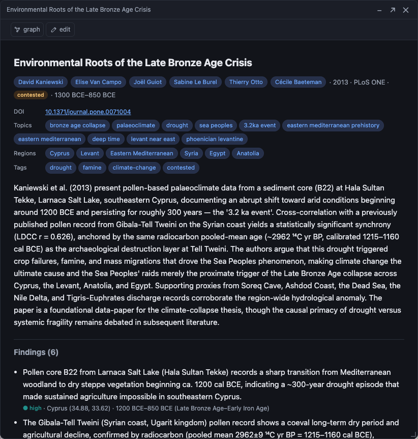
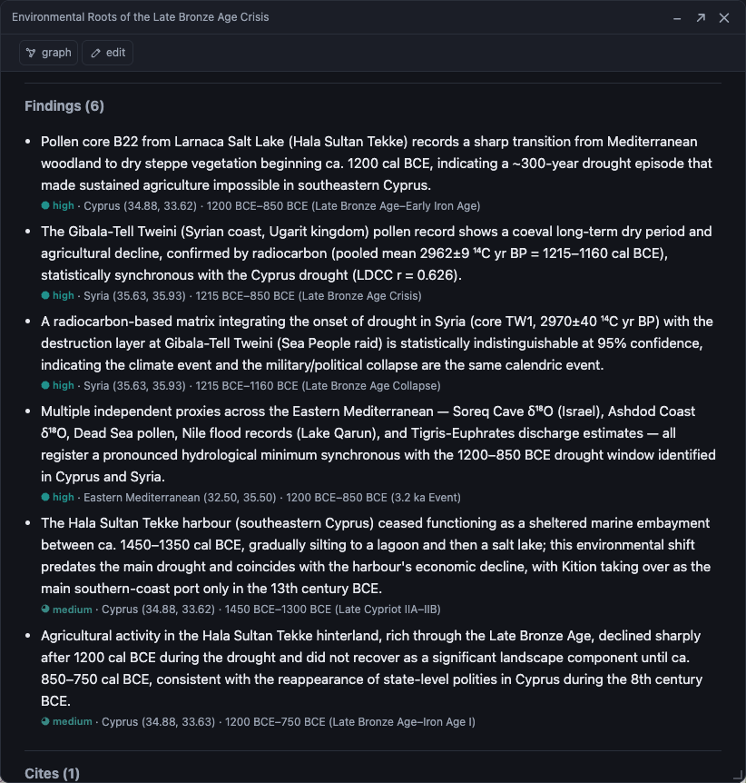
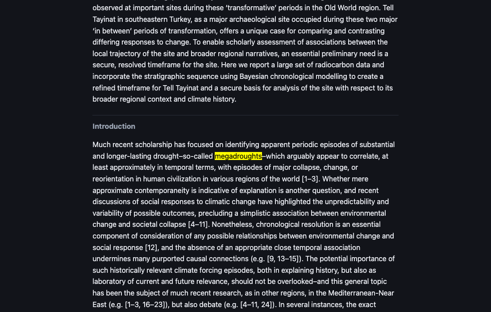

# Reading a source

A source's page — in the web page, or `histmersion get <citekey>` — shows:

- its **details**: title, authors, year, venue, DOI, how it was acquired, its **status**;
- its **summary** and **notes**;
- its **findings**: each claim with its place, years and confidence;
- its **topics, regions, tags and period**;
- the **articles that cite it**, and its **citation links**;
- its **figures**, and its **full text** as recognised from the original.

<figure markdown="span">
  { loading=lazy }
  <figcaption>The top of a source's window: details, its status badge (here <code>contested</code>),
  what it is about, and the summary.</figcaption>
</figure>

<figure markdown="span">
  { loading=lazy }
  <figcaption>Its findings: each claim with its confidence, its place (and point) and its years — what
  the map draws.</figcaption>
</figure>

## Parts of a source

```bash
histmersion get cline2014                        # summary, findings, notes
histmersion get cline2014 --section toc          # the headings of the full text
histmersion get cline2014 --heading "Chapter 3"  # one part of the text, by heading
histmersion get cline2014 --full                 # everything, including the full text
histmersion get cline2014 --offset 120000 --chars 8000   # read on from a position
```

`--section` takes `summary`, `findings`, `notes`, `toc`, `body` or `all`. A full text can be very long
(hundreds of thousands of characters), so read a part when you can.

## Finding a passage

`passages` finds a word, a phrase or a pattern inside **one** source and shows the text around each
match, with the heading it sits under and its position:

```bash
histmersion passages cline2014 "Ugarit"
histmersion passages cline2014 "Shardana|Sherden" --regex
```

Matching ignores case and accents. Each match gives an offset; pass it to `get --offset` to read on
from there.

On the web page, the search box looks across every source and the list shows the passage that
matched. A source's own page marks words for you when its address carries them:
`http://localhost:8000/source/<citekey>?q=<words>&full=true` shows the full text with every match
marked, counts them, and jumps to the next one with `n`.

<figure markdown="span">
  { loading=lazy }
  <figcaption>A source's page with <code>?q=megadrought&amp;full=true</code>: its full text with every
  occurrence marked.</figcaption>
</figure>

## Figures

```bash
histmersion assets cline2014        # the figures stored with a source, and where each is served
```

Figures are kept from the original at text-recognition time. Their licence is the source's own;
`histmersion media fill-licences` copies the licence a source records onto figures that have none.

## When the text looks wrong

Text recognition can garble a scan: broken words, a table read as prose. `histmersion reocr
<citekey> --quality` runs it again on the stored original with the slower, more accurate method.

## Always go back to the page

The full text is a recognised copy. When a claim matters, check it against the original (the PDF,
the book in your Calibre library or on your shelf) — page numbers, footnotes and quotations most of
all.
