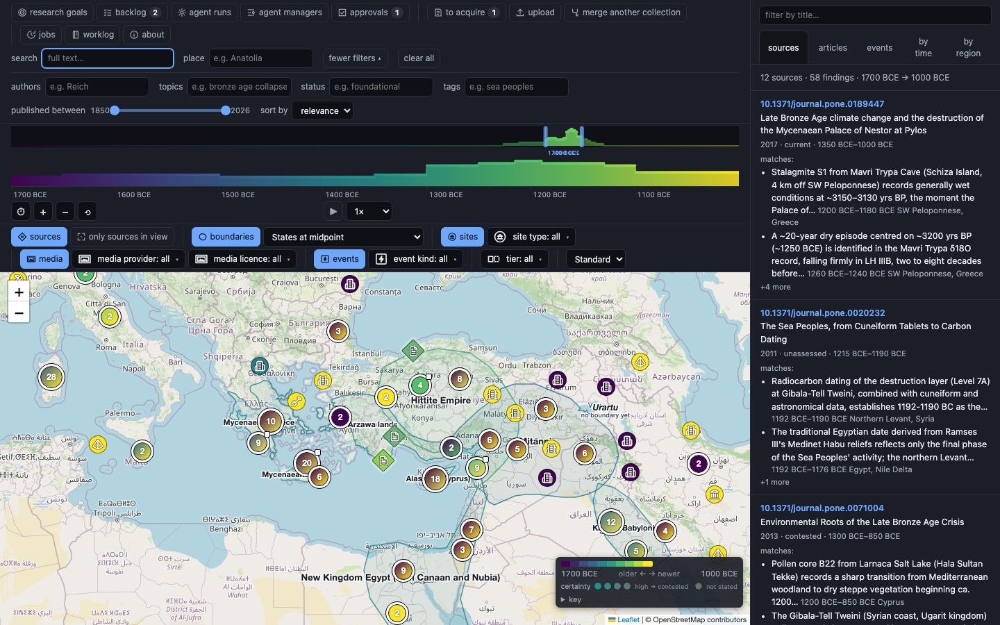
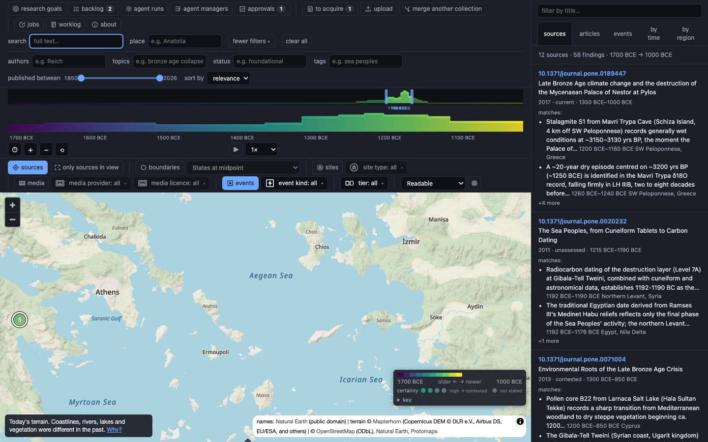
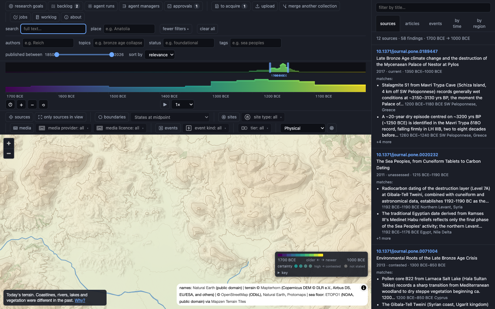
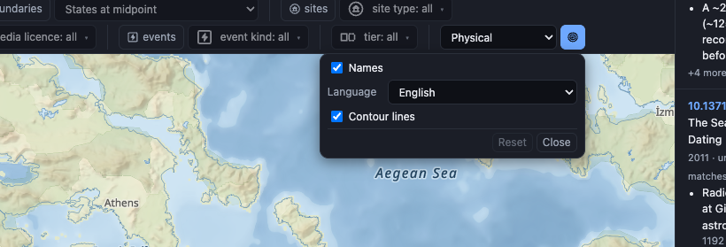
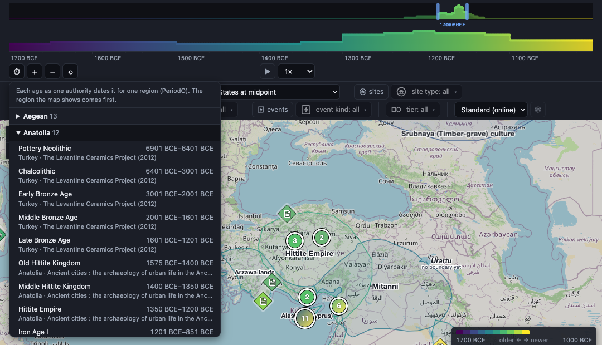
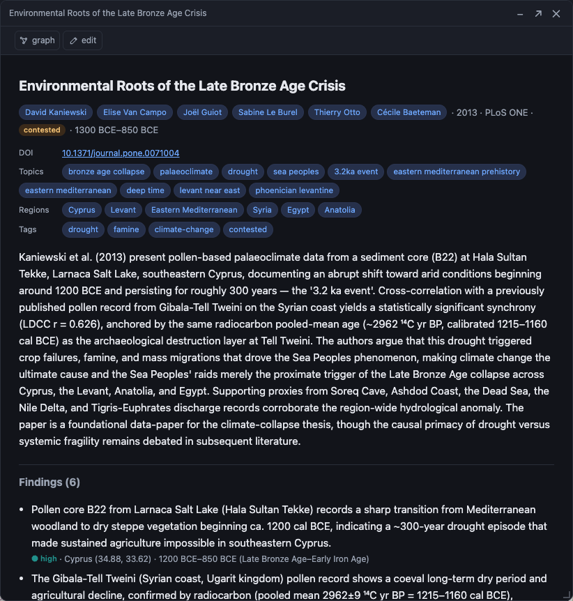

# The web page

Open <http://localhost:8000>. The page has four parts: the **toolbar** that opens windows, the
**filters** and the **timeline** under it, the **map**, and the **side panel** with the lists.

<figure markdown="span">
  { loading=lazy }
  <figcaption>Every layer switched on for 1700–1000 BCE: numbered circles group nearby claims, diamonds
  are single claims, the outlines are the states of the time.</figcaption>
</figure>

## The map

The map shows what falls inside the years selected on the timeline. Each kind of point can be
switched on and off:

| on the map | what it is |
|---|---|
| **findings** | the claims your sources make, at the place they are about. Several claims at one spot show as one marker with a count. The colour follows the date; paler means lower confidence. |
| **sites** | every place of the gazetteer that is a site (settlements, sanctuaries, forts, burials…) and existed at some time in those years — anywhere in the world. |
| **events** | every battle, siege, eruption, earthquake or treaty of those years. A local event (a battle) shows as a dot at its site; a regional one (a war, a migration) as a label with the region's outline. |
| **pictures** | every picture of a place or an event dated into those years whose licence allows reuse, each with its credit. |
| **areas** | regions and the states of the time, drawn as shapes. |

Nothing is left out to keep the map light: where many markers would sit on top of each other, they are
drawn as one round bubble with their number — the whole world at once shows tens of thousands of sites
as a few hundred bubbles. Click a bubble to zoom in on what it holds (a small one lists them); zoomed in
far enough, every marker stands on its own. The bubbles' colour spans the dates of what they hold.

Hover over a marker for a short card; click it (or press Enter on it) for the details — a site
click also filters the lists by that place.

### The base map

The menu at the end of the layer buttons picks the map under your data — one of five
[base maps](../how-to/base-maps.md):

- **Readable** (the default) and **Physical** — drawn in your browser from a download your own server
  keeps, so they work without the internet. Readable is a general-purpose map in OpenStreetMap's
  colours with towns, faint main roads and borders; Physical shows the land's form — relief, height,
  the sea by its depth — and the physical names, without roads or borders;
- **Standard (online)**, **Muted (online)** and **Dark (online)** — OpenStreetMap's tiles from the
  internet (or the ones `ui.tiles` names). They are offered only while the server cannot draw its own
  map yet, or when `ui.base-map-source = "online"`. Once the download is complete, the page asks no
  other computer for anything: [Working offline](../how-to/offline.md).

The button beside the menu opens the **map options**: on every base map the [map motion](#map-motion),
and for Readable and Physical the names on or off,
their language (*English*, *Local* — each name in its own language and script — or another), the sea
coloured by its depth (on in Physical, off in Readable), and in Physical the contour lines. They stay open while you change things (Escape, or *Close*, closes them),
each change shows at once, and they are remembered by this browser until **Reset**. An option the map
cannot offer, or whose data the server has not downloaded, is disabled with a line saying why — and,
for missing data, the command that fetches it. A base map the download cannot draw whole is marked
"needs the full download" and drawn with what is there.

<figure markdown>
  { loading=lazy }
</figure>

<figure markdown>
  { loading=lazy }
</figure>

<figure markdown>
  { loading=lazy }
</figure>

### Map motion

The map moves when you zoom: groups of points split as you zoom in and merge as you zoom out (the
points slide out of a bubble, or fly into it), names grow and shrink into place, and the zoom itself
glides instead of jumping. **Map motion**, in the map options, decides whether it does:

| choice | what the map does |
|---|---|
| **Follow the system** (the default) | moves, unless your computer or phone asks for reduced motion — then everything on the map jumps to its new place |
| **Always animate** | moves, whatever the system asks |
| **Never animate** | jumps, whatever the system asks |

The choice is kept by this browser on this device — another browser or another device keeps its own —
and applies at once. While the setting follows the system and the system asks for reduced motion, a
line under it says *Animations are off because your system asks for reduced motion*. "Follow the
system" also follows a change made while the page is open. The map's own **+**/**−** buttons, a
double click, the keyboard's zoom keys and the glide after a drag take a new choice when the page is
next loaded. The rest of the page (the side panel, the sheet on a phone) is not affected.

Where the system's setting is:

- **macOS**: System Settings → Accessibility → Display → **Reduce motion**;
- **iOS and iPadOS**: Settings → Accessibility → Motion → **Reduce Motion**;
- **Android**: Settings → Accessibility → Colour and motion (or Visibility enhancements) → **Remove
  animations** (the name and the place vary by maker);
- **Windows 11**: Settings → Accessibility → Visual effects → **Animation effects** (off asks for
  reduced motion); Windows 10: Settings → Ease of Access → Display → **Show animations in Windows**;
- **Linux (GNOME)**: Settings → Accessibility → **Reduce Animation** (or *Enable Animations* off).

!!! warning "Today's landscape, not the past's"
    Readable and Physical are drawn from **present-day** data. Coastlines have moved (silted harbours
    such as Ephesus and Troy, the Nile and Mesopotamian deltas, the Black Sea's shores), rivers have
    changed course, lakes have grown, shrunk or been dammed, and the vegetation is today's. No
    reliable, worldwide map of how these looked in a given century exists, so the map does not pretend
    to show one: a notice in its corner says so whenever one of them is on. Read a site's setting from
    your sources, not from the background.

Readable and Physical are drawn from files your server keeps (about 2 GB for the default region,
Atlantic Europe to the Indus). They are not there until someone downloads them once:

```bash
histmersion basemap fetch --keep-all      # see Open data → The base map's data
```

Until then the menu says "not downloaded", and choosing one shows the online Standard tiles instead
(nothing, on a page that has only the local maps), with a note on how to fetch it. Outside the
downloaded region the map is blank; beyond the downloaded zooms of the relief (8 by default), it is
read from the provider as you look, when the server is online — also on a page that has only the local
maps: the server reads it, not the page. Offline, the server cuts the deeper relief from the coarser
tiles it has.

The map is drawn with WebGL. On a computer whose browser cannot use a graphics card (a virtual
machine, a remote desktop, hardware acceleration switched off), Readable and Physical are drawn
without their relief, which keeps them quick, and a line of the notice says so. A browser with no
WebGL 2 at all (WebGL off, or only the older WebGL 1) draws no map — neither the online maps nor the
local ones: the map's place then says why and what to do, and the list, the timeline and the articles
work as usual. The credits of the
base map drawn are in the box at its lower left corner, under the note on today's terrain.

## The timeline

The strip under the map is the **time window**: the range of years you are looking at. Drag its
handles to change the range, drag the middle to move it, and zoom in or out. Years before the common
era are negative (1200 BCE is −1200).

- **Period presets** set the window to a named period, such as the Late Bronze Age *as one authority
  dates it for one region* — there is no single Bronze Age; dates differ between regions and between
  scholars. See [Places, periods and the map](places-and-periods.md).
- **Playback** animates the map through time; events appear and fade as the play head passes them.
  Choose the speed, stop and reset.
- The bars above the strip show **when the evidence is**: how many sources fall into each stretch of
  time.

<figure markdown="span">
  { loading=lazy }
  <figcaption>The presets menu: each period as one authority dates it for one region, the region the
  map shows first.</figcaption>
</figure>

## The side panel

At the top is one **title box** that narrows every list. Below it are the **filters** — words,
tags, authors, places, topics, statuses — shown as chips you can remove. The tabs:

| tab | shows |
|---|---|
| **sources** | the sources that match, with the findings that matched and why |
| **articles** | the compiled articles |
| **events** | the events in the window |
| **by time** | counts grouped by period, nested |
| **by region** | counts grouped by region, nested (a continent, its regions, their places) |

Every tab starts with the same count line — *showing 1–20 of 285 sources · 491 findings · 1475 BCE →
1465 BCE* — with what that tab adds: the findings for sources, the count of each kind for articles, the
number of periods or regions for the two trees. Lists end with one **show 20 more (265 left)** button
that brings the next rows.

A count in *by time* and *by region* counts a source in **every** group it overlaps, so the numbers
do not add up to the total. That is expected.

## Windows

Clicking a source or an article opens it in a **window** on top of the map. Several can be open at
once; they can be moved, resized and minimised, and the page's address remembers them, so a reload
or a shared link brings them back.

<figure markdown="span">
  { loading=lazy }
  <figcaption>A source's window. Windows can be moved, resized and minimised; the address bar keeps
  them, so a reload or a shared link reopens them.</figcaption>
</figure>

| window | what is in it |
|---|---|
| **a source** | its details, status, summary, findings, notes and full text, and the articles citing it |
| **a source's editor** | change its details, status, topics, regions, tags, period and summary |
| **a citation graph** | the network of sources around one source, with their links and statuses |
| **an article** | the article, its sources, its coverage notes, the articles linking to it |

The toolbar opens the others:

| toolbar | window |
|---|---|
| research goals | your research areas as a tree, and a form for a new one |
| backlog | the `tasks` list |
| agent runs · agent managers · approvals | the built-in agents (shown only when the server runs them) |
| to acquire | the acquisition list: what to buy, borrow or find |
| upload | upload a PDF or EPUB for text recognition |
| merge another collection | review and merge a `.hmx` bundle from another machine |
| jobs | text-recognition and import jobs, with progress |
| worklog | the `log` list, by date |
| API key | enter the key writes need (shown only when the server asks for one) |
| about | version, the licence and a link to the source code of the running version, health, the job queue, the last backup, counts, where the data is on disk and how much space each part takes (and the free space left), plugins |

<figure markdown="span">
  { loading=lazy }
  <figcaption>The About window: what is running, whether its parts are healthy, and how much is
  stored.</figcaption>
</figure>

### The list windows: approvals, agent runs, jobs

These three windows list what can run to thousands of rows, a page at a time, newest first, and are
**filtered on the server**:

| window | filters |
|---|---|
| approvals | the state (`open` by default); the **kind**; who decided it (a person, the autopilot's checks, or applied at once); text in what it is about |
| agent runs | the state; the **pipeline**; who started it; the manager, the provider and the model; a goal; text in its target; the start dates |
| jobs | the state; the **kind** of job; text in what it is about; the start dates |

A facet is a row of **chips**, each with its count — `goal-plan 64 · article-publish 30 · edge 3` —
and you may pick several. The counts are the server's, taken over every other filter: picking one kind
leaves the others' counts as they were, so you see what each would add. The rows a chip leaves out
disappear at once, and the server's page replaces them a moment later; a text box asks only once you
pause typing. The filters are part of the page's address, so a reload or a link keeps them; **clear
filters** resets them. In the approvals window you can tick open approvals and decide them together
([Approvals](../articles/approvals.md#finding-the-ones-you-want)).

## Reading and writing

Reading needs nothing. Changing anything (editing a source, uploading, deciding an approval) works at
once on your own computer; when the server is set up with an API key (`auth.api-key`), the page asks
for it before the first change and keeps it in the browser.

## On a phone or a narrow window

At 760 pixels wide or less, the page switches to a phone layout: the map first, the filters,
timeline, layers and tools on buttons (or a swipe in from the edge), the list as a sheet that slides
up, and windows full screen. The map's legend and its notice with the credits are small buttons at its
bottom corners — **legend** on the right, **ⓘ** on the left: tap one to open it and the same button to
close it (or press Escape). The opened legend fits the screen and scrolls inside itself; its **key**
opens the list of every shape and icon.

<figure markdown="span">
  { width="300" loading=lazy }
  <figcaption>On a phone: the map first, the controls behind the buttons of the top bar, the list as a
  sheet you pull up.</figcaption>
</figure>

## On a tablet or a small laptop

From 761 up to 1366 pixels wide (a tablet held either way, a 1280 × 800 or 1366 × 768 laptop) the page
uses the same map-first layout as a phone, sized for the larger screen. With the side column and the
bars above it, the map used to get under a tenth of a tablet held upright; now it keeps three quarters
or more of the screen.

- The **top bar** holds the ☰ filters, the search field, the time span and the layers button, as on a
  phone. The filters come in from the left and the map's layers, the base map, its options and the
  tools come in from the right. Escape, the ✕, a tap on the dimmed map or a swipe back closes them.
  With the map options open, Escape closes only them.
- The **timeline** is open under the bar, its controls on one line. Its button in the bar (the time
  span) folds it away to give the map more room, and opens it again.
- The **list** is a sheet at the lower right. Its handle pulls it up to half the height, then all of
  it, then back down. The map beside it stays in view.
- **Windows** float over the map, as on a desktop: they can be moved, resized and minimised.
- The map's **legend** and its **notice** are small buttons at its bottom corners, as on a phone.
- With a mouse or a trackpad, hovering over a source or a place shows its card, as on a desktop.

Wider than 1366 pixels, the page has the desktop layout described above. The width where the tablet
layout ends is `ui.tablet-max-width-px` in the [configuration](../reference/configuration.md). Set it
to `0` to have the desktop layout at every width above a phone's.
