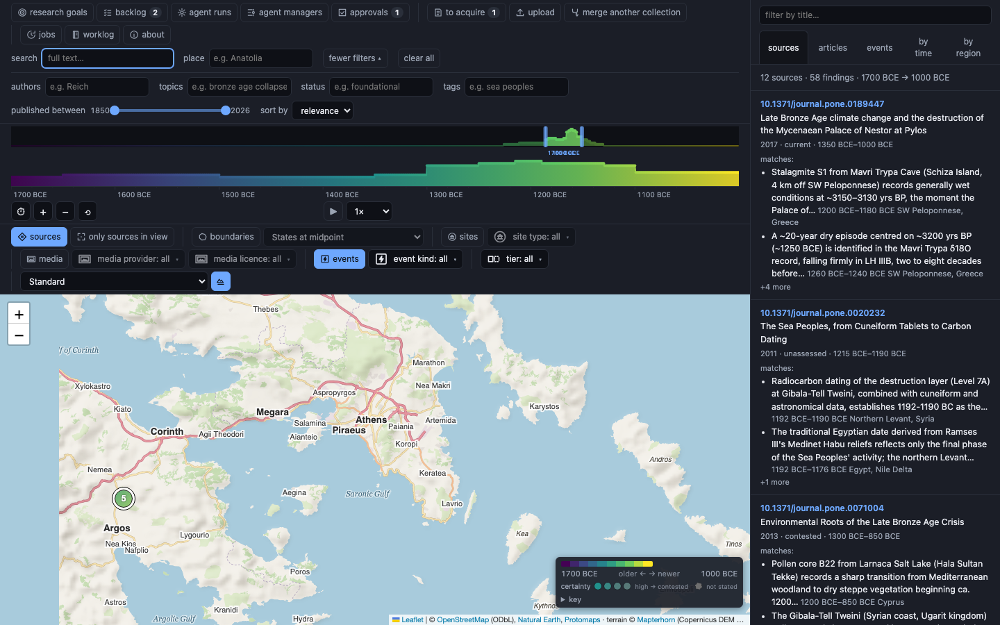
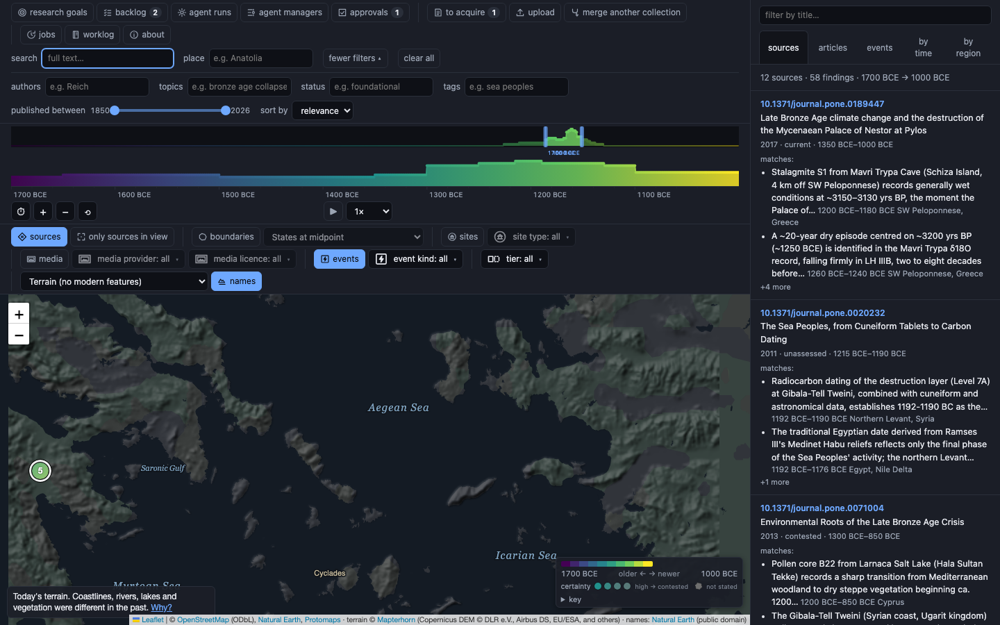
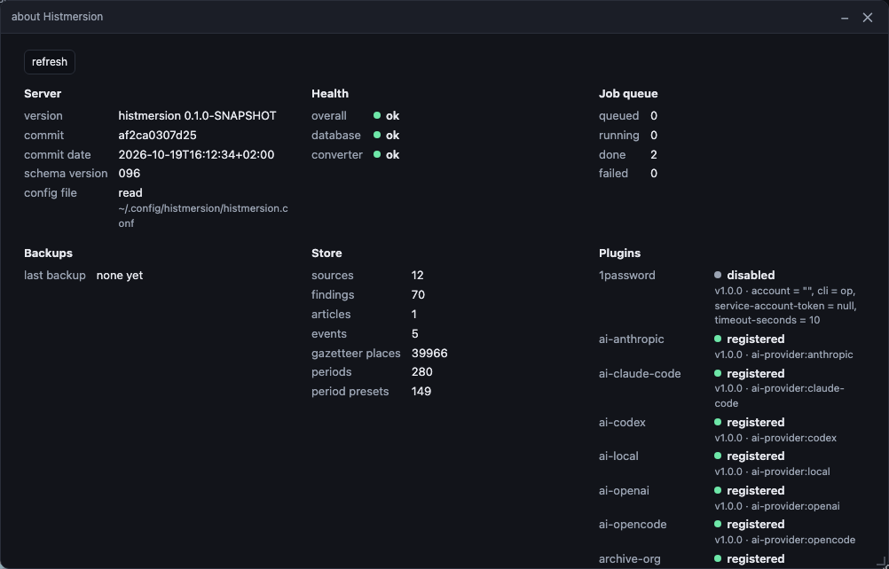
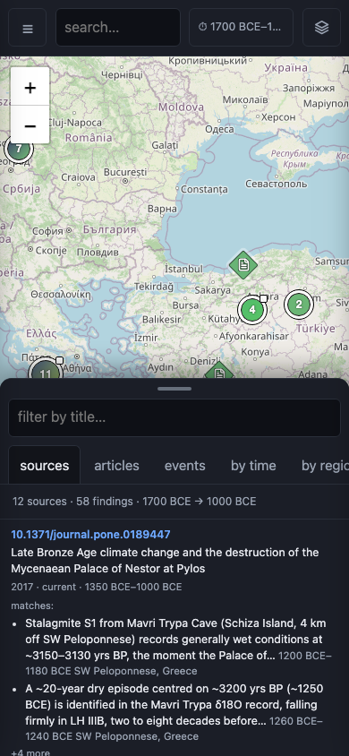

# The web page

Open <http://localhost:8000>. The page has four parts: the **toolbar** that opens windows, the
**filters** and the **timeline** under it, the **map**, and the **side panel** with the lists.

<figure markdown="span">
  { loading=lazy }
  <figcaption>Every layer switched on for 1700–1000 BCE: numbered circles group nearby claims, diamonds
  are single claims, the outlines are the states of the time.</figcaption>
</figure>

## The map

The map shows what falls inside the years selected on the timeline. Each kind of point can be
switched on and off:

| on the map | what it is |
|---|---|
| **findings** | the claims your sources make, at the place they are about. Several claims at one spot show as one marker with a count. The colour follows the date; paler means lower confidence. |
| **sites** | ancient places from the gazetteer (settlements, sanctuaries, forts, burials…), as they existed in those years. |
| **events** | battles, sieges, eruptions, earthquakes, treaties. A local event (a battle) shows as a dot at its site; a regional one (a war, a migration) as a label with the region's outline. |
| **pictures** | images of places and events whose licence allows reuse, each with its credit. |
| **areas** | regions and the states of the time, drawn as shapes. |

Hover over a marker for a short card; click it (or press Enter on it) for the details — a site
click also filters the lists by that place.

### The base map

The base map is chosen in two steps, at the end of the layer buttons. The first menu picks the
**family**:

- **Histmersion map** — drawn in your browser from a download your own server keeps, so it works
  without the internet: [the terrain map](#the-terrain-map) with no modern features (*Natural*, the
  default, and the other terrain styles) and the street maps **Standard**, **Muted** and **Dark** —
  today's map with roads, towns, borders and place names;
- **Online map** — the same kind of street map as tiles from OpenStreetMap's servers (or the ones
  `ui.tiles` names): *Standard (online)*, *Muted (online)*, *Dark (online)*, in the second menu. They need
  the internet, and are offered only while the server cannot draw its own map yet, or when
  `ui.base-map-source = "online"`. Once the download is complete, the page asks no other computer for
  anything: [Working offline](../how-to/offline.md).

For the Histmersion map, the button beside the menu opens the **map options**: the style (the
*preset*) and what you change of it for yourself. They stay open while you change things (Escape, or
a click elsewhere, closes them), each change shows at once, and your changes are remembered by this
browser, per preset, until **Reset to preset**:

| option | what it does |
|---|---|
| **Style** | the preset: *Natural* (the default), *Contour map*, *Standard*, *Muted*, *Dark*, *Terrain*, *Terrain + vegetation*, *Relief only*, *Parchment*, and any your [style file](../how-to/terrain-styles.md) adds |
| **Names** · **Language** | the names on or off; *English*, *Local* (each name in its own language and script) or another language — a name missing in it falls back to English, then to the local name |
| **Relief** | how strongly the slopes are shaded (none … twice the preset's) |
| **Colours by height** | the ground coloured by its elevation (lowland green, upland tan, mountain grey-brown, snow) |
| **Land cover** | forest, grass, scrub, farmland, bare rock, sand, wetland and ice |
| **Sea floor by depth** | the sea coloured and shaded by its depth: the shallow shelf light, the deep basins dark |
| **Contour lines** · **Interval** | lines of equal height from zoom 11 (*Contour map*: 9), every 200, 100, 50 or 20 m as you zoom in — or a fixed interval |

An option a preset cannot offer, or whose data the server has not downloaded, is shown disabled with
a line saying why — and, for missing data, the command that fetches it. A street map the download
cannot draw whole is marked "needs the full download" and drawn with what is there.

<figure markdown>
  { loading=lazy }
</figure>

<figure markdown>
  { loading=lazy }
</figure>

### The terrain map

The **Histmersion map** shows the land itself — relief, coastlines, seas and the sea floor, lakes,
rivers and the land cover, with the names of the seas, mountain ranges, deserts, lakes and rivers — and
nothing people built: no roads, towns, place names, borders or buildings. The markers, names and state
outlines of your own corpus are then the only human geography on the map.

Its default style, **Natural**, is a light map that tells the lie of the land at a glance: the ground
coloured by its height, forests, grass, bare rock, sand and ice in their own colours, the slopes shaded
from several directions, the sea a soft blue lighter along the shore and darker over its deep basins,
and — close in — contour lines with their heights, so a citadel on a small hill between two others
reads as just that. Zoomed close, the relief goes to about 30 m detail (the server reads the tiles you
look at once and keeps them). You can change the styles or add your own without restarting anything:
[Customising the terrain map](../how-to/terrain-styles.md).

<figure markdown>
  { loading=lazy }
</figure>

<figure markdown>
  { loading=lazy }
</figure>

!!! warning "Today's landscape, not the past's"
    The terrain map is drawn from **present-day** data. Coastlines have moved (silted harbours such as
    Ephesus and Troy, the Nile and Mesopotamian deltas, the Black Sea's shores), rivers have changed
    course, lakes have grown, shrunk or been dammed, and the vegetation is today's. No reliable,
    worldwide map of how these looked in a given century exists, so the map does not pretend to
    show one: a notice in its corner says so whenever it is on. Read a site's setting from your
    sources, not from the background.

The map is drawn in your browser from files your server keeps (about 2 GB for the default region,
Atlantic Europe to the Indus). They are not there until someone downloads them once:

```bash
histmersion basemap fetch      # see Open data → The terrain base map
```

Until then the menu says "not downloaded", and choosing it shows the online standard tiles, dimmed
(nothing, on a page that has only the local maps), with a note on how to fetch it. Outside the
downloaded region the map is blank; beyond the downloaded zooms of the relief (8 by default), it is read
from the provider as you look, when the server is online — also on a page that has only the local maps:
the server reads it, not the page, and offline the map shows the coarser relief.

## The timeline

The strip under the map is the **time window**: the range of years you are looking at. Drag its
handles to change the range, drag the middle to move it, and zoom in or out. Years before the common
era are negative (1200 BCE is −1200).

- **Period presets** set the window to a named period, such as the Late Bronze Age *as one authority
  dates it for one region* — there is no single Bronze Age; dates differ between regions and between
  scholars. See [Places, periods and the map](places-and-periods.md).
- **Playback** animates the map through time; events appear and fade as the play head passes them.
  Choose the speed, stop and reset.
- The bars above the strip show **when the evidence is**: how many sources fall into each stretch of
  time.

<figure markdown="span">
  { loading=lazy }
  <figcaption>The presets menu: each period as one authority dates it for one region, the region the
  map shows first.</figcaption>
</figure>

## The side panel

At the top is one **title box** that narrows every list. Below it are the **filters** — words,
tags, authors, places, topics, statuses — shown as chips you can remove. The tabs:

| tab | shows |
|---|---|
| **sources** | the sources that match, with the findings that matched and why |
| **articles** | the compiled articles |
| **events** | the events in the window |
| **by time** | counts grouped by period, nested |
| **by region** | counts grouped by region, nested (a continent, its regions, their places) |

A count in *by time* and *by region* counts a source in **every** group it overlaps, so the numbers
do not add up to the total. That is expected.

## Windows

Clicking a source or an article opens it in a **window** on top of the map. Several can be open at
once; they can be moved, resized and minimised, and the page's address remembers them, so a reload
or a shared link brings them back.

<figure markdown="span">
  { loading=lazy }
  <figcaption>A source's window. Windows can be moved, resized and minimised; the address bar keeps
  them, so a reload or a shared link reopens them.</figcaption>
</figure>

| window | what is in it |
|---|---|
| **a source** | its details, status, summary, findings, notes and full text, and the articles citing it |
| **a source's editor** | change its details, status, topics, regions, tags, period and summary |
| **a citation graph** | the network of sources around one source, with their links and statuses |
| **an article** | the article, its sources, its coverage notes, the articles linking to it |

The toolbar opens the others:

| toolbar | window |
|---|---|
| research goals | your research areas as a tree, and a form for a new one |
| backlog | the `tasks` list |
| agent runs · agent managers · approvals | the built-in agents (shown only when the server runs them) |
| to acquire | the acquisition list: what to buy, borrow or find |
| upload | upload a PDF or EPUB for text recognition |
| merge another collection | review and merge a `.hmx` bundle from another machine |
| jobs | text-recognition and import jobs, with progress |
| worklog | the `log` list, by date |
| API key | enter the key writes need (shown only when the server asks for one) |
| about | version, health, the job queue, the last backup, counts, where the data is on disk and how much space each part takes (and the free space left), plugins |

<figure markdown="span">
  { loading=lazy }
  <figcaption>The About window: what is running, whether its parts are healthy, and how much is
  stored.</figcaption>
</figure>

## Reading and writing

Reading needs nothing. Changing anything (editing a source, uploading, deciding an approval) works at
once on your own computer; when the server is set up with an API key (`auth.api-key`), the page asks
for it before the first change and keeps it in the browser.

## On a phone or a narrow window

At 760 pixels wide or less, the page switches to a phone layout: the map first, the filters,
timeline, layers and tools on buttons (or a swipe in from the edge), the list as a sheet that slides
up, and windows full screen.

<figure markdown="span">
  { width="300" loading=lazy }
  <figcaption>On a phone: the map first, the controls behind the buttons of the top bar, the list as a
  sheet you pull up.</figcaption>
</figure>
