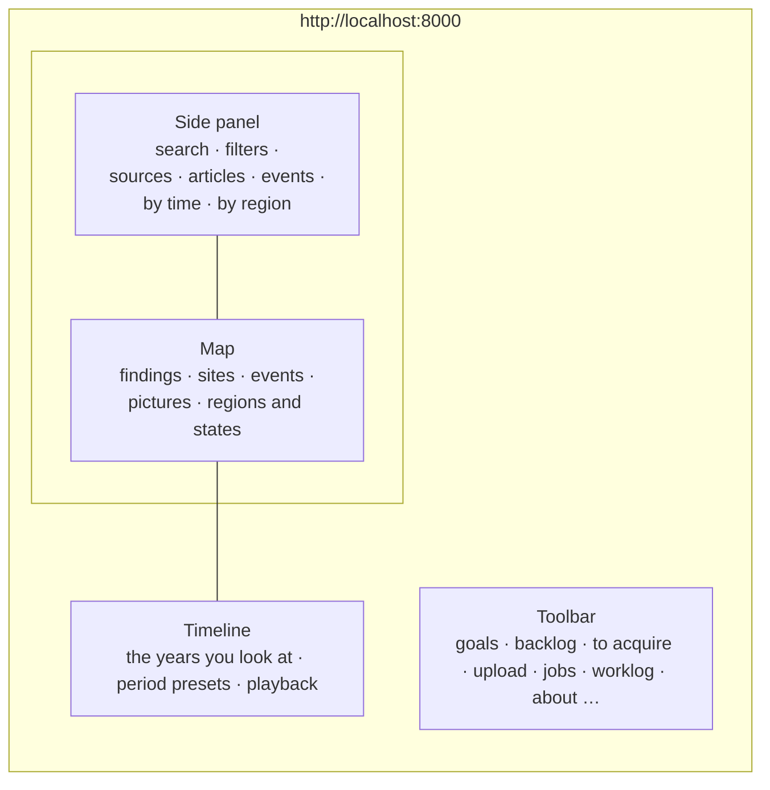

# The web page

Open <http://localhost:8000>. The page has four parts: the **map**, the **timeline** under it, the
**side panel** with filters and lists, and the **toolbar** that opens windows.

## The map

The map shows what falls inside the years selected on the timeline. Each kind of point can be
switched on and off:

| on the map | what it is |
|---|---|
| **findings** | the claims your sources make, at the place they are about. Several claims at one spot show as one marker with a count. The colour follows the date; paler means lower confidence. |
| **sites** | ancient places from the gazetteer (settlements, sanctuaries, forts, burials…), as they existed in those years. |
| **events** | battles, sieges, eruptions, earthquakes, treaties. A local event (a battle) shows as a dot at its site; a regional one (a war, a migration) as a label with the region's outline. |
| **pictures** | images of places and events whose licence allows reuse, each with its credit. |
| **areas** | regions and the states of the time, drawn as shapes. |

Hover over a marker for a short card; click it (or press Enter on it) for the details — a site
click also filters the lists by that place. Three base maps are offered: standard, muted and dark. The tiles come from OpenStreetMap unless the
server is configured otherwise (`ui.tiles`), so the background map needs the internet; everything
else works offline.

## The timeline

The strip under the map is the **time window**: the range of years you are looking at. Drag its
handles to change the range, drag the middle to move it, and zoom in or out. Years before the common
era are negative (1200 BCE is −1200).

- **Period presets** set the window to a named period, such as the Late Bronze Age *as one authority
  dates it for one region* — there is no single Bronze Age; dates differ between regions and between
  scholars. See [Places, periods and the map](places-and-periods.md).
- **Playback** animates the map through time; events appear and fade as the play head passes them.
  Choose the speed, stop and reset.
- The bars above the strip show **when the evidence is**: how many sources fall into each stretch of
  time.

## The side panel

At the top is one **title box** that narrows every list. Below it are the **filters** — words,
tags, authors, places, topics, statuses — shown as chips you can remove. The tabs:

| tab | shows |
|---|---|
| **sources** | the sources that match, with the findings that matched and why |
| **articles** | the compiled articles |
| **events** | the events in the window |
| **by time** | counts grouped by period, nested |
| **by region** | counts grouped by region, nested (a continent, its regions, their places) |

A count in *by time* and *by region* counts a source in **every** group it overlaps, so the numbers
do not add up to the total. That is expected.

## Windows

Clicking a source or an article opens it in a **window** on top of the map. Several can be open at
once; they can be moved, resized and minimised, and the page's address remembers them, so a reload
or a shared link brings them back.

| window | what is in it |
|---|---|
| **a source** | its details, status, summary, findings, notes and full text, and the articles citing it |
| **a source's editor** | change its details, status, topics, regions, tags, period and summary |
| **a citation graph** | the network of sources around one source, with their links and statuses |
| **an article** | the article, its sources, its coverage notes, the articles linking to it |

The toolbar opens the others:

| toolbar | window |
|---|---|
| research goals | your research areas as a tree, and a form for a new one |
| backlog | the `tasks` list |
| agent runs · agent managers · approvals | the built-in agents (shown only when the server runs them) |
| to acquire | the acquisition list: what to buy, borrow or find |
| upload | upload a PDF or EPUB for text recognition |
| merge another collection | review and merge a `.hmx` bundle from another machine |
| jobs | text-recognition and import jobs, with progress |
| worklog | the `log` list, by date |
| API key | enter the key writes need (shown only when the server asks for one) |
| about | version, health, the job queue, the last backup, counts, plugins |

## Reading and writing

Reading needs nothing. Changing anything (editing a source, uploading, deciding an approval) works at
once on your own computer; when the server is set up with an API key (`auth.api-key`), the page asks
for it before the first change and keeps it in the browser.

## On a phone or a narrow window

At 760 pixels wide or less, the page switches to a phone layout: the map first, the filters,
timeline, layers and tools on buttons (or a swipe in from the edge), the list as a sheet that slides
up, and windows full screen.
