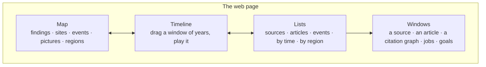
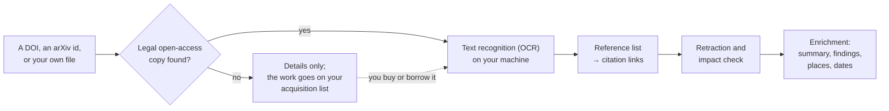

# What Histmersion is

## The problem it solves

Research about the past piles up quickly: hundreds of PDFs, scanned books, notes, half-remembered
claims. Three things are hard to do with such a pile:

1. **Finding what a source said about a place and a time.** Full-text search finds words, not
   "everything my sources say about Anatolia between 1500 and 1200 BCE".
2. **Knowing whether a claim still stands.** A paper from 1990 may have been challenged, superseded
   or even retracted since.
3. **Writing it up without losing the trail.** A summary that does not say which source said what
   cannot be checked.

Histmersion keeps each source **once**, as full text, and adds structure to it: *findings* (claims
with a place and a date), *citation links* between sources, and a *status* for each source. Then it
shows all of it on a map crossed with a timeline, and lets you (or an AI helper) write articles in
which every sentence points back to its source.

## What you see

- **The map** shows dots where your sources make claims, plus ancient sites, events (battles,
  eruptions, earthquakes) and pictures. Regions and states of the time are drawn as areas.
- **The timeline** under the map selects the years you are looking at. Move it and the map changes.
  Press play and the map animates through time.
- **The lists** on the side show the sources that match, the articles, the events, and counts
  grouped by time or by region.
- **Windows** open on top: a source's page (summary, findings, full text), an article, the network
  of citations around a source, and tools such as the job list and the research goals.

The page is described in detail in [The web page](../exploring/web-ui.md).

## The main ideas

| idea | in plain words |
|---|---|
| **source** | one book, paper or chapter. It has a short name, the **citekey** (for example `cline2014`), its details (title, authors, year), its full text, and a **status**. |
| **finding** | one claim a source makes, with *where* (a place, a point on the map) and *when* (a range of years). "Ugarit was destroyed around 1185 BCE", placed at Ugarit, dated −1190 to −1180. |
| **year** | years are whole numbers; years before the common era are **negative**: 3300 BCE is `-3300`. |
| **status** | how a source stands today: `foundational`, `current`, `contested`, `superseded`, `debunked`, `retracted`, or `unassessed` (nobody has checked yet). |
| **citation link** (edge) | a typed link from one source to another: it simply `references` it, or it `challenges`, `refutes`, `updates` it, or the older one is `superseded_by` the newer. |
| **place** | an entry of the **gazetteer** — a list of places with their shapes, names in many languages, the years they existed and what they lie inside (a city inside a region inside a continent). |
| **period** | a named span of years, such as "Late Minoan IB", as a published authority defines it for a region (from PeriodO). |
| **event** | something that happened at a place and time: a battle, a siege, an eruption, a treaty. Many come from public catalogues; others are written by hand. |
| **picture** | an image of a place or event (a photograph, a plan, a museum object) whose licence allows reuse. |
| **article** | a page written *across* sources — about a concept, a myth, a culture, a region, a timeline, or the answer to a question (a report). Each claim cites its source as `[[citekey]]`. |
| **goal** | a research area you want covered (for example "Bronze-Age collapse"), with its plan, sub-goals and articles. |
| **queues** | three lists for bookkeeping: `acquire` (what to buy or borrow), `tasks` (what to do next) and `log` (what was done, by date). |

The [Glossary](glossary.md) has more terms.

## How a source comes in

The text recognition (**OCR**, optical character recognition: turning page images into text) runs
on your own machine, once per document. Enrichment — writing the summary and the findings — is done
by you, by your AI assistant, or by Histmersion's built-in agents if you switch them on.

## Who it is for

- **Historians, archaeologists, students and curious readers** who collect sources on a subject
  and want to see them in space and time.
- **People writing about a subject** who want every statement to stay checkable.
- **People who work with an AI assistant** and want it to answer from their own sources, with
  citations, instead of from memory.

It runs on one computer (macOS on Apple Silicon, or Linux) and keeps everything there. Nothing is
sent anywhere unless you ask for it: downloading a paper, importing a public dataset, or calling an
AI model you configured.

## What it is not

- It is **not an authority**. It shows what your sources say, and what a model or a person wrote
  about them. It can be wrong ([Responsible use](../responsible-use.md)).
- It is **not a complete database of the past**. It knows only what you put in and what the
  datasets you imported contain.
- It is **not a way around paywalls**. It downloads legal open-access copies only.
