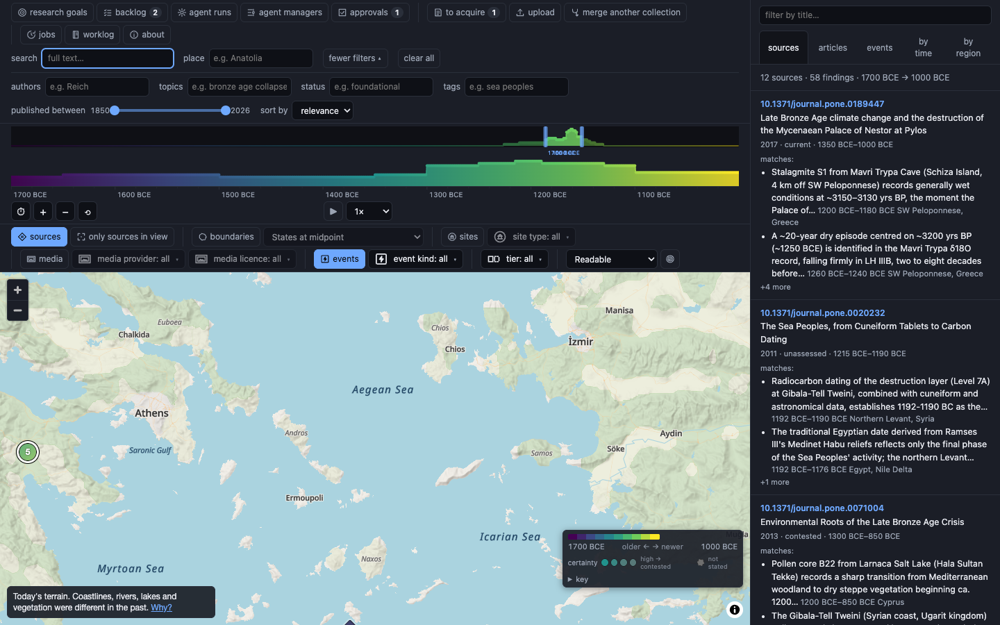
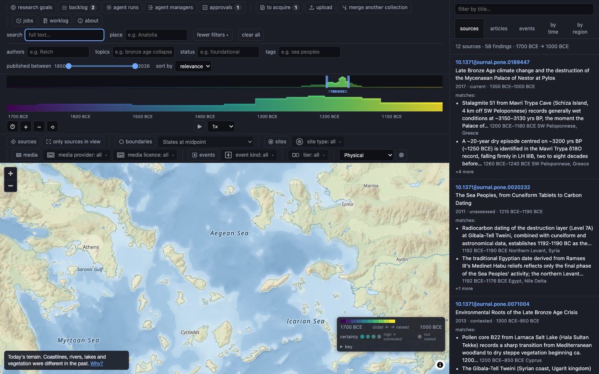
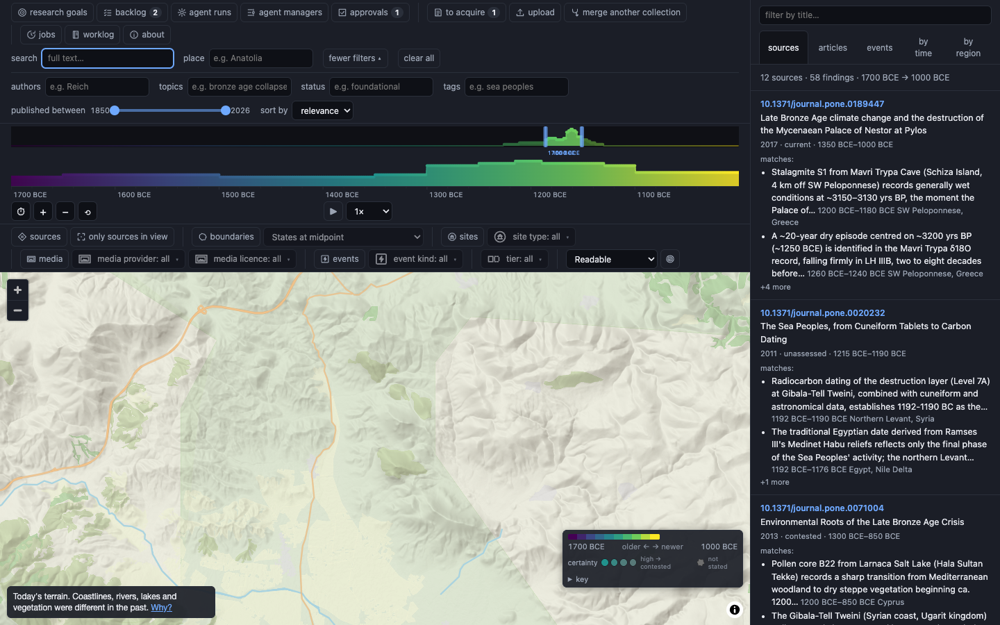
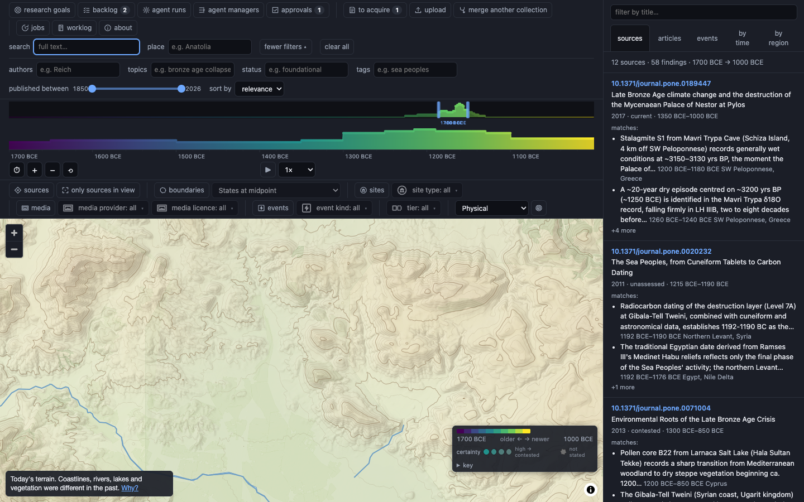
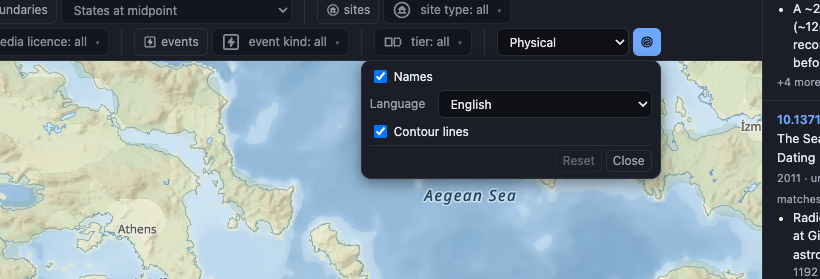

# Base maps

The map under your sources and events is one of five **base maps**, chosen in the menu at the end of
the layer buttons ([The base map](../exploring/web-ui.md#the-base-map)). Two are drawn in your browser
from files your own server keeps, so they work without the internet; three are OpenStreetMap's tiles
from the internet.

| base map | drawn from | what it shows |
|---|---|---|
| **Readable** (the default) | this server's download | a general-purpose map in the colours of OpenStreetMap's standard map: land and water, pale land cover, a light relief, rivers, faint main roads and dashed country borders, towns and villages by size, and the names of countries, seas, gulfs, islands, mountain ranges, rivers and peaks |
| **Physical** | this server's download | the land's form first: the relief shaded from several directions, the ground coloured lightly by its height, the sea coloured by its depth, forest, fields, scrub, rock, sand and ice as faint veils at every zoom, rivers darker than the sea; physical names (seas, ranges, lakes, rivers, islands, peaks) and small town names; no roads or borders. Close in, contour lines where the detailed relief is downloaded |
| **Standard (online)** | OpenStreetMap's tile servers (or `ui.tiles`) | today's standard OpenStreetMap |
| **Muted (online)** | OpenStreetMap France's Humanitarian style | the same in quieter colours |
| **Dark (online)** | the Standard tiles, inverted | a dark map |

Readable and Physical show **today's landscape**, and a notice in their corner says so: coastlines,
rivers, lakes and vegetation were different in the past. Read a site's setting from your sources, not
from the background.

<figure markdown>
  { loading=lazy }
</figure>

<figure markdown>
  { loading=lazy }
</figure>

<figure markdown>
  { loading=lazy }
</figure>

<figure markdown>
  { loading=lazy }
</figure>

## What each needs downloaded

Both are drawn from the download described in [Open data → The base map's data](open-data.md#the-base-maps-data):

| base map | needs | and draws, when downloaded |
|---|---|---|
| Readable | the vector layer **with** roads, places and borders (`histmersion basemap fetch --keep-all`) | the relief, the physical names |
| Physical | the vector layer (the default download is enough) | the relief, the sea floor, the physical names |
| Physical's contours | a **focus region** of the relief (`histmersion basemap fetch --layer terrain --focus aegean`) | — |

A base map whose vector layer lacks something is marked "needs the full download" in the menu and drawn
with what is there; without a focus region the contour option is disabled, its line saying what to run.

`histmersion basemap status` says what the download holds, which base map lacks something in it, and
the command that adds it. With `ui.base-map-source = "auto"` (the default) the page offers only the
local maps — and asks no other computer for anything — as soon as one of the two can be drawn whole;
`local` and `online` fix the choice ([Working offline](offline.md#choosing-the-maps-the-page-offers)).

## Map options

The button beside the menu opens the options for Readable and Physical. They are your own, remembered
by this browser, and apply at once:

| option | what it does |
|---|---|
| **Names** | the base map's names on or off (your corpus's names stay) |
| **Language** | *English*, *Local* (each name in its own language and script) or another language; a name missing in it falls back to English, then to the local name. The default for everyone is `basemap.labels.language` |
| **Contour lines** | Physical only: lines of equal height from zoom 11, every 100 m, then 50, 20 and 10 m as you zoom in, inside the downloaded focus regions |

**Reset** returns to the defaults. The online maps have no options.

<figure markdown>
  { loading=lazy }
</figure>

## Fonts, credits and computers without a graphics card

- **The names** are drawn in Noto Sans — Latin, Greek and Cyrillic, with its Arabic, Armenian,
  Georgian and Hebrew companions (SIL Open Font License 1.1) — served by Histmersion itself from
  `web/vendor/noto-sans/`, only the parts a name needs; no font service is asked.
- **The credits** of each base map are behind the ⓘ button in the map's lower right corner (folded until you open it): © OpenStreetMap contributors (ODbL) and Protomaps for the vector layer, Natural
  Earth for the physical names, © Mapterhorn with the Copernicus elevation model for the relief, and
  ETOPO1 (NOAA) via Mapzen's terrain tiles for the sea floor; for the online maps, OpenStreetMap and
  the tile server.
- **The map is drawn with WebGL.** On a computer whose browser has no graphics card to draw with (a
  virtual machine, a remote desktop, a browser with hardware acceleration switched off), the page
  draws Readable and Physical without their relief and contours, which keeps them quick, and a line of
  the notice says so. Switching hardware acceleration on in the browser's settings brings them back.
