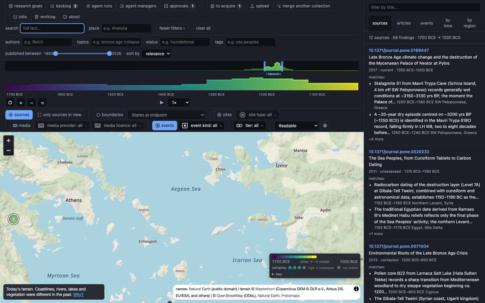

# Working offline

Histmersion runs on your own computer, and so does almost everything it does. Once the base map is
downloaded, the web page asks no other computer for anything: you can read, search and explore your
collection on a train, in an archive without a network, or behind a firewall.

## What works without the internet

- **Everything you look at**: the map and the timeline, the lists, the filters and the search, the
  sources with their full text and figures, the articles, the events and places, the backlog and the
  worklog, the jobs window.
- **The map itself**, once it is downloaded (below): the two local [base maps](base-maps.md),
  Readable and Physical, with their relief, names and font — drawn by your browser from files your
  server keeps.
- **Pictures** that were imported: their thumbnails and the stored copies are served by your server.
- **Writing**: adding notes, findings and articles, editing sources, the queues, backups and exports —
  from the web page, the `histmersion` command or an agent's tools.

## What needs the network

These reach another service by design. Each fails with a message when there is no connection; nothing
else is affected.

| what | why |
|---|---|
| AI providers (embedded agents, a model in the cloud) | the model runs elsewhere — a provider on your own machine needs no network |
| `histmersion discover …`, ingesting by DOI or arXiv id, `archive …`, acquisition | they look up and fetch papers and books from OpenAlex, Crossref, Unpaywall, the Internet Archive and the other open-access services |
| `refs`, `followups`, `assess` | citation data and retraction notices come from Crossref, OpenAlex and the Retraction Watch list |
| `places fetch`, `periods fetch`, `events import`, `media import` | gazetteers, period definitions, event catalogues and picture collections are downloaded from their publishers |
| `histmersion basemap fetch` | the one-time download of the map, below |
| the online maps (Standard, Muted and Dark (online)) | their tiles come from OpenStreetMap's servers (or the ones `ui.tiles` names) |
| a DOI link, a link to a source's publisher, "Why?" and "How to download it" on the map | they open another site; the guide's links follow `ui.docs-url`, which you can point at a copy of this guide (`just docs-serve`) |

## The one-time download

The map is a few files the server downloads once (see [Open data → The base map's
data](open-data.md#the-base-maps-data) for what they hold, the sources and their licences). For
**Readable** the vector layer must keep roads, places and borders, which the default download leaves
out to save space, so download it with `--keep-all`:

```bash
histmersion basemap fetch --keep-all --dry-run   # what it would download and keep, nothing stored
histmersion basemap fetch --keep-all             # the download, as a job; run it again to resume
```

Measured for the default region (`basemap.bbox`, Atlantic Europe to the Indus) on 2026-10-20:

| file | downloaded | kept |
|---|---|---|
| `vector.pmtiles`, zoom 0–10, `--keep-all` | 1.54 GB | 1.52 GB |
| `terrain.pmtiles` (relief), zoom 0–8 | 0.49 GB | 0.49 GB |
| `labels.pmtiles` (physical names) | about 20 MB | 1.4 MB |
| **all** | **about 2.05 GB** | **about 2.0 GB** |

Without `--keep-all` the vector layer keeps 1.30 GB: Physical is whole, and Readable is marked "needs
the full download". A download made that way is completed with the vector layer
alone — the relief and the names stay:

```bash
histmersion basemap status                              # which base map lacks something, and what to run
histmersion basemap fetch --layer vector --keep-all     # about 1.5 GB, replaces the vector layer
```

Fewer zooms cost much less (`--max-zoom 9`: 0.61 GB kept, `8`: 0.21 GB); the map is then drawn larger,
and less sharp, from zoom 10 on. A fetch is refused before it starts when it would leave less than
`basemap.min-free-gb` (5 GB) free.

<figure markdown>
  { loading=lazy }
</figure>

## Choosing the maps the page offers

`ui.base-map-source` in `histmersion.conf` decides which maps the base-map menu offers
([The base map](../exploring/web-ui.md#the-base-map)):

| value | the menu | the page |
|---|---|---|
| `auto` (the default) | `local` once the download can draw Readable or Physical whole, else `online` | |
| `local` | only Readable and Physical | asks no other computer for anything — an online map chosen before is drawn as Readable (Physical when the download cannot draw Readable whole) |
| `online` | Readable, Physical and the online Standard, Muted and Dark | the online maps load tiles from the internet when chosen |

```hocon
# ~/.config/histmersion/histmersion.conf
histmersion.ui.base-map-source = "local"
```

`histmersion config reload` applies it; reload the web page afterwards. With `local` and nothing
downloaded yet, the map shows its background and a note saying what to run.

**The relief deeper than the download** (zooms 9–12) is read by the server, not the page, from
Mapterhorn when someone looks that closely (`basemap.terrain.on-demand`), and kept: so it stays on with
`local` — the page still asks no other host. Without the internet the map shows the coarser relief there;
`basemap.terrain.on-demand.enabled = false` stops the server asking, and `histmersion basemap fetch
--layer terrain --focus <region>` keeps a region's detail beforehand ([Open data](open-data.md#the-base-maps-data)).
Where a deeper relief tile is missing (outside a focus region, and not read on demand), the server
cuts it from the nearest coarser tile it holds, so the relief never disappears as you zoom in — it
only gets softer.

**The map and the sea floor outside the download** are read the same way: when a page shows an area
outside `basemap.bbox` (or the map deeper than its zoom), the server reads just those tiles — the map from
the same Protomaps build, the sea floor from Mapzen's tiles — and keeps them (`vector-cache/`,
`sea-cache/`, each with a size ceiling). Offline, what was seen once is still drawn; the rest stays empty.
`basemap.vector.on-demand.enabled = false` and `basemap.bathymetry.on-demand.enabled = false` stop the
server asking. To have a region ready before going offline, download it ahead: `histmersion basemap fetch
--bbox <minLon,minLat,maxLon,maxLat>` (or `--bbox world`), with `--dry-run` first — it says the size zoom by
zoom, so you can choose a smaller `--max-zoom`. About › Storage shows the caches' sizes, and `histmersion
basemap rm --cache` empties them.

The online maps are only ever loaded as you look at them, tile by tile, never in advance or in bulk
(OpenStreetMap's tile usage policy forbids that); the local maps are drawn from Protomaps' build of
the same OpenStreetMap data, © OpenStreetMap contributors (ODbL), credited on the map.
