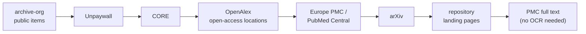
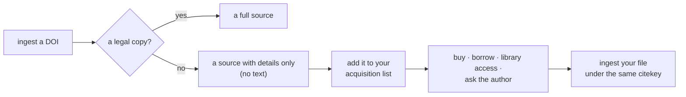

# Downloading open-access papers

**Open access** means the publisher or the author lets anyone read a work for free. Histmersion
downloads papers **only** from open-access services, and when there is no legal free copy it puts the
work on your acquisition list instead. Read [Responsible use](../responsible-use.md) first.

## Find literature

```bash
histmersion discover search "late bronze age collapse" --since 2015 --not-in-db
histmersion discover meta 10.1234/example-doi                     # one paper's details
histmersion discover wikirefs https://en.wikipedia.org/wiki/Late_Bronze_Age_collapse
```

`discover search` asks OpenAlex; `--not-in-db` leaves out what you already have. `wikirefs` collects
every DOI a Wikipedia article cites — Wikipedia as a trailhead to the primary literature, not as a
source.

## Bring a paper in

```bash
histmersion ingest 10.1234/example-doi
histmersion ingest arxiv:2101.00001
histmersion jobs                       # follow the job
```

`ingest` fetches the paper's details (Crossref, OpenAlex), then asks the **acquisition chain** for a
legal copy, in this order (`acquire.chain`):



The first service with a copy wins. Each step is a built-in plugin you can switch off
(`plugins.<id>.enabled = false`): `archive-org`, `oa-unpaywall`, `oa-core`, `oa-openalex`, `pmc`,
`arxiv`, `oa-landing`. The server also checks that every "PDF" really is one.

Then the same job recognises the text on your machine, records the paper's reference list as
citation links, and checks it for retractions and corrections.

Running `ingest` again on the same DOI is safe: it updates the details and never wipes enrichment.

### What some services need

- **Unpaywall** asks for a contact e-mail. Set `acquire.contact-email` (environment
  `HISTMERSION_ACQUIRE_CONTACT_EMAIL`) to your own; without one, Unpaywall is not asked. It is sent
  only as the service's `email`/`mailto` parameter, never in a header.
- **CORE** needs an API key: `plugins.oa-core.api-key`, as a secret reference
  ([Credentials and secrets](credentials.md)). Without one, CORE is skipped.
- Everyone else needs nothing.

## When there is no legal copy



```bash
histmersion queue acquire add "Author 2019, Title — not open access" --topic "bronze age collapse"
histmersion queue acquire                                     # the list, with item ids
# … once you have the file:
histmersion ingest ~/Downloads/author2019.pdf --citekey author2019_title --acquire-item 42
```

`--acquire-item` ticks the item off when the import succeeds. The web page's **to acquire** window
shows the same list.

**The acquisition list is yours.** A watcher with auto-ingest on ingests only legal open-access works;
anything without a legal copy goes to this list for you to decide.

## Old books: archive.org

The Internet Archive holds many out-of-print books. Histmersion imports **public** items only; an item
that is only lent out (a lending-library loan) is refused.

```bash
histmersion archive search "Nilsson Minoan-Mycenaean religion"
histmersion archive info <identifier>          # its files, and whether it is public
histmersion archive import <identifier> --citekey nilsson1950_religion
```

## Your own files

A PDF or EPUB you bought, borrowed or got from the author:

```bash
histmersion ingest ~/Downloads/book.pdf --citekey author2020_short
histmersion ingest ~/Downloads/scan.pdf --citekey author1975_scan --quality   # slow, accurate OCR for image-only scans
```

Books you keep in Calibre: [Books and Calibre](books-and-calibre.md).
