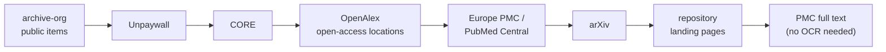
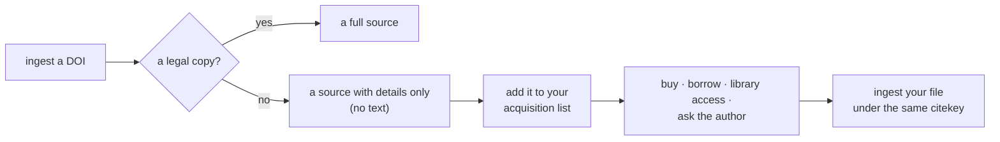

# Downloading open-access papers

**Open access** means the publisher or the author lets anyone read a work for free. Histmersion
downloads papers **only** from open-access services, and when there is no legal free copy it puts the
work on your acquisition list instead. Read [Responsible use](../responsible-use.md) first.

## Find literature

```bash
histmersion discover search "late bronze age collapse" --since 2015 --not-in-db
histmersion discover meta 10.1234/example-doi                     # one paper's details
histmersion discover wikirefs https://en.wikipedia.org/wiki/Late_Bronze_Age_collapse
```

`discover search` asks OpenAlex; `--not-in-db` leaves out what you already have. `wikirefs` collects
every DOI a Wikipedia article cites — Wikipedia as a trailhead to the primary literature, not as a
source.

## Bring a paper in

```bash
histmersion ingest 10.1234/example-doi
histmersion ingest arxiv:2101.00001
histmersion jobs                       # follow the job
```

`ingest` fetches the paper's details (Crossref, OpenAlex), then asks the **acquisition chain** for a
legal copy, in this order (`acquire.chain`):



The first service with a copy wins. Each step is a built-in plugin you can switch off
(`plugins.<id>.enabled = false`): `archive-org`, `oa-unpaywall`, `oa-core`, `oa-openalex`, `pmc`,
`arxiv`, `oa-landing`. The server also checks that every "PDF" really is one.

Then the same job recognises the text on your machine, records the paper's reference list as
citation links, and checks it for retractions and corrections.

Running `ingest` again on the same DOI is safe: it updates the details and never wipes enrichment.

### Only the legal services

A plugin you install yourself may add a fetcher that obtains copies **without** the rights holder's
permission. Histmersion ships none, and such a fetcher runs only when you switch
`acquire.allow-unauthorised` on. To keep one ingest to the legal services whatever that switch says:

```bash
histmersion ingest 10.1234/example-doi --legal-only
```

With no legal copy it behaves like a plain `ingest`: the source is created with its details only, and
the report says how to bring the file in by hand. The watchers' auto-ingest always asks the legal services
only.

### What some services need

- **Unpaywall** asks for a contact e-mail. Set `acquire.contact-email` (environment
  `HISTMERSION_ACQUIRE_CONTACT_EMAIL`) to your own; without one, Unpaywall is not asked. It is sent
  only as the service's `email`/`mailto` parameter, never in a header.
- **CORE** needs an API key: `plugins.oa-core.api-key`, as a secret reference
  ([Credentials and secrets](credentials.md)). Without one, CORE is skipped. The same key also
  lets the new-source search (`histmersion candidates`) read each goal's saved queries from CORE.

### CORE's limits

A personal CORE key allows 1,000 tokens a day and 25 a minute; a lookup or a search costs 1 token
(CORE may change these). The PDF lookups of the chain and the searches of the goal watchers share
**one budget**, kept in the database so that a restart does not reset it:

| setting | default | what it limits |
|---|---|---|
| `acquire.core.daily-tokens` | `900` | tokens a day (a UTC day), lookups and searches together |
| `acquire.core.search-daily-tokens` | `600` | what searches may spend of that; the other 300 are kept for PDF lookups |
| `acquire.core.per-minute` | `20` | calls in any 60 seconds; a call waits up to `acquire.core.max-wait-seconds` (30) for its slot |
| `acquire.core.lookup-cost` · `search-cost` | `1` · `1` | what one call costs, if CORE changes its prices |
| `acquire.core.exhausted-pause-seconds` | `60` | the pause after a refusal that names no retry time |

When CORE answers HTTP 429, or its `X-RateLimit-Remaining` header reaches 0, Histmersion does not ask
it again until the time CORE gives in `X-RateLimit-Retry-After`. Meanwhile:

- an ingest skips the `core` step and goes on down the chain; the job's report says
  `core: no copy — CORE not asked: …` with the reason;
- a candidate sweep leaves CORE out and says so at the top of its report. Those watches keep their
  place and are read at the next sweep.

`histmersion about` and `histmersion agent autopilot status` show the day's spending, CORE's own count
of what is left, and any wait:

```
- CORE today (UTC 2026-10-26): 214 of 900 tokens — PDF lookups 61, searches 153 of 600 · at most 20 a minute · CORE's window 18 of 25 left
```
- Everyone else needs nothing.

## When there is no legal copy



```bash
histmersion queue acquire add "Author 2019, Title — not open access" --topic "bronze age collapse"
histmersion queue acquire                                     # the list, with item ids
# … once you have the file:
histmersion ingest ~/Downloads/author2019.pdf --citekey author2019_title --acquire-item 42
```

`--acquire-item` ticks the item off when the import succeeds. The web page's **to acquire** window
shows the same list.

**The acquisition list is yours.** A watcher with auto-ingest on ingests only legal open-access works;
anything without a legal copy goes to this list for you to decide.

## Old books: archive.org

The Internet Archive holds many out-of-print books. Histmersion imports **public** items only; an item
that is only lent out (a lending-library loan) is refused.

```bash
histmersion archive search "Nilsson Minoan-Mycenaean religion"
histmersion archive info <identifier>          # its files, and whether it is public
histmersion archive import <identifier> --citekey nilsson1950_religion
```

## Your own files

A PDF or EPUB you bought, borrowed or got from the author:

```bash
histmersion ingest ~/Downloads/book.pdf --citekey author2020_short
histmersion ingest ~/Downloads/scan.pdf --citekey author1975_scan --quality   # slow, accurate OCR for image-only scans
```

Books you keep in Calibre: [Books and Calibre](books-and-calibre.md).
