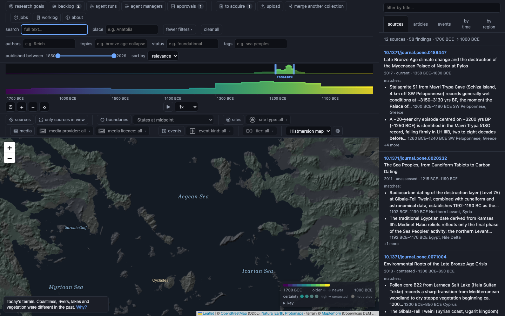
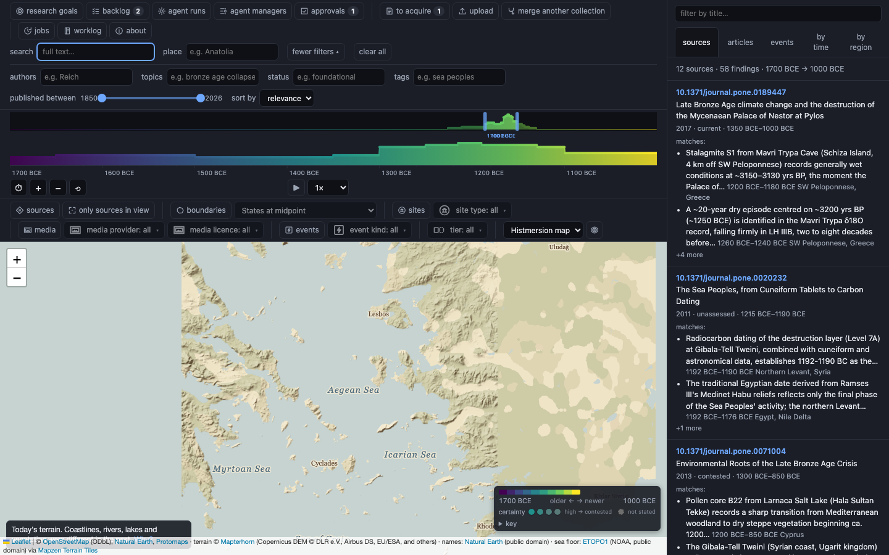
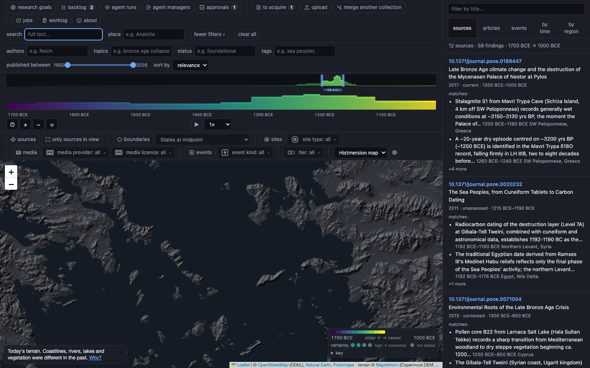

# Customising the terrain map

The [terrain map](../exploring/web-ui.md#the-terrain-map) is drawn in your browser from files your
server keeps (see [Open data → The terrain base map](open-data.md#the-terrain-base-map)). **How** it
is drawn — the colours, which features are shown, line widths, the relief's light, the names — is a
**style**, a small text file. You can change it, or add your own styles, without rebuilding or even
restarting anything: the server reads the file again when it changes, and an open map redraws within
a few seconds.

## The named styles

Every style is an entry of the base-map menu at the end of the map's layer buttons. Seven come with
Histmersion — three street maps and four terrain styles:

| style | what it shows |
|---|---|
| **Standard** (the default of a page with only the local maps) | today's map: land cover and land use, water, roads by class, country and province borders, and the names of countries, cities, towns and villages (more of them the further you zoom in) and of the seas |
| **Muted** | the same in pale, quiet colours, so your markers stand out |
| **Dark** | the same in dark colours |
| **Terrain** | today's terrain, dark and muted so your markers, names and boundaries stay on top: land, seas, lakes and rivers, a light tint for forest, grassland, scrub, bare ground and ice, the shaded relief, and the physical names |
| **Terrain + vegetation** | the same with the land cover drawn strongly, and OpenStreetMap's own woods, scrub and wetlands where they are mapped |
| **Relief only** | land, water and the relief — no land cover, no names |
| **Parchment** | a light, old-atlas look: pale land and sea, sepia relief, brown names in a serif type |

The street maps draw roads, places and borders, which the download leaves out unless it is made
with `--keep-all` ([Working offline](offline.md#the-one-time-download)); until then the menu marks
them "needs the full download" and draws them with what is there. `histmersion basemap styles`
lists the data layers each style draws, and `histmersion basemap status` which of them the download
on the server lacks. They have no dots for towns: the dots on the map are your corpus's.

<figure markdown>
  { loading=lazy }
</figure>

<figure markdown>
  { loading=lazy }
</figure>

<figure markdown>
  { loading=lazy }
</figure>


The **names** button beside the menu switches the physical names off and on (it is greyed out when
the style shown has none). Your choice of style and of names is remembered by this browser.

## The physical names

The names on the terrain map are those of the land and the water, never of anything people built:

- seas, oceans, gulfs, bays and straits, the islands, and the smaller lakes and rivers — from the
  same OpenStreetMap download as the map itself;
- mountain ranges, deserts, plateaus, plains, peninsulas, deltas, island groups, the large lakes,
  the major rivers and peaks — from [Natural Earth](https://www.naturalearthdata.com) (public domain),
  a separate download of about 20 MB, of which about 1.4 MB is kept.

No towns, countries, borders or roads are named. The names are drawn below every marker of the map,
and fewer of them show the further out you zoom. They are shown in **English** by default; set
`basemap.labels.language` (or `language` in your style file, or in one style) to `local` for each
name in its own language, or to another language code the data carries (`de`, `fr`, `el`, `tr`,
`ar`, `ru`, `zh-Hans`, …). A place without a name in that language falls back to English, then to
its local name.

!!! note "A download made before the names existed"
    `histmersion basemap status` says when the names are missing, and what to run. Natural Earth's
    names are a separate small layer:

    ```bash
    histmersion basemap fetch --layer labels
    ```

    A vector layer fetched before 2026-10-19 also kept only coast, water and land cover;
    `basemap status` recommends fetching it once more (`histmersion basemap fetch --layer vector`).
    Since then the download keeps everything a map of the past could use, and a style decides what
    is drawn — so restyling never needs another download.

## Your own style file

Your styles go in **`basemap-style.conf`** beside your config file — by default
`~/.config/histmersion/basemap-style.conf` (a `basemap-style.json` there works too). To keep it
elsewhere, set `basemap.style` to its path. Start from the built-in file:

```bash
histmersion basemap styles --example > ~/.config/histmersion/basemap-style.conf
```

The file is [HOCON](https://github.com/lightbend/config/blob/main/HOCON.md) — JSON with comments,
optional quotes and commas — or plain JSON. Its `styles` are **merged over the built-in ones by
`id`**, so your file only needs what you change:

```hocon
# ~/.config/histmersion/basemap-style.conf
default = "night"            # the style the menu starts on
language = "local"           # names in their own language

styles = [
  # a new entry of the menu: Terrain with a darker sea and white rivers
  {
    id = "night"
    extends = "terrain"      # start from a built-in style; change only what follows
    name = "Night"
    background = "#05070a"   # the sea, and where there is no data
    relief { shadow-opacity = 0.9, azimuth = 270 }      # light from the west
    layers = [
      { id = "water", fill = "#05070a" }                # a layer of the parent, by id: these keys change
      { id = "rivers", color = "white", width = [[5, 0.3], [10, 1.5]] }
      { id = "streams", remove = true }                 # not drawn
      { id = "coast", type = "line", layer = "earth", geometry = "polygon",   # a new layer,
        color = "#2a3440", width = 0.5, before = "water" }                    # drawn under the water
    ]
  }

  # a built-in style changed in place: Terrain without names
  { id = "terrain", extends = "terrain", labels = false }

  # a built-in style taken out of the menu
  { id = "parchment", hidden = true }
]
```

### The format

**A style:** `id` (letters, digits, `-`, `_`), `name` (the menu's text), `description`, `extends`
(another style's id), `hidden`, `modern` (`true` for a map of today's world — no "(no modern
features)" in the menu, no notice about the past landscape), `tone` (`dark` or `light` — the map's own names follow it),
`background` (a colour), `labels` (`true`/`false`: whether its label layers are drawn), `language`,
`relief` and `layers`.

**The relief:** `enabled`, `shadow` and `highlight` (colours), `shadow-opacity` and
`highlight-opacity` (0–1, on the steepest slope), `azimuth` (where the light comes from, degrees
clockwise from north; 315 = north-west), `altitude` (how high it stands, degrees), `exaggeration`
(how much the slopes are steepened — relief is invisible at a continent's scale without it).

**A layer**, bottom to top:

| key | meaning |
|---|---|
| `id` | its name, by which a style that extends this one changes it |
| `type` | `fill` (areas), `line`, or `label` (names) |
| `source` | `vector` (the default: coast, water, land cover and use, natural points; roads, places and borders after a `--keep-all` download) or `labels` (Natural Earth's names) |
| `layer` | the data layer(s) it draws, one or a list: `earth`, `water`, `landcover`, `landuse`, `pois`, `roads`, `places`, `boundaries` — or `physical` and `rivers` for `source = "labels"`. A style needs every vector layer it draws: one the download left out makes it "need the full download" |
| `geometry` | `point`, `line` or `polygon` (all when left out) |
| `kinds`, `not-kinds` | the features' `kind`s drawn, or not drawn (`forest`, `river`, `sea`, `range`, `peak`, …) |
| `details` | their `kind_detail` (a lake is a `water` of detail `lake`) |
| `min-zoom`, `max-zoom` | the map zooms it is drawn at |
| `fill`, `opacity` | an area's colour and opacity |
| `color`, `width`, `dash` | a line's or a name's colour; a line's width in pixels and dash pattern (`[4, 2]`) |
| `placement` | a name at its `point` or along a `line` (rivers) |
| `halo`, `halo-width` | the outline around a name's letters |
| `font { family, size, weight, style }` | e.g. `{ family = "Georgia, serif", size = 11, style = "italic" }` |
| `transform`, `letter-spacing`, `max-line-chars` | `uppercase`/`lowercase`/`capitalize`; spacing in pixels; where a long name wraps |
| `own-min-zoom` | a name also waits for the zoom its data says it starts at (default `true`) |
| `remove`, `before` | in a style that extends another: drop this layer; put a new one before that id |

Names are placed in layer order: where two would overlap, the earlier one wins; within a layer, the
one whose own `min_zoom` is lower first, then the larger place (`population_rank`).

**Colours:** `#rgb`, `#rrggbb`, `#rrggbbaa`, `rgb(…)`, `rgba(…)`, `hsl(…)`, a CSS colour name, or
`var(--token)` — a colour of the web page's own theme (the built-in Terrain style uses
`var(--terrain-land)`, `var(--terrain-water)`, … so a theme still applies).

**Zoom-dependent numbers** (`width`, `opacity`, `halo-width`, a font's `size`, the relief's
`exaggeration`): a number, or a list of `[zoom, value]` stops — `[[5, 0.3], [10, 1.5]]` is 0.3 up to
zoom 5, growing evenly to 1.5 at zoom 10, and 1.5 beyond.

The features the data holds — every `kind` of every layer — are listed in Protomaps' [basemap
layers](https://docs.protomaps.com/basemaps/layers) and, for the names, under
[The physical names](#the-physical-names) above (`range`, `desert`, `plateau`, `plain`, `basin`,
`valley`, `delta`, `peninsula`, `isthmus`, `coast`, `wetland`, `region`, `continent`,
`island_group`, `island`, `lake`, `peak`, `pass`, `depression`, `cape`, `waterfall`; `river` in
`rivers`).

### Checking a file, and what happens to a broken one

```bash
histmersion basemap styles --check ~/.config/histmersion/basemap-style.conf   # checks it, uses nothing
histmersion basemap styles                                                    # the styles served now
```

The check names every problem at its place in the file — `styles[0].layers[2].width: the stops'
zooms must ascend` — and an unknown key (a typo) as a warning. **A file with an error is not used at
all**: the map keeps the built-in styles, never goes blank, and the error is listed by
`histmersion basemap styles`, `histmersion health` and `histmersion about` until the file is fixed.

### When a change shows

The server looks at the file whenever a page asks for the styles; a page showing the terrain map
asks every `basemap.style-check-seconds` (5) and redraws when they changed. A change of
`basemap.style` or `basemap.labels.language` in `histmersion.conf` applies with
`histmersion config reload` (or the config watcher, `config.watch`) — no restart either way.
