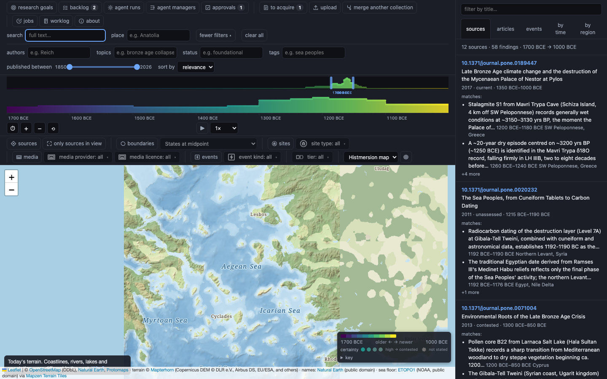
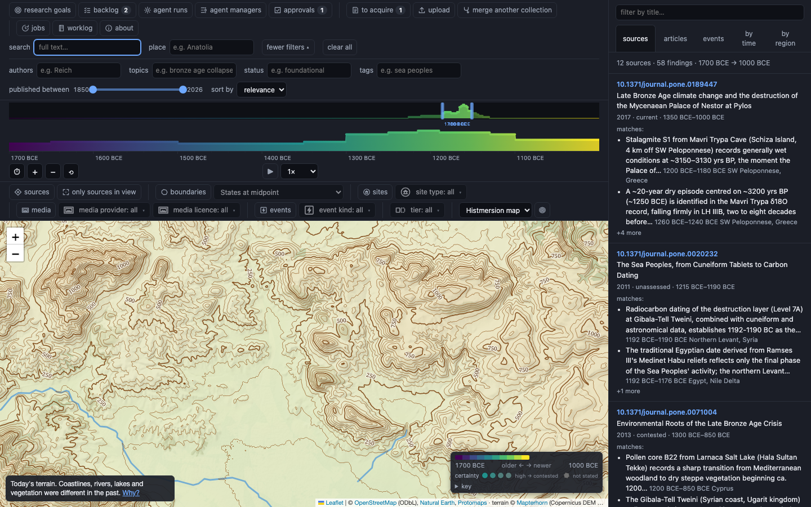

# Customising the terrain map

The [terrain map](../exploring/web-ui.md#the-terrain-map) is drawn in your browser from files your
server keeps (see [Open data → The terrain base map](open-data.md#the-terrain-base-map)). **How** it
is drawn — the colours, which features are shown, line widths, the relief's light, the names — is a
**style**, a small text file. You can change it, or add your own styles, without rebuilding or even
restarting anything: the server reads the file again when it changes, and an open map redraws within
a few seconds.

## The named styles

Every style is a **preset** of the map options' *Style* menu (the button beside the base-map menu, with
the *Histmersion map* chosen — see [The base map](../exploring/web-ui.md#the-base-map)). Nine come with
Histmersion — two drawn for reading the land, three street maps and four more terrain styles:

| style | what it shows |
|---|---|
| **Natural** (the default) | a light, natural map: the ground coloured by its height, the land cover in its own colours, the relief shaded from several directions, the sea coloured by its depth and lighter along the shore, contour lines from zoom 11; names in Noto Serif — italic for water, letter-spaced capitals for ranges and regions |
| **Contour map** | Natural as a topographic map: contour lines from zoom 9 (every 200 m, then 100, 50, 20, 10 as you zoom in), depth lines under the sea, pale colours, faint shading |
| **Standard** | today's map: land cover and land use, water, roads by class, country and province borders, and the names of countries, cities, towns and villages (more of them the further you zoom in) and of the seas |
| **Muted** | the same in pale, quiet colours, so your markers stand out |
| **Dark** | the same in dark colours |
| **Terrain** | today's terrain, dark and muted so your markers, names and boundaries stay on top: land, seas, lakes and rivers, a light tint for forest, grassland, scrub, bare ground and ice, the shaded relief, and the physical names |
| **Terrain + vegetation** | the same with the land cover drawn strongly, and OpenStreetMap's own woods, scrub and wetlands where they are mapped |
| **Relief only** | land, water and the relief — no land cover, no names |
| **Parchment** | a light, old-atlas look: pale land and sea, sepia relief, brown names in a serif type |

The street maps draw roads, places and borders, which the download leaves out unless it is made
with `--keep-all` ([Working offline](offline.md#the-one-time-download)); until then the menu marks
them "needs the full download" and draws them with what is there. `histmersion basemap styles`
lists the data layers each style draws, and `histmersion basemap status` which of them the download
on the server lacks. They have no dots for towns: the dots on the map are your corpus's.

<figure markdown>
  { loading=lazy }
</figure>

<figure markdown>
  { loading=lazy }
</figure>

<figure markdown>
  { loading=lazy }
</figure>

<figure markdown>
  { loading=lazy }
</figure>

<figure markdown>
  { loading=lazy }
</figure>

The map options change a preset for you alone — names and their language, relief strength, colours by
height, land cover, sea floor, contours and their interval — and are remembered by this browser per
preset until *Reset to preset*; the style file stays the source of the presets. An option a preset has
nothing for (Terrain carries no contours; Relief only no names) or whose data is not downloaded is
disabled, its line saying why.

## How the Natural map is drawn

- **Colours by height** (`relief.tint`): the elevation of every pixel through a ramp of `[metres,
  colour]` stops — lowland green, upland tan, mountain grey-brown, snow white — under the land cover's
  translucent fills, so a forest on a mountain is a darker green over the mountain's tan.
- **Land cover**: Protomaps' `landcover` (satellite-derived, the same everywhere) to zoom 8, then
  OpenStreetMap's own `landuse` — forest and wood dark green, grass and meadow light green, scrub and
  heath olive, farmland pale, bare rock grey, sand and beach ochre, wetland blue-green, glacier white.
- **The relief**, shaded from several directions (`relief.multidirectional`, 0–1: light from the main
  direction and three more), so a slope turned away from the main light still shows its shape. It is
  computed for the screen's own pixels: a zoom deeper than the data is resampled smoothly (bicubic),
  never in blocks, and each tile takes its neighbours' edge pixels, so no seam shows. To zoom 8 it comes
  from the downloaded extract; deeper (to 12, about 30 m) the server reads the tiles you look at
  ([Open data → The terrain base map](open-data.md#the-terrain-base-map)).
- **The sea floor** (`relief.sea-tint`, `relief.sea-shading`): the sea coloured by its depth — light over
  the shelf, a step at its edge near 200 m, darker over the basins — and its floor faintly shaded, from
  the `bathymetry` layer (ETOPO1). Without it the sea is one shallow colour.
- **Water**: a soft blue, lighter along every shore (`glow` on the water layer: a band inside the outline
  fading towards open water); rivers by size — the major rivers wide at a continent's scale, then
  OpenStreetMap's rivers, then streams from zoom 11.
- **Contours** (`relief.contours`): traced from the same elevation in your browser, once per tile — every
  `interval` metres by zoom (Natural 100 m at zoom 11, 50 m at 12, 20 m at 14, 10 m at 16), every
  `index-every`-th line thicker with its height written along it; `depth-interval` adds depth lines under
  the sea (the Contour map). The *Contour lines* option switches them, and *Interval* fixes one.

Each tile's relief is computed once, when it arrives — never during a pan or a zoom — in a few
milliseconds, and the decoded elevation is kept in a small bounded cache.

## The physical names

The names on the terrain map are those of the land and the water, never of anything people built:

- seas, oceans, gulfs, bays and straits, the islands, and the smaller lakes and rivers — from the
  same OpenStreetMap download as the map itself;
- mountain ranges, deserts, plateaus, plains, peninsulas, deltas, island groups, the large lakes,
  the major rivers and peaks — from [Natural Earth](https://www.naturalearthdata.com) (public domain),
  a separate download of about 20 MB, of which about 1.4 MB is kept.

No towns, countries, borders or roads are named. The names are drawn below every marker of the map,
and fewer of them show the further out you zoom; two never overlap (each takes the room of its whole
block — every line, its halo and a margin — and the more important, placed first, wins). They are shown
in **English** by default; the map options' *Language* switches them for you (English, *Local* — each
name in its own language and script — Deutsch, Français, Italiano, Español, Ελληνικά, Türkçe, Русский,
العربية, עברית, فارسی, 中文). The default for everyone is `basemap.labels.language` (or `language` in
your style file, or in one style). A place without a name in that language falls back to English, then
to its local name. Natural Earth's names (ranges, deserts, lakes, rivers, peaks) exist in Arabic,
Bengali, Chinese, Dutch, English, French, German, Greek, Hebrew, Hindi, Hungarian, Indonesian, Italian,
Japanese, Korean, Persian, Polish, Portuguese, Russian, Spanish, Swedish, Turkish, Ukrainian, Urdu and
Vietnamese; OpenStreetMap's (seas, gulfs, islands, smaller lakes and rivers) in whatever languages
people mapped them — for the Aegean, Greek and Turkish nearly always.

**The fonts** are served by Histmersion itself, so the map needs no font service: Noto Serif (Latin,
Greek, Cyrillic) with Noto Serif Armenian, Georgian and Hebrew and Noto Naskh Arabic for local names in
those scripts (SIL Open Font License). Each label layer names its own `font { family … }`; the built-in
styles use `${fonts.serif}` — water italic, ranges and regions in letter-spaced capitals, islands,
peninsulas and peaks in regular, smaller type.

!!! note "A download made before the names existed"
    `histmersion basemap status` says when the names are missing, and what to run. Natural Earth's
    names are a separate small layer:

    ```bash
    histmersion basemap fetch --layer labels
    ```

    A vector layer fetched before 2026-10-19 also kept only coast, water and land cover;
    `basemap status` recommends fetching it once more (`histmersion basemap fetch --layer vector`).
    Since then the download keeps everything a map of the past could use, and a style decides what
    is drawn — so restyling never needs another download.

## Your own style file

Your styles go in **`basemap-style.conf`** beside your config file — by default
`~/.config/histmersion/basemap-style.conf` (a `basemap-style.json` there works too). To keep it
elsewhere, set `basemap.style` to its path. Start from the built-in file:

```bash
histmersion basemap styles --example > ~/.config/histmersion/basemap-style.conf
```

The file is [HOCON](https://github.com/lightbend/config/blob/main/HOCON.md) — JSON with comments,
optional quotes and commas — or plain JSON. Its `styles` are **merged over the built-in ones by
`id`**, so your file only needs what you change:

```hocon
# ~/.config/histmersion/basemap-style.conf
default = "night"            # the style the menu starts on
language = "local"           # names in their own language

styles = [
  # a new entry of the menu: Terrain with a darker sea and white rivers
  {
    id = "night"
    extends = "terrain"      # start from a built-in style; change only what follows
    name = "Night"
    background = "#05070a"   # the sea, and where there is no data
    relief { shadow-opacity = 0.9, azimuth = 270 }      # light from the west
    layers = [
      { id = "water", fill = "#05070a" }                # a layer of the parent, by id: these keys change
      { id = "rivers", color = "white", width = [[5, 0.3], [10, 1.5]] }
      { id = "streams", remove = true }                 # not drawn
      { id = "coast", type = "line", layer = "earth", geometry = "polygon",   # a new layer,
        color = "#2a3440", width = 0.5, before = "water" }                    # drawn under the water
    ]
  }

  # a built-in style changed in place: Terrain without names
  { id = "terrain", extends = "terrain", labels = false }

  # a built-in style taken out of the menu
  { id = "parchment", hidden = true }
]
```

### The format

**A style:** `id` (letters, digits, `-`, `_`), `name` (the menu's text), `description`, `extends`
(another style's id), `hidden`, `modern` (`true` for a map of today's world — no "(no modern
features)" in the menu, no notice about the past landscape), `tone` (`dark` or `light` — the map's own names follow it),
`background` (a colour), `labels` (`true`/`false`: whether its label layers are drawn), `language`,
`relief` and `layers`.

**The relief:** `enabled`, `shadow` and `highlight` (colours), `shadow-opacity` and
`highlight-opacity` (0–1, on the steepest slope), `azimuth` (where the light comes from, degrees
clockwise from north; 315 = north-west), `altitude` (how high it stands, degrees), `exaggeration`
(how much the slopes are steepened — relief is invisible at a continent's scale without it),
`multidirectional` (0–1: how much light also comes from three more directions);
`tint` (colours by height: `[[metres, colour], …]`, elevations ascending), `tint-opacity`, `heights`
(whether they are shown — a preset may carry them switched off for the map options);
`sea-tint` (the sea by its depth, negative metres), `sea-shading` (0–1, the sea floor's shading against
the land's), `sea-floor` (shown or not); and `contours`:

| contour key | meaning |
|---|---|
| `enabled` | drawn (`true` as soon as a `contours { }` block is given) |
| `min-zoom` | from this map zoom on (Natural 11) |
| `interval` | metres between lines, by zoom — a step, not a ramp: `[[11, 100], [12, 50], [14, 20]]` is 100 m at zoom 11, 50 m from 12, 20 m from 14 |
| `index-every` | every n-th line an index line (thicker, its height written along it) |
| `color`, `index-color`, `width`, `index-width` | the lines |
| `labels`, `label-color`, `halo`, `font { … }` | the heights on the index lines |
| `depth-interval`, `depth-color` | depth lines under the sea, by zoom (0: none) |

```hocon
styles = [
  { id = "mine", extends = "natural", name = "Steep and bare",
    relief { multidirectional = 1, shadow-opacity = 0.8,
             contours { min-zoom = 10, interval = [[10, 100], [13, 25]], index-every = 4 } }
    layers = [ { id = "forest", remove = true }, { id = "water", glow { color = "white", width = 10 } } ] }
]
```

**A layer**, bottom to top:

| key | meaning |
|---|---|
| `id` | its name, by which a style that extends this one changes it |
| `type` | `fill` (areas), `line`, or `label` (names) |
| `source` | `vector` (the default: coast, water, land cover and use, natural points; roads, places and borders after a `--keep-all` download) or `labels` (Natural Earth's names) |
| `layer` | the data layer(s) it draws, one or a list: `earth`, `water`, `landcover`, `landuse`, `pois`, `roads`, `places`, `boundaries` — or `physical` and `rivers` for `source = "labels"`. A style needs every vector layer it draws: one the download left out makes it "need the full download" |
| `geometry` | `point`, `line` or `polygon` (all when left out) |
| `kinds`, `not-kinds` | the features' `kind`s drawn, or not drawn (`forest`, `river`, `sea`, `range`, `peak`, …) |
| `details` | their `kind_detail` (a lake is a `water` of detail `lake`) |
| `min-zoom`, `max-zoom` | the map zooms it is drawn at |
| `fill`, `opacity` | an area's colour and opacity |
| `color`, `width`, `dash` | a line's or a name's colour; a line's width in pixels and dash pattern (`[4, 2]`) |
| `placement` | a name at its `point` or along a `line` (rivers) |
| `halo`, `halo-width` | the outline around a name's letters |
| `font { family, size, weight, style }` | e.g. `{ family = "Georgia, serif", size = 11, style = "italic" }` |
| `transform`, `letter-spacing`, `max-line-chars` | `uppercase`/`lowercase`/`capitalize`; spacing in pixels; where a long name wraps |
| `own-min-zoom` | a name also waits for the zoom its data says it starts at (default `true`) |
| `glow { color, width }` | an area's soft inner edge: `color` along its outline, fading inwards over `width` pixels (the sea's shore) |
| `padding`, `line-height` | a name's free space all round, in pixels (3), and the distance of its lines, × its size (1.2) |
| `remove`, `before` | in a style that extends another: drop this layer; put a new one before that id |

Names are placed in layer order: where two would overlap, the earlier one wins; within a layer, the
one whose own `min_zoom` is lower first, then the larger place (`population_rank`). A name's room is its
whole block — every line of it, its halo and its `padding` — so two names never touch.

**Values to share:** a top-level `fonts { … }` holds values the styles refer to with HOCON's
`${fonts.serif}` (the built-in file's `serif` is the bundled Noto Serif family with its companions).

**Colours:** `#rgb`, `#rrggbb`, `#rrggbbaa`, `rgb(…)`, `rgba(…)`, `hsl(…)`, a CSS colour name, or
`var(--token)` — a colour of the web page's own theme (the built-in Terrain style uses
`var(--terrain-land)`, `var(--terrain-water)`, … so a theme still applies).

**Zoom-dependent numbers** (`width`, `opacity`, `halo-width`, a font's `size`, the relief's
`exaggeration`): a number, or a list of `[zoom, value]` stops — `[[5, 0.3], [10, 1.5]]` is 0.3 up to
zoom 5, growing evenly to 1.5 at zoom 10, and 1.5 beyond.

The features the data holds — every `kind` of every layer — are listed in Protomaps' [basemap
layers](https://docs.protomaps.com/basemaps/layers) and, for the names, under
[The physical names](#the-physical-names) above (`range`, `desert`, `plateau`, `plain`, `basin`,
`valley`, `delta`, `peninsula`, `isthmus`, `coast`, `wetland`, `region`, `continent`,
`island_group`, `island`, `lake`, `peak`, `pass`, `depression`, `cape`, `waterfall`; `river` in
`rivers`).

### Checking a file, and what happens to a broken one

```bash
histmersion basemap styles --check ~/.config/histmersion/basemap-style.conf   # checks it, uses nothing
histmersion basemap styles                                                    # the styles served now
```

The check names every problem at its place in the file — `styles[0].layers[2].width: the stops'
zooms must ascend` — and an unknown key (a typo) as a warning. **A file with an error is not used at
all**: the map keeps the built-in styles, never goes blank, and the error is listed by
`histmersion basemap styles`, `histmersion health` and `histmersion about` until the file is fixed.

### When a change shows

The server looks at the file whenever a page asks for the styles; a page showing the terrain map
asks every `basemap.style-check-seconds` (5) and redraws when they changed. A change of
`basemap.style` or `basemap.labels.language` in `histmersion.conf` applies with
`histmersion config reload` (or the config watcher, `config.watch`) — no restart either way.
