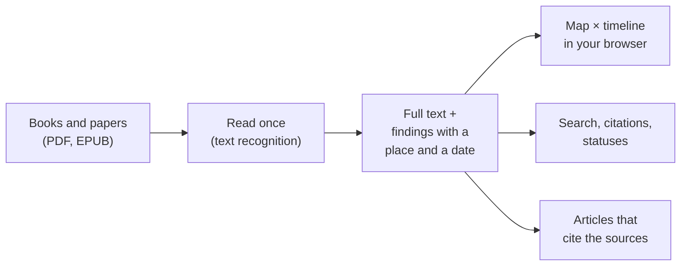

# Histmersion

**Histmersion is a research library for the past that you run on your own computer.** You put
books and papers into it. It reads them once, keeps their full text, and places what they say on a
**map** and a **timeline**. You can then ask: *what do my sources say about this place, at this
time?* — and see the answer on the map, with every claim linked back to the page it came from.

It was built for comparative mythology, folklore, Bronze-Age history and the origins of the
Indo-European peoples, but nothing in it is tied to those subjects. Any collection of writing about
places and times fits.

## Where to start

- **New here?** Read [What Histmersion is](getting-started/what-is-histmersion.md) — the ideas in
  plain words, and who it is for.
- **Before you use it:** read [Responsible use](responsible-use.md). It is short, and it matters.
- **Set it up:** [Installing](getting-started/install.md), then [First steps](getting-started/first-steps.md).
- **Do I need an AI subscription?** No. [Do I need AI?](getting-started/ai-optional.md) lists what
  works without one.
- **Explore:** [the web page](exploring/web-ui.md), [searching](exploring/searching.md),
  [places and periods](exploring/places-and-periods.md), [events](exploring/events.md).
- **Write up what you found:** [Articles](articles/index.md).
- **Work with an AI assistant you already use** (Claude Code, Codex, opencode, other MCP clients):
  [Using your AI assistant](ai-assistant.md).

!!! warning "Use it responsibly"

    - Fetch only what you may fetch. Histmersion downloads **legal open-access copies only**; pay
      for what is paid (buy or borrow books, use your library's access). Respect every site's terms
      of use and rate limits, and honour the licence of every picture.
    - **AI makes mistakes.** Summaries, findings and articles written with an AI model can be
      wrong, miss nuance or credit the wrong author. Check every claim against the cited source
      yourself.
    - An article is **a starting point for your own research**, not a finished paper. Do not use
      Histmersion to generate scientific papers for publication.
    - **Absence is not evidence.** Your collection and the downloaded datasets are incomplete. A
      missing source, event or place on the map proves nothing.

    The full text: [Responsible use](responsible-use.md).

## Three ways in, one collection

| you are | you use | what you get |
|---|---|---|
| a person reading and exploring | the **web page** at `http://localhost:8000` | the map, the timeline, sources, articles, events |
| a person at a terminal, or a script | the **`histmersion` command** | the same data as text (Markdown) or JSON |
| an AI assistant | the **MCP tools** at `http://localhost:8000/mcp` | the same operations, as tools the assistant can call |

All three talk to one program, the Histmersion **server**, which keeps everything in one database.
They cannot disagree: each command, web request and MCP tool runs the same code.

This documentation describes Histmersion {{ histmersion_version() }}.
