# Histmersion

**Histmersion is a research library for the past that you run on your own computer.** You put
books and papers into it. It reads them once, keeps their full text, and places what they say on a
**map** and a **timeline**. You can then ask: *what do my sources say about this place, at this
time?* — and see the answer on the map, with every claim linked back to the page it came from.

<figure markdown="span">
  { loading=lazy }
  { loading=lazy }
  <figcaption>Twelve open-access papers on the Late Bronze Age, 1700–1000 BCE: the markers are their
  claims (findings), ancient sites and events, the outlines are the states of the time, and the list
  shows each source with the findings that fall in the selected years.</figcaption>
</figure>

How a book or paper becomes something you can see on that map:

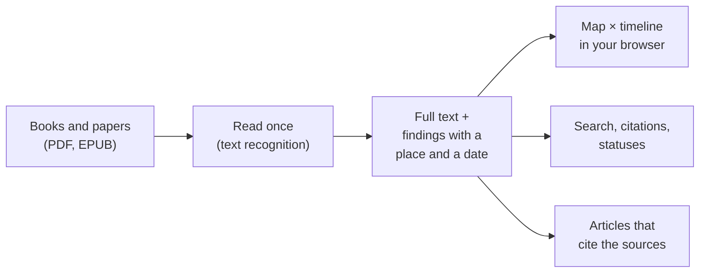

It was built for comparative mythology, folklore, Bronze-Age history and the origins of the
Indo-European peoples, but nothing in it is tied to those subjects. Any collection of writing about
places and times fits.

## Where to start

- **New here?** Read [What Histmersion is](getting-started/what-is-histmersion.md) — the ideas in
  plain words, and who it is for.
- **Before you use it:** read [Responsible use](responsible-use.md). It is short, and it matters.
- **Set it up:** [Installing](getting-started/install.md), then [First steps](getting-started/first-steps.md).
- **Do I need an AI subscription?** No. [Do I need AI?](getting-started/ai-optional.md) lists what
  works without one.
- **Explore:** [the web page](exploring/web-ui.md), [searching](exploring/searching.md),
  [places and periods](exploring/places-and-periods.md), [events](exploring/events.md).
- **Write up what you found:** [Articles](articles/index.md).
- **Work with an AI assistant you already use** (Claude Code, Codex, opencode, other MCP clients):
  [Using your AI assistant](ai-assistant.md).

!!! warning "Use it responsibly"

    - Fetch only what you may fetch. Histmersion downloads **legal open-access copies only**; pay
      for what is paid (buy or borrow books, use your library's access). Respect every site's terms
      of use and rate limits, and honour the licence of every picture.
    - **AI makes mistakes.** Summaries, findings and articles written with an AI model can be
      wrong, miss nuance or credit the wrong author. Check every claim against the cited source
      yourself.
    - An article is **a starting point for your own research**, not a finished paper. Do not use
      Histmersion to generate scientific papers for publication.
    - **Absence is not evidence.** Your collection and the downloaded datasets are incomplete. A
      missing source, event or place on the map proves nothing.

    The full text: [Responsible use](responsible-use.md).

## A short tour

All the pictures come from the same twelve papers. Click a tab to switch pictures.

### The map in three styles

The menu at the end of the layer bar (it says *Standard*) changes the background map. The markers,
outlines and names stay the same; only the background changes.

=== "Standard"

    <figure markdown="span">
      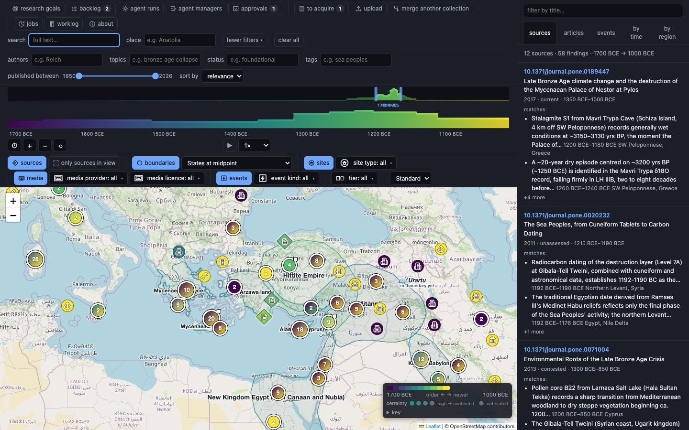{ loading=lazy }
      <figcaption>Standard: OpenStreetMap's own map, with roads, borders and names.</figcaption>
    </figure>

=== "Muted"

    <figure markdown="span">
      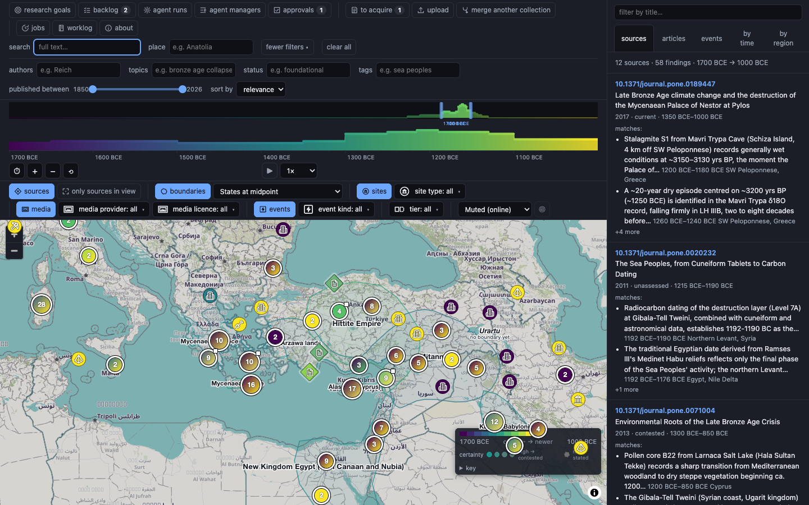{ loading=lazy }
      <figcaption>Muted: a paler map, the Humanitarian style served by OpenStreetMap France. Its
      credit line, bottom right, names its makers.</figcaption>
    </figure>

=== "Dark"

    <figure markdown="span">
      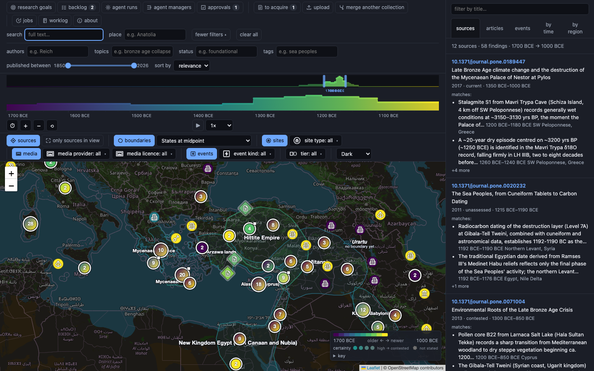{ loading=lazy }
      <figcaption>Dark: the standard map drawn dark, for a dark room. No other map server is
      contacted.</figcaption>
    </figure>

### One source on the map

<figure markdown="span">
  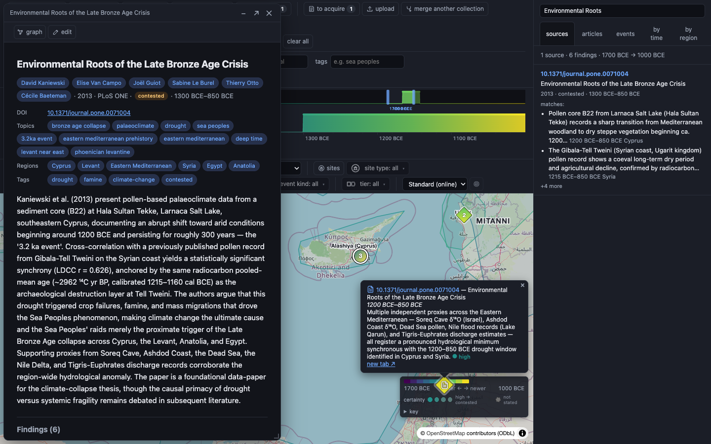{ loading=lazy }
  <figcaption>Typing a title in the box above the list leaves only that paper on the map (top right:
  1 source, 6 findings). Click a marker to read its claim, its dates and how certain the paper is;
  the window on the left is the whole source.</figcaption>
</figure>

### Reading a source

=== "Details and summary"

    <figure markdown="span">
      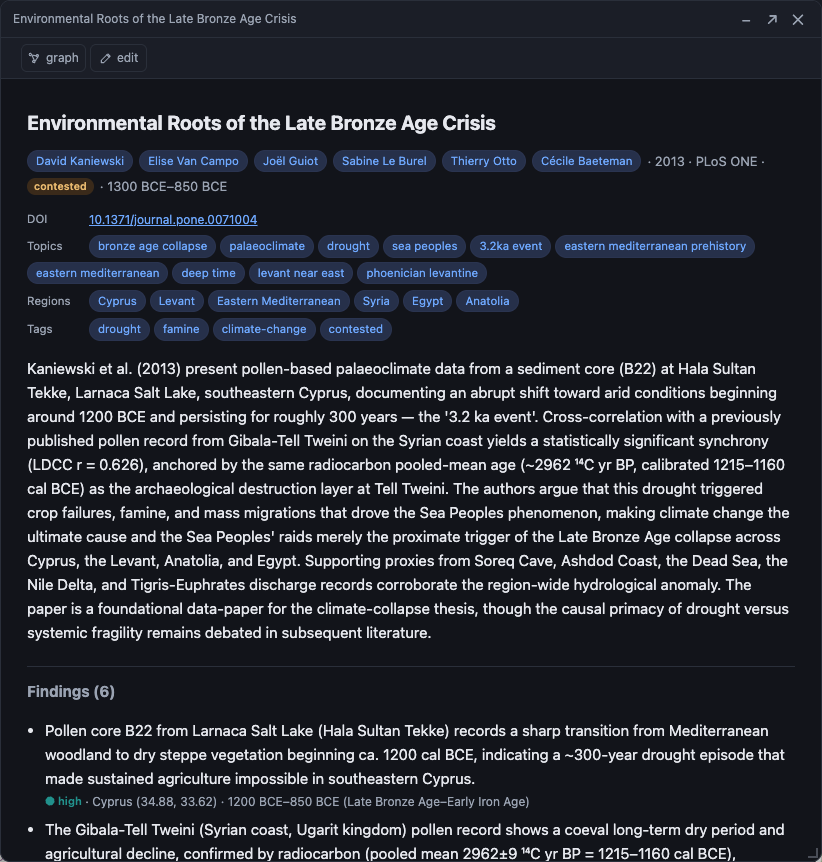{ loading=lazy }
      <figcaption>A source's window. Notice the status next to the year, <em>contested</em>: a
      later paper challenges this one.</figcaption>
    </figure>

=== "Findings"

    <figure markdown="span">
      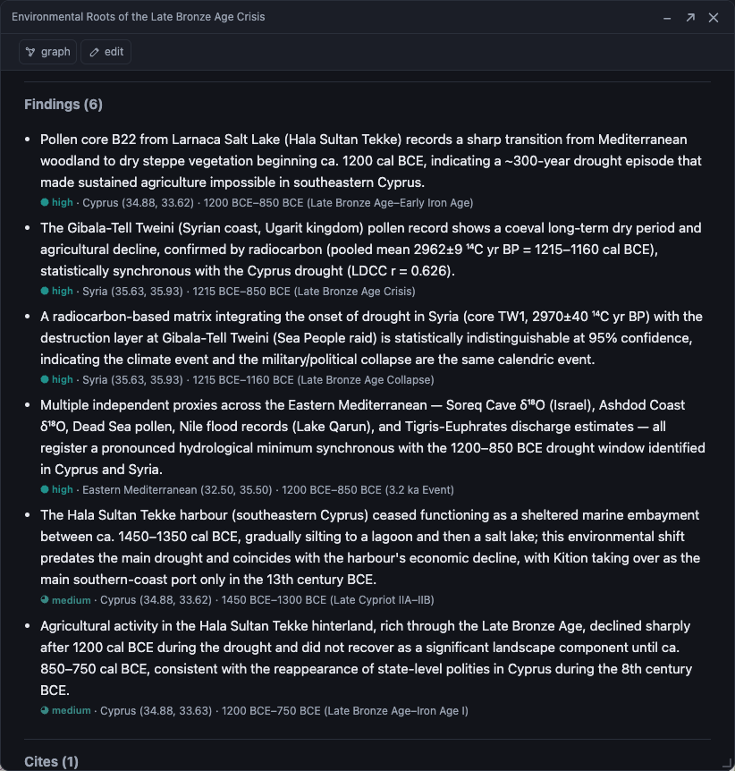{ loading=lazy }
      <figcaption>Each finding is one claim with a place, a period and a certainty. The findings are
      the markers on the map.</figcaption>
    </figure>

=== "Its own page"

    <figure markdown="span">
      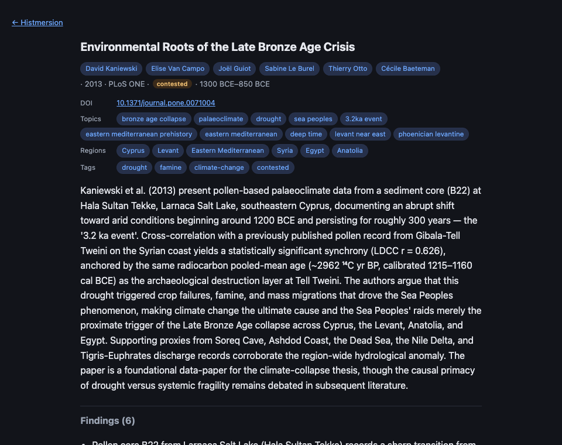{ loading=lazy }
      <figcaption>Every source also has a page of its own, with an address you can bookmark or
      share. The ↗ button in the window's title bar opens it.</figcaption>
    </figure>

### Reading an article

=== "Text and citations"

    <figure markdown="span">
      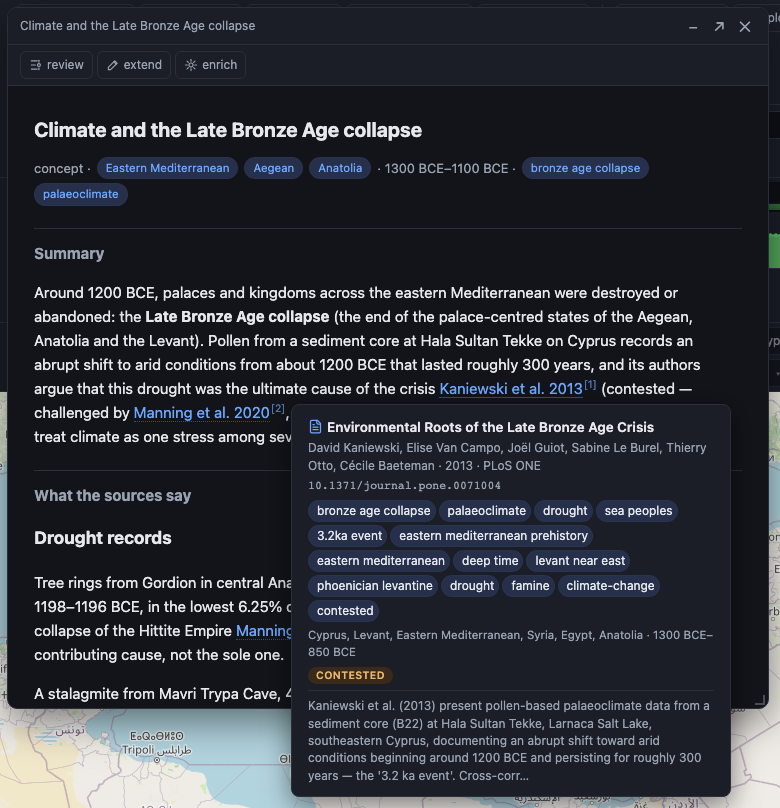{ loading=lazy }
      <figcaption>An article is a text that cites your sources. Each citation is a link: point at
      it to see the source's card, click it to open the source. The sentence itself says that the
      source is contested, and by whom.</figcaption>
    </figure>

=== "Not used and Method"

    <figure markdown="span">
      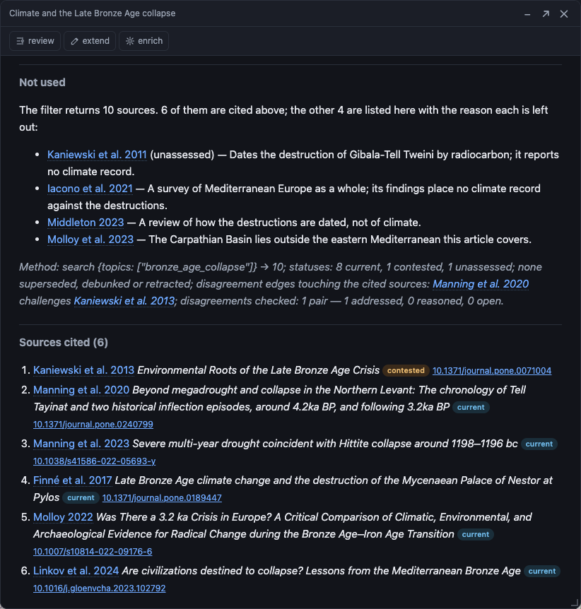{ loading=lazy }
      <figcaption>Histmersion writes the end of every article itself: which matching sources were
      left out and why, how the sources were found, and the sources cited with their
      statuses.</figcaption>
    </figure>

=== "Its own page"

    <figure markdown="span">
      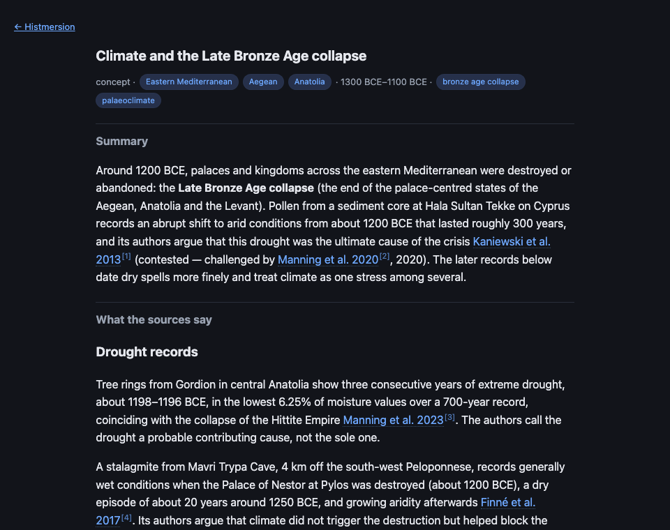{ loading=lazy }
      <figcaption>Like a source, every article has a page of its own, to read at full width or to
      share as a link.</figcaption>
    </figure>

### A period on the timeline

<figure markdown="span">
  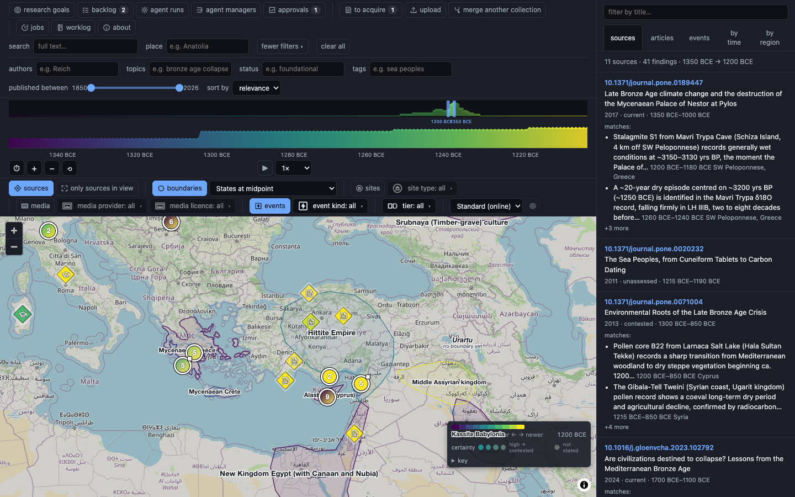{ loading=lazy }
  <figcaption>Choose a named period (here the Hittite Empire, from the ⏱ menu under the timeline)
  and everything follows it: the outlines on the map, the markers and the list on the right.</figcaption>
</figure>

## Three ways in, one collection

| you are | you use | what you get |
|---|---|---|
| a person reading and exploring | the **web page** at `http://localhost:8000` | the map, the timeline, sources, articles, events |
| a person at a terminal, or a script | the **`histmersion` command** | the same data as text (Markdown) or JSON |
| an AI assistant | the **MCP tools** at `http://localhost:8000/mcp` | the same operations, as tools the assistant can call |

All three talk to one program, the Histmersion **server**, which keeps everything in one database.
They cannot disagree: each command, web request and MCP tool runs the same code.

This documentation describes Histmersion {{ histmersion_version() }}.
