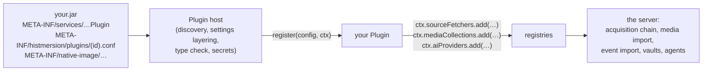

# Developing plugins

This page is for programmers. A plugin is a Scala 3 library, packaged as one jar, that the server
discovers when it starts. You can write one without a copy of Histmersion's source code: the install
on your computer has everything a plugin compiles against, and `histmersion plugin new` writes a
working project to start from.

## Where the plugin API comes from

Histmersion is an application, not a library, so its plugin API is **not published to a Maven
repository**: there is no `libraryDependencies += …` line to copy. You compile against the API jar
that comes with Histmersion instead.

- **From your install.** Every install carries the API and its sources (with the documentation of every
  type) in `plugin-api/`:

    ```bash
    histmersion plugin api-jar             # …/Histmersion/plugin-api/histmersion-plugin-api.jar
    histmersion plugin api-jar --sources   # …/Histmersion/plugin-api/histmersion-plugin-api-sources.jar
    ```

    The file names stay the same when you upgrade Histmersion, so a project that points at them
    compiles against the new API after an upgrade. The jar's version is in its manifest
    (`Implementation-Version`).

- **From a release.** Each tagged release on GitHub carries the same two files as
  `histmersion-plugin-api-<version>.jar` and `histmersion-plugin-api-<version>-sources.jar`, for
  building a plugin on a computer where Histmersion is not installed.

Besides the API, a plugin needs the two libraries the API itself uses, which are on Maven Central:
sconfig and kindlings' sconfig derivation. The server provides all three at run time, so they are
never packed into your plugin's jar.

## Your first plugin, with scala-cli

[scala-cli](https://scala-cli.virtuslab.org) builds, tests and packages a Scala project from
directives at the top of its source files, with no build definition. It is the simplest way to write
a plugin.

```bash
histmersion plugin new doi-mirror                         # a source fetcher, in ./doi-mirror
histmersion plugin new my-events --kind event-catalogue   # or another kind
```

The kinds are `source-fetcher` (the default), `media-collection`, `event-catalogue`, `ai-provider` and
`secret-vault`. Each writes a small plugin of that kind that works as written. `--dir` chooses
another directory, `--package` another Scala package, and `--api-jar <path>` a downloaded API jar
instead of the install's (a `-sources.jar` beside it is used too).

What it writes, for `doi-mirror`:

| file | what it is |
|---|---|
| `DoiMirror.scala` | the plugin: its settings, the `Plugin` class and the source fetcher it adds |
| `DoiMirror.test.scala` | its tests, and checks of what the jar must carry |
| `resources/META-INF/services/com.histmersion.plugin.Plugin` | names the plugin class, so the server can find it (Java's ServiceLoader reads it). Rename the class and you must rename it here too; a test checks it |
| `resources/META-INF/histmersion/plugins/doi-mirror.conf` | the plugin's settings and their defaults |
| `resources/META-INF/native-image/…/reachability-metadata.json` | what the server's native binary must be told about the plugin (see [Native image](#native-image)) |

The two Scala files are the ones you edit. The top of `DoiMirror.scala` is the build:

```scala
//> using scala 3.10.0
//> using jar "/Users/you/Applications/Histmersion/plugin-api/histmersion-plugin-api.jar"
//> using sourceJar "/Users/you/Applications/Histmersion/plugin-api/histmersion-plugin-api-sources.jar"
//> using dep org.ekrich::sconfig:2.1.0
//> using dep com.kubuszok::kindlings-sconfig-derivation:0.3.3
//> using resourceDir resources
```

The Scala version and the two libraries are the ones your Histmersion runs; keep them when you edit.
The test file adds munit with `//> using test.dep org.scalameta::munit:…`.

The loop:

```bash
cd doi-mirror
scala-cli test .                                             # compile, run the tests
scala-cli --power package --library . -o doi-mirror.jar -f   # the plugin jar
histmersion plugin add ./doi-mirror.jar                      # shows what it adds, then installs it
histmersion plugin rebuild                                   # link it into the server
```

Then turn it on in `histmersion.conf` and reload the settings:

```hocon
histmersion.plugins.doi-mirror { enabled = true, base-url = "https://mirror.example.org" }
```

```bash
histmersion config reload
histmersion about          # doi-mirror 0.1.0 — registered (source-fetcher:doi-mirror)
```

`package --library` makes a jar of your classes and resources only: no Scala library, no plugin API,
no sconfig or kindlings. That is what the server expects, since it provides all of those.

### Libraries of your own

The server provides the Scala library, the plugin API, sconfig and kindlings, and nothing else a plugin
can rely on. `histmersion plugin add` installs exactly one jar, so any other library has to be
**shaded** into it (copied in, under a package of its own). scala-cli cannot shade. Prefer the JDK's own
classes (`java.net.URI`, `java.time`, `java.util.Base64`, …) and the host's HTTP client (`ctx.http`);
when you need another library, build with sbt and its assembly plugin ([below](#with-sbt-instead)).

### In an editor: VS Code with Metals

```bash
scala-cli setup-ide .
```

writes `.bsp/scala-cli.json`, which tells an editor how to build the project. Open the directory in
VS Code with the **Metals** extension (or in IntelliJ IDEA with the Scala plugin) and import the build
when it asks. You get completion, errors as you type, and go-to-definition into the plugin API's
sources, with its documentation on hover: that is what the `sourceJar` directive is for. Run
`setup-ide` again after you change a `//> using` line.

### With a coding agent

```bash
histmersion plugin new doi-mirror --with-agent-notes
```

adds `AGENTS.md` (and a `CLAUDE.md` that points at it) to the project: the rules the server enforces on a
plugin, where the API's sources and documentation are and how to read them, the build and install
commands, and the licence. Coding agents that read `AGENTS.md` or `CLAUDE.md` pick it up when they work in
that directory. To read the API without an editor:

```bash
unzip -l "$(histmersion plugin api-jar --sources)"                                         # the files
unzip -p "$(histmersion plugin api-jar --sources)" com/histmersion/plugin/PluginContext.scala   # one, with its docs
javap -cp "$(histmersion plugin api-jar)" com.histmersion.plugin.PluginContext                  # signatures only
```

[cellar](https://github.com/VirtusLab/cellar) answers the same questions as Markdown from inside the
project (`cellar get com.histmersion.plugin.PluginContext`), once your cellar reads Scala 3.10;
an older one stops with "TASTy signature has wrong version".

### With sbt instead

sbt suits a plugin that needs its own libraries shaded in. Put the API jar in the project's `lib/`
directory, which sbt puts on the class path by itself (an *unmanaged* jar), and depend on the API's
own two libraries as `Provided`, so they stay out of the packaged jar:

```bash
mkdir -p lib && cp "$(histmersion plugin api-jar)" lib/
```

```scala
// build.sbt
scalaVersion := "3.10.0"
libraryDependencies ++= Seq(
  "org.ekrich"   %% "sconfig"                      % "2.1.0" % Provided,
  "com.kubuszok" %% "kindlings-sconfig-derivation" % "0.3.3" % Provided,
  "org.scalameta" %% "munit"                       % "1.3.6" % Test
)
```

The resources go in `src/main/resources/` (the same three files `plugin new` writes under `resources/`),
the sources in `src/main/scala/`. `sbt package` makes a jar without dependencies; with sbt-assembly,
exclude the `lib/` jar and the `Provided` libraries from the assembly. Copy the API jar again after
upgrading Histmersion. (A checkout of Histmersion can also publish the API to your local repository
with `sbt pluginApi/publishLocal`; the copied jar needs no checkout.)

## Installing it

`histmersion plugin add` takes a jar in any of four forms; [Installing plugins](installing.md) has
the details:

```bash
histmersion plugin add ./doi-mirror.jar                      # a file on this computer
histmersion plugin add https://example.org/doi-mirror.jar    # a URL
histmersion plugin add org.example::doi-mirror:0.1.0         # Maven coordinates, if you publish it
```

Copying the jar into the data directory's `plugins/` by hand works too. Either way, the server sees a
changed set of plugins only after `histmersion plugin rebuild` (or a restart in JVM mode).

## Licence

Histmersion, its plugin API and the built-in plugins are licensed under the AGPL-3.0, and a plugin
built on the API is AGPL-3.0 as well.

## The SPI in one page

The design and its reasons are in {{ repo_file("docs/research-plugins.md") }} (sections 15–23
describe what was built).

A plugin compiles against **one** module, `modules/plugin-api` (artifact `histmersion-plugin-api`,
package `com.histmersion.plugin`). It never sees the server, the database or the domain model. The
module's only dependencies are sconfig and kindlings' sconfig derivation.

`plugin-api`, like the rest of Histmersion, is licensed under the AGPL-3.0-or-later. A plugin is
linked into the server's binary and runs inside it, so a plugin you give to other people must be
under a licence compatible with the AGPL ([Legal notice](../legal.md)).

- **One service type: `Plugin`.** A plugin is found through Java's `ServiceLoader`: the jar lists its
  provider class in `META-INF/services/com.histmersion.plugin.Plugin`. The provider is a public
  class with a no-argument constructor (not a Scala `object`), and constructing it does nothing —
  real work starts in `register`, and only for an enabled plugin.
- **`PluginInfo(id, version, spiVersion)`.** `id` is kebab-case (`[a-z0-9][a-z0-9-]*`) and is also
  the settings key: `histmersion.plugins.<id> { … }`. `spiVersion` must be `Spi.Version` (now 1);
  a plugin built for another one is refused.
- **A path-dependent `Config`.** Each plugin declares `type Config` and a `given ConfigReader[Config]`
  — a `deferred` given, so `derives ConfigReader` on your case class fills it in. The host decodes
  *this* plugin's block with *this* reader and hands the value to *this* plugin's `register`: no cast,
  and no other plugin can see it. Import `com.histmersion.plugin.PluginConfig.given` where you derive,
  so a number or boolean can come from an environment variable (which always arrives as a string).
- **Defaults as a named resource.** `META-INF/histmersion/plugins/<id>.conf` holds the defaults, keys
  relative to the plugin's block. It is also the type schema: every key the plugin reads has a default
  (`null` for an optional value), and a key the user sets that it lacks is reported as unknown.
  `enabled` belongs to the host; absent, the plugin is disabled. Never ship a `reference.conf`.
- **`register(config, ctx): Either[String, Unit]`.** Called once per configuration generation, after
  every `Secret` in the decoded config was resolved. What the plugin adds to the context's
  **registries** is staged: a `Left` or an exception discards all of it.
- **Five registries** on `PluginContext`, one per extension point: `secretVaults`, `sourceFetchers`,
  `mediaCollections`, `eventCatalogues`, `aiProviders`. A new extension point is a new registry, not a
  new service type, so existing jars keep loading.
- **What the host lends.** `ctx.http` (the host's HTTP client and its politeness policy — a plugin
  never opens its own sockets), `ctx.log` (`info`/`warn`, the plugin's id on every line),
  `ctx.env(name)` (for things like `PATH`, never for credentials) and `ctx.secret(s)`.
- **Secrets are typed.** A credential field is a `Secret` (a reference: `env:NAME`, `<vault>:<ref>`,
  `value:…`). Its `toString` never shows a value. The host finds every `Secret` in your decoded config
  and resolves it before `register`.
- **Failures are values.** Return `Left(message)`, `Fetch.Miss(why)`, `AiFailure.Error(…)`; the host
  catches exceptions and reads them as failures, but do not rely on it.



The settings a plugin finally sees are layered: **environment overrides its defaults declare >
the user's `plugins.<id>` block > its defaults**.

## Walkthrough 1: `hello`, a source fetcher

`modules/plugin-fixtures/hello` is the smallest third-party plugin — a **test fixture**, not a
product. It registers one open-access source fetcher that never has a copy.

```scala
import com.histmersion.plugin.*
import com.histmersion.plugin.PluginConfig.given
import hearth.kindlings.sconfigderivation.ConfigReader

final case class HelloConfig(greeting: String, greeter: String, mirrors: List[String]) derives ConfigReader

final class HelloPlugin extends Plugin:
  type Config = HelloConfig
  val info = PluginInfo("hello", "0.1.0", Spi.Version)

  def register(config: HelloConfig, ctx: PluginContext): Either[String, Unit] =
    ctx.log.info(s"hello: ${config.greeting} (${config.mirrors.size} mirror(s))")
    ctx.sourceFetchers.add("hello", HelloFetcher(config.mirrors.size))

final class HelloFetcher(mirrors: Int) extends SourceFetcher:
  val access = Access.Open
  def fetch(work: WorkKey, ctx: FetchContext): Fetch =
    Fetch.Miss(s"hello has no copy (asked $mirrors mirror(s))")
```

(The real fixture also picks a `Greeter` class **by name** from its settings, to prove that its own
native-image metadata is honoured — see below.)

`src/main/resources/META-INF/services/com.histmersion.plugin.Plugin`:

```text
com.histmersion.fixtures.hello.HelloPlugin
```

`src/main/resources/META-INF/histmersion/plugins/hello.conf`:

```hocon
# keys relative to histmersion.plugins.hello
enabled  = false
greeting = "hello from the plugin's defaults"
greeting = ${?HISTMERSION_PLUGIN_HELLO_GREETING}
greeter  = QuietGreeter
mirrors  = ["https://example.org/a"]
```

A user turns it on in `histmersion.conf`:

```hocon
histmersion.plugins.hello { enabled = true, greeting = "hi" }
```

The fetcher contract (`SourceFetcher.scala`):

- `fetch(work: WorkKey, ctx: FetchContext): Fetch` gets every identifier the caller has (DOI, arXiv,
  PubMed, PMC, archive.org, ISBN, title, authors, year, preferred format) and answers
  `Fetch.Found(FetchedFile(…))`, `Fetch.Miss(why)` or `Fetch.Refused(why)` (a copy exists but may not
  be taken). A `FetchedFile` may carry the copy's `licence` (`licence = Some("CC-BY-4.0")`: an SPDX id,
  `public-domain` or the licence's URL); ingest records it as the source's licence when it has none.
- A bot-protection page (Cloudflare's challenge, Anubis's proof-of-work check) is a `Fetch.Refused`:
  never solve or work around it.
- `access` is `Access.Open`, `Access.Subscription` or `Access.Unauthorised`. The host alone decides
  from it whether the fetcher may run ([Installing plugins](installing.md)).
- A fetcher is called from several threads at once: keep no per-work state in it; share a lookup
  between fetchers of one work with `ctx.memo("<plugin id>:<what>:<identifier>")(…)`.
- `histmersion.acquire.chain` orders fetchers by their registered ids; one not listed runs after the
  listed ones, in plugin order.

## Walkthrough 2: `hello-ai`, an AI provider

`modules/plugin-fixtures/hello-ai` is a scripted AI provider: it calls no model and opens no socket,
so the test suites can run a real pipeline through the host's tool loop with it.

```scala
final case class HelloAiConfig(name: String, token: Option[Secret], replies: List[Reply]) derives ConfigReader

final class HelloAiPlugin extends Plugin:
  type Config = HelloAiConfig
  val info = PluginInfo("hello-ai", "0.1.0", Spi.Version)

  def register(config: HelloAiConfig, ctx: PluginContext): Either[String, Unit] =
    config.token.fold[Either[String, Boolean]](Right(false))(t => ctx.secret(t).map(_.nonEmpty)).flatMap { hasToken =>
      ctx.aiProviders.add(config.name, HelloAiProvider(config.replies, hasToken))
    }
```

An `AiProvider` (`AiProvider.scala`) answers **one model call at a time**:

- `turn(request: AiTurnRequest, http: AiHttp): Either[AiFailure, AiTurn]` — the request carries the
  model id, the system prompt, the conversation so far, the tools offered on this call, the JSON
  schema the final answer must match, and the output-token cap. The answer is text and/or tool calls,
  why it stopped, and token usage.
- `AiFailure.LimitReached` tells the host that the plan behind the model hit its usage limit: the
  host passes the model over and tries the chain's next one.
- `check(model)` (can this model run now? spends nothing), `models(http)` (a free listing for
  `agent doctor`), `doctor(online, http)` (its own checks), `capabilities` (tools, structured output),
  `spendsPersonalPlan` (refused while the server listens beyond loopback).

The host keeps everything else: the prompts, the tool loop and the tools, decoding and validating the
answer, retries, budgets, allowances, approvals and the trace. A provider's models are **metered**:
users price them in `agents.prices` (`0/0` for a free one) and cap them with allowances on
`<name>:*`. The provider name is the part before the colon in `agents.roles.*`
(`hello-ai:echo`).

The other extension points follow the same pattern: `MediaCollection` (`search` a place, `complete`
a record; the host judges every licence and every match itself), `EventCatalogue` (`parts` and
`read` pages of `CatalogueEvent`s, with its `licence` and `citation`) and `SecretVault` (`name`,
`resolve(ref)`).

## Native image

The installed server is a native binary, and a native binary cannot load classes it did not see
when it was linked. Two consequences:

1. **A changed set of plugins needs a relink** (`histmersion plugin rebuild`), which runs GraalVM
   `native-image` over the bundle's relink kit plus the plugin jars. In JVM mode
   (`plugin rebuild --jvm`) plugins load at each start instead.
2. **Reflection and resources need metadata.** Anything your plugin reaches dynamically — a class
   chosen by name, a resource file, a JNI call — must be declared in
   `META-INF/native-image/<group>/<artifact>/reachability-metadata.json` inside your jar. Scala 3
   lazy vals count: each keeps its value in a field named `<name>$lzy<n>`, reached by name, and every
   `given` the compiler derives (`derives ConfigReader`) is one. `plugin new` writes this file for the
   classes it generates, with the defaults file; the packaging test lists any lazy val field the file
   lacks, so add the ones it names. For anything else, use GraalVM's **tracing agent**: run your
   plugin's code once under `-agentlib:native-image-agent=…` (for example its tests, or a JVM-mode
   `--self-check` with the plugin enabled) and ship the JSON it writes. Use the GraalVM version
   Histmersion pins (CE 25.4, JDK 25.0.4.1.1: `sdk install java 25.4.4.1+1-graalce`).
   The `hello` fixture's `Class.forName` lookup works in a relinked binary only because its jar carries
   such a file.

The relink also runs **Sloth** over plugin jars, which rewrites lazy vals compiled by Scala before
3.8 into the form JDK 25 prefers; nothing for you to do.

## Packaging

- One jar per plugin, with the services file, the defaults file and the native-image metadata.
- **Shade in every dependency the server does not ship** (with your build tool's assembly or shading
  plugin): `histmersion plugin add` installs exactly one jar and resolves nothing else. Do not bundle
  `histmersion-plugin-api` itself, sconfig or kindlings — the server provides them.
- Build with a Scala 3 version no newer than the server's (3.10.0 in this release), against the
  same `Spi.Version`.
- Publish it as a file, an `https` URL, or Maven coordinates; users then run
  `histmersion plugin add <path|url|group:artifact:version>`. To support GPG verification, publish a
  detached signature next to the jar (`<jar>.asc`).

Inside this repository, `sbt pluginHello/package` and `sbt pluginHelloAi/package` build the two
fixtures.

**An example external plugin.** `histmersion-plugin-oabooks`, a separate repository, is a complete
plugin built outside this one with sbt: an open-access source fetcher for openly licensed books in the
OAPEN Library and DOAB. It builds against the plugin API (Provided), shades its own dependency into one
jar with sbt-assembly, carries its defaults and native-image metadata, and tests its fetcher against a
fake host HTTP client.

## Testing

- **Unit-test `register` with a fake `PluginContext`.** Every registry but `secretVaults` has a
  default that refuses additions, so a test context needs only the parts you use. The tests
  `plugin new` writes have one (`TestContext`) to start from.
- **Load it the way the server does.** `histmersion plugin add ./my-plugin.jar` shows the id,
  version, SPI version, what it registers and the access its fetchers declare — before it installs
  anything, and it refuses a jar built for another SPI version.
- **Check the settings without serving:** `histmersion-server --self-check` loads the config and every
  plugin, resolves secrets, checks the time zones, prints a report and exits (0 all good, 2 a plugin
  failed or was refused or the time zones are missing, 3 the config is broken).
- **Pre-flight a relink:** `histmersion plugin rebuild --check`.
- In this repository, the plugin suites install, describe and relink the `hello` jar, and the
  AI-provider suites run pipelines through `hello-ai`; `scripts/bundle/smoke.sh` relinks a real
  bundle with `hello` in it. See [Contributing](../contributing/index.md).
