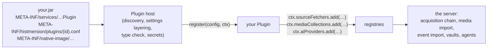

# Developing plugins

This page is for programmers. A plugin is a Scala 3 library, published as a jar with a POM, that
the server discovers when it starts. You can write one without a copy of Histmersion's source code: the install
on your computer has everything a plugin compiles against, in a Maven repository of its own, and
`histmersion plugin new` writes a working project to start from.

## Where the plugin API comes from

Histmersion is an application, not a library, so its plugin API is **not published to Maven
Central**. Instead, every install carries a small **Maven repository** of its own, in `maven/`, and a
plugin build reads from it as it reads from any other repository:

```bash
histmersion plugin repo          # …/Histmersion/maven
histmersion plugin repo --url    # file:///…/Histmersion/maven/
histmersion plugin repo --m2     # copy it into ~/.m2/repository, the local Maven repository
```

A build should not name that directory: its path is different on every computer, and a plugin's
repository is often public. Instead, the installer (and `histmersion plugin new`, and `plugin repo
--m2` whenever you ask) copies the install's artifacts into your **local Maven repository**,
`~/.m2/repository`, which every build tool knows by name: `m2Local` in scala-cli,
`Resolver.mavenLocal` in sbt, `mavenLocal()` in Gradle. Only files that are missing there or differ
are copied, so running it again after an update is cheap.

It holds these artifacts, all at the version of your Histmersion:

- **`com.histmersion::histmersion-plugin-api`**: the API a plugin compiles against, with its sources
  (the documentation of every type) and a POM.
- **`com.histmersion::histmersion-plugin-platform`**: no code, only a POM. Its dependencies are the
  libraries the server provides to plugins, at exactly the versions it ships (below).
- **`com.histmersion::histmersion-plugin-testkit`**: a test dependency that runs a plugin as the server
  does (see [Testing](#testing)), with the parts of Histmersion it needs.

A plugin depends on both **compile-only**: the server provides them at run time, so they are never
packed into the plugin and never listed as its dependencies. Everything else comes from Maven Central
as usual.

On a computer where Histmersion is not installed, use the repository from a release: each tagged
release on GitHub carries it as `histmersion-maven-<version>.zip` (unzip it and name its `maven/`
directory with `--repo` wherever this page uses the local Maven repository), and the API jars on their own as
`histmersion-plugin-api-<version>.jar` and `-sources.jar`.

### The plugin platform

The libraries the server provides to plugins, and so the ones a plugin may use without installing
anything:

| library | what for |
|---|---|
| Scala 3 standard library | the language |
| sconfig, kindlings sconfig derivation | settings (the API is built on them) |
| circe (core, parser), kindlings circe derivation | JSON |
| cats | functional data types (circe uses it) |
| sttp client 4 | HTTP models (for requests, still use `ctx.http`) |
| tapir (core, circe JSON), kindlings tapir schema derivation | endpoint and schema descriptions |
| ox | direct-style concurrency |
| iron | refined types |

The exact versions are in the platform's POM, and in {{ repo_file("modules/plugin-api/plugin-platform.txt") }}.
The list is part of the plugin compatibility contract, like the SPI version: a release that changes
one of these versions says so, because a plugin built against the old version may need rebuilding.

## Your first plugin, with scala-cli

[scala-cli](https://scala-cli.virtuslab.org) builds, tests and packages a Scala project from
directives at the top of its source files, with no build definition. It is the simplest way to write
a plugin.

```bash
histmersion plugin new doi-mirror                         # a source fetcher, in ./doi-mirror
histmersion plugin new my-events --kind event-catalogue   # or another kind
```

The kinds are `source-fetcher` (the default), `media-collection`, `event-catalogue`, `ai-provider` and
`secret-vault`. Each writes a small plugin of that kind that works as written. `--dir` chooses
another directory, `--package` another Scala package, and `--repo <directory or URL>` another Maven
repository with the plugin API, platform and testkit than the local one (one unzipped from a release, or
a remote one). Without `--repo`, `new` copies the install's artifacts into `~/.m2/repository` first.

What it writes, for `doi-mirror`:

| file | what it is |
|---|---|
| `project.scala` | the build: every `//> using` directive of the project, the tests' too |
| `DoiMirror.scala` | the plugin: its settings, the `Plugin` class and the source fetcher it adds |
| `DoiMirror.test.scala` | its tests, a live check against the real site (skipped until you ask for it), and checks of what the jar must carry |
| `README.md` | how to test it: offline, live, and recorded then replayed (see [Testing](#testing)) |
| `.gitignore` | keeps the build's output and the published `repo/` out of version control |
| `resources/META-INF/services/com.histmersion.plugin.Plugin` | names the plugin class, so the server can find it (Java's ServiceLoader reads it). Rename the class and you must rename it here too; a test checks it |
| `resources/META-INF/histmersion/plugins/doi-mirror.conf` | the plugin's settings and their defaults |
| `resources/META-INF/native-image/doimirror/doi-mirror/reachability-metadata.json` | what the server's native binary must be told about the plugin (see [Native image](#native-image)) |

`test-resources/` (not written until you need it) holds files only the tests read, such as trimmed
copies of a site's answers: it is on the test class path and never in the jar. The live check's
recordings go in `recordings/` (see [Testing](#testing)).

The two Scala files are the ones you edit, and `project.scala` is the build:

```scala
//> using scala 3.10.0
//> using repository m2Local
//> using compileOnly.dep com.histmersion::histmersion-plugin-api:0.1.0-SNAPSHOT
//> using compileOnly.dep com.histmersion::histmersion-plugin-platform:0.1.0-SNAPSHOT
//> using resourceDir resources

//> using publish.organization doimirror
//> using publish.name doi-mirror
//> using publish.version 0.1.0
//> using publish.doc false

//> using test.dep org.scalameta::munit:1.3.6
//> using test.dep com.histmersion::histmersion-plugin-platform:0.1.0-SNAPSHOT
//> using test.dep com.histmersion::histmersion-plugin-testkit:0.1.0-SNAPSHOT
//> using test.resourceDir test-resources
//> using test.javaProp histmersion.plugin.project=${.}
```

- The Scala version and the Histmersion artifacts are the ones your Histmersion runs; keep them when you
  edit. `m2Local` is `~/.m2/repository`; the project names no path of your computer, so it builds as
  it is on another one with Histmersion installed.
- The API and the platform are **compile-only**: the server provides them, so they are neither in the
  jar nor in its POM. A compile-only dependency is not on the test class path, so the tests, which run
  the plugin, name the platform again; the **plugin testkit** loads and runs the plugin as the server
  does (see [Testing](#testing)) and brings the API with it.
- The Histmersion version is written on four lines. scala-cli has no variables, so to build against
  another Histmersion change all four.
- `publish.doc false`: `publish` would otherwise build a Scaladoc jar, and Scaladoc warns about every
  link into the compile-only API. The sources jar is still published, for editors.
- `test.javaProp histmersion.plugin.project=${.}` gives the tests the project's directory (`${.}` is
  the directory of `project.scala`), so the testkit finds `recordings/` wherever `scala-cli test` is
  started.
- The `publish` lines name the plugin when you publish it: change the organization to your own (a
  reversed domain name, say) and keep the version equal to the one in `PluginInfo`.

**More source files.** A plugin of several files keeps all its directives in `project.scala`,
including the `test.*` ones: put a file's `//> using dep` there, not at the top of that file. scala-cli
reads directives from every file and warns when they are spread over several; one file is one place to
change a version. Name test files `*.test.scala`.

The loop:

```bash
cd doi-mirror
scala-cli fmt .                                                   # format the sources (scalafmt)
scala-cli test .                                                  # compile, run the tests
scala-cli --power publish . --publish-repository ./repo          # the jar and its POM
histmersion plugin add doimirror::doi-mirror:0.1.0 --repo ./repo  # shows what it adds and needs, then installs it
histmersion plugin rebuild                                        # link it into the server
```

[Installing plugins](installing.md#install-a-plugin-from-its-source-repository) has these steps in
full, with the relink's memory, updating and removing.

Then turn it on in `histmersion.conf` and reload the settings:

```hocon
histmersion.plugins.doi-mirror { enabled = true, base-url = "https://mirror.example.org" }
```

```bash
histmersion config reload
histmersion about          # doi-mirror 0.1.0 — registered (source-fetcher:doi-mirror)
```

`publish` writes a Maven repository in `./repo`: the plugin jar (your classes and resources only), a
sources jar, and a **POM**, the file that lists the plugin's dependencies. The compile-only Histmersion
artifacts are not in it; your own libraries are. `plugin add` reads that POM.

### Libraries of your own

Add a library as scala-cli adds any:

```scala
//> using dep org.scala-lang.modules::scala-xml:2.5.0
```

Nothing more is needed. The published POM lists it, and `histmersion plugin add` resolves the
plugin's dependencies (with [coursier](https://get-coursier.io), from Maven Central and the
repositories you name) and installs them beside the plugin, in the data directory's `plugins/lib/`.
The relink links them into the server with the plugin; in JVM mode they are on the class path with
it. Do not copy a library's classes into your jar: the server has one copy of each class, and refuses
a plugin whose jar repeats a class it already has.

What the server ships is never installed again: when your library depends on, say, cats, the server's
cats is used. That works as long as the server's version is the same or newer than the one your
dependencies ask for. When a plugin needs a **newer** version of a library the server ships, it cannot
be installed (two versions of one library cannot be loaded side by side), and `plugin add` refuses it
naming the library and both versions:

```text
refused:
  - doi-mirror-0.1.0.jar needs io.circe:circe-core_3 0.14.20, but this Histmersion ships 0.14.17 — …
```

Build against the platform's version instead, or wait for a Histmersion that ships the newer one.

### In an editor: VS Code with Metals

```bash
scala-cli setup-ide .
```

writes `.bsp/scala-cli.json`, which tells an editor how to build the project. Open the directory in
VS Code with the **Metals** extension (or in IntelliJ IDEA with the Scala plugin) and import the build
when it asks. You get completion, errors as you type, and go-to-definition into the plugin API's
sources, with its documentation on hover: the editor fetches the sources jar from the repository. Run
`setup-ide` again after you change a `//> using` line.

### With a coding agent

```bash
histmersion plugin new doi-mirror --with-agent-notes
```

adds `AGENTS.md` (and a `CLAUDE.md` that points at it) to the project: the rules the server enforces on a
plugin, where the API's sources and documentation are and how to read them, the build and install
commands, and the licence. Coding agents that read `AGENTS.md` or `CLAUDE.md` pick it up when they work in
that directory. To read the API without an editor:

```bash
unzip -l "$(histmersion plugin api-jar --sources)"                                         # the files
unzip -p "$(histmersion plugin api-jar --sources)" com/histmersion/plugin/PluginContext.scala   # one, with its docs
javap -cp "$(histmersion plugin api-jar)" com.histmersion.plugin.PluginContext                  # signatures only
```

[cellar](https://github.com/VirtusLab/cellar) answers the same questions as Markdown from inside the
project (`cellar get com.histmersion.plugin.PluginContext`), once your cellar reads Scala 3.10;
an older one stops with "TASTy signature has wrong version".

### With sbt instead

The same works with sbt: add the local Maven repository to the resolvers, depend on the plugin API and
platform as `Provided` (compiled against, not packaged, not a dependency of the published plugin), and
on your own libraries as usual:

```scala
// build.sbt
scalaVersion := "3.10.0"
organization := "org.example"
version      := "0.1.0"
resolvers += Resolver.mavenLocal                 // ~/.m2/repository: histmersion plugin repo --m2
val histmersion = "0.1.0-SNAPSHOT"
libraryDependencies ++= Seq(
  "com.histmersion" %% "histmersion-plugin-api"      % histmersion % Provided,
  "com.histmersion" %% "histmersion-plugin-platform" % histmersion % Provided,
  "org.scala-lang.modules" %% "scala-xml"         % "2.5.0",
  "com.histmersion" %% "histmersion-plugin-testkit"  % histmersion % Test,   // see Testing
  "org.scalameta" %% "munit"                      % "1.3.6" % Test
)
Test / fork := true                              // the testkit finds recordings/ under the project
Test / javaOptions += s"-Dhistmersion.plugin.project=${baseDirectory.value}"
publishTo := Some(MavenCache("local-plugin-repo", baseDirectory.value / "repo"))
publishConfiguration := publishConfiguration.value.withOverwrite(true)   // publish the same version again while developing
```

The resources go in `src/main/resources/` (the same three files `plugin new` writes under `resources/`),
the sources in `src/main/scala/`, the fixtures in `src/test/resources/`. sbt's `Provided` puts the API
and the platform on the test class path too, and a `val` holds the Histmersion version once. `sbt publish` writes the jar and its POM to `./repo`; then
`histmersion plugin add org.example::my-plugin:0.1.0 --repo ./repo`. No assembly or shading plugin is
needed.

## Installing it

`histmersion plugin add` takes a plugin in any of four forms; [Installing plugins](installing.md) has
the details:

```bash
histmersion plugin add org.example::doi-mirror:0.1.0 --repo ./repo   # Maven coordinates, from a repository
histmersion plugin add ./repo/org/example/doi-mirror_3/0.1.0/doi-mirror_3-0.1.0.jar   # a file (the .pom beside it is read)
histmersion plugin add https://example.org/doi-mirror_3-0.1.0.jar    # a URL (and the .pom beside it)
```

A plugin installed with its POM gets its dependencies installed with it. A bare jar without a POM is
taken as having none: it still works when it uses only the API and the platform, and fails to
register with "class … is missing" when it needs anything else.

Copying the jar into the data directory's `plugins/` by hand works too. Either way, the server sees a
changed set of plugins only after `histmersion plugin rebuild` (or a restart in JVM mode).

## Licence

Histmersion, its plugin API and the built-in plugins are licensed under the AGPL-3.0, and a plugin
built on the API is AGPL-3.0 as well.

## The SPI in one page

The design and its reasons are in {{ repo_file("docs/research-plugins.md") }} (sections 15–23
describe what was built).

A plugin compiles against **one** module, `modules/plugin-api` (artifact `histmersion-plugin-api`,
package `com.histmersion.plugin`). It never sees the server, the database or the domain model. The
module's only dependencies are sconfig, kindlings' sconfig derivation and Iron, all three part of the
plugin platform.

`plugin-api`, like the rest of Histmersion, is licensed under the AGPL-3.0-or-later. A plugin is
linked into the server's binary and runs inside it, so a plugin you give to other people must be
under a licence compatible with the AGPL ([Legal notice](../legal.md)).

- **One service type: `Plugin`.** A plugin is found through Java's `ServiceLoader`: the jar lists its
  provider class in `META-INF/services/com.histmersion.plugin.Plugin`. The provider is a public
  class with a no-argument constructor (not a Scala `object`), and constructing it does nothing —
  real work starts in `register`, and only for an enabled plugin.
- **`PluginInfo(id, version, spiVersion)`.** `id` is kebab-case (`[a-z0-9][a-z0-9-]*`) and is also
  the settings key: `histmersion.plugins.<id> { … }`. `spiVersion` must be `Spi.Version` (now 2),
  which is compiled into your plugin; a plugin built for another one is refused, with a message to
  rebuild it.
- **Typed values.** What the SPI exchanges about works, places, events and pictures has a type of its
  own: `Year`, `Period`, `Latitude`, `Longitude`, `Doi`, `WikidataId`, `Licence` (Iron newtypes, plain
  `Int`s, `Double`s and `String`s at run time). A literal is checked when the plugin compiles:
  `Year(-1600)`, `Doi("10.1234/abc")`. A value read at run time is parsed: `Doi.option(raw)`,
  `Latitude.either(raw)` (a `Left` with the reason); `Period.from(start, end)` refuses one that ends
  before it starts. `.value` takes the plain value out. The host checks every value you hand over
  again and refuses that record, naming the value, if one fails.
- **A path-dependent `Config`.** Each plugin declares `type Config` and a `given ConfigReader[Config]`
  — a `deferred` given, so `derives ConfigReader` on your case class fills it in. The host decodes
  *this* plugin's block with *this* reader and hands the value to *this* plugin's `register`: no cast,
  and no other plugin can see it. Import `com.histmersion.plugin.PluginConfig.given` where you derive,
  so a number or boolean can come from an environment variable (which always arrives as a string).
- **Defaults as a named resource.** `META-INF/histmersion/plugins/<id>.conf` holds the defaults, keys
  relative to the plugin's block. It is also the type schema: every key the plugin reads has a default
  (`null` for an optional value), and a key the user sets that it lacks is reported as unknown.
  `enabled` belongs to the host; absent, the plugin is disabled. Never ship a `reference.conf`.
- **`register(config, ctx): Either[String, Unit]`.** Called once per configuration generation, after
  every `Secret` in the decoded config was resolved. What the plugin adds to the context's
  **registries** is staged: a `Left` or an exception discards all of it.
- **Six registries** on `PluginContext`, one per extension point: `secretVaults`, `sourceFetchers`,
  `mediaCollections`, `eventCatalogues`, `aiProviders`, `gazetteerSources`. A new extension point is a new registry, not a
  new service type, so existing jars keep loading.
- **What the host lends.** `ctx.http` (the host's HTTP client and its politeness policy — a plugin
  never opens its own sockets), `ctx.log` (`info`/`warn`, the plugin's id on every line),
  `ctx.env(name)` (for things like `PATH`, never for credentials) and `ctx.secret(s)`.
- **Secrets are typed.** A credential field is a `Secret` (a reference: `env:NAME`, `<vault>:<ref>`,
  `value:…`). Its `toString` never shows a value. The host finds every `Secret` in your decoded config
  and resolves it before `register`.
- **Failures are values.** Return `Left(message)`, `Fetch.Miss(why)`, `AiFailure.Error(…)`; the host
  catches exceptions and reads them as failures, but do not rely on it.



The settings a plugin finally sees are layered: **environment overrides its defaults declare >
the user's `plugins.<id>` block > its defaults**.

## SPI 2: what changed

SPI 2 gave the values the SPI exchanges types of their own. A plugin built against SPI 1 is refused
when it is installed, linked or loaded — `it was built against plugin SPI 1; this Histmersion speaks
SPI 2 — rebuild the plugin against SPI 2` — so rebuild it against this release's `histmersion-plugin-api`
(`histmersion plugin repo --m2`, then `scala-cli test .` and publish), raise its version, and install the
new jar with `histmersion plugin add`.

| where | SPI 1 | SPI 2 |
|---|---|---|
| `WorkKey` | `doi: Option[String]`, `year: Option[Int]` | `doi: Option[Doi]`, `year: Option[Year]` |
| `FetchedFile` | `licence: Option[String]`; a four-field `apply` and constructor | `licence: Option[Licence]`; the four-field forms are gone (`licence` still defaults to `None`) |
| `MediaPlace` | `wikidata: Option[String]`, `lat`/`lon: Option[Double]`, `period: Option[(Long, Long)]` | `Option[WikidataId]`, `Option[Latitude]`/`Option[Longitude]`, `Option[Period]` |
| `MediaItem` | `period: Option[(Long, Long)]`, ends in either order | `period: Option[Period]`, built with `Period.from(start, end)` |
| `MediaRights` | `licence: String` | `licence: Licence` |
| `MediaMatchRule.Map` | `maxYear: Int` | `maxYear: Year` |
| `CatalogueQuery` | `from: Option[Long]`, `to: Long`, `area: Option[(Double, Double, Double, Double)]` | `Option[Year]`, `Year`, `Option[(Longitude, Latitude, Longitude, Latitude)]` |
| `CatalogueEvent` | `notBefore`, `notAfter`, `beginBy`, `endFrom`, `central: Option[Long]`; `lat`/`lon: Option[Double]`; `wikidata: Option[String]` | `Option[Year]`; `Option[Latitude]`/`Option[Longitude]`; `Option[WikidataId]` |
| `EventCatalogue` | `licence: String`, `floorYear: Option[Long]` | `licence: Licence`, `floorYear: Option[Year]` |
| `Spi.Version` | `val Version: Int = 1`, read from the host at run time | `inline val Version = 2`, compiled into the plugin |
| testkit `AcceptedEvent` | `notBefore` … `notAfter: Option[Long]` | `Option[Year]` |

What to change in a plugin:

- Wrap literals: `Year(-1600)`, `Licence("CC0-1.0")`, `Doi("10.1234/abc")`, `Latitude(36.4)`.
- Parse what you read from a provider: `WikidataId.option(raw.trim.toUpperCase)`, `Doi.option(raw)`,
  `Latitude.option(lat)`; `Year(raw.toInt)` for a year (every integer is one). SPI 1's host corrected a
  Wikidata id written in lower case and dropped one that was none; now the type does, in your code.
- Take values out with `.value` where you build text or URLs: `work.doi.map(_.value)`.
- A tuple period becomes `Period.from(Year(a), Year(b))` (`Left` when it ends before it starts).
- In munit, compare a value taken out with `.value` against a plain one through its base type
  (`.map(d => d.value: String)`): munit compares only types it can tell are comparable.
- Nothing changed in `PluginInfo`, `PluginContext`, the registries, `Secret`, the AI provider's types, the
  settings, or how a plugin is packaged, installed and linked.

## Walkthrough 1: `hello`, a source fetcher

`modules/plugin-fixtures/hello` is the smallest third-party plugin — a **test fixture**, not a
product. It registers one open-access source fetcher that never has a copy.

```scala
import com.histmersion.plugin.*
import com.histmersion.plugin.PluginConfig.given
import hearth.kindlings.sconfigderivation.ConfigReader

final case class HelloConfig(greeting: String, greeter: String, mirrors: List[String]) derives ConfigReader

final class HelloPlugin extends Plugin:
  type Config = HelloConfig
  val info = PluginInfo("hello", "0.1.0", Spi.Version)

  def register(config: HelloConfig, ctx: PluginContext): Either[String, Unit] =
    ctx.log.info(s"hello: ${config.greeting} (${config.mirrors.size} mirror(s))")
    ctx.sourceFetchers.add("hello", HelloFetcher(config.mirrors.size))

final class HelloFetcher(mirrors: Int) extends SourceFetcher:
  val access = Access.Open
  def fetch(work: WorkKey, ctx: FetchContext): Fetch =
    Fetch.Miss(s"hello has no copy (asked $mirrors mirror(s))")
```

(The real fixture also picks a `Greeter` class **by name** from its settings, to prove that its own
native-image metadata is honoured — see below.)

`src/main/resources/META-INF/services/com.histmersion.plugin.Plugin`:

```text
com.histmersion.fixtures.hello.HelloPlugin
```

`src/main/resources/META-INF/histmersion/plugins/hello.conf`:

```hocon
# keys relative to histmersion.plugins.hello
enabled  = false
greeting = "hello from the plugin's defaults"
greeting = ${?HISTMERSION_PLUGIN_HELLO_GREETING}
greeter  = QuietGreeter
mirrors  = ["https://example.org/a"]
```

A user turns it on in `histmersion.conf`:

```hocon
histmersion.plugins.hello { enabled = true, greeting = "hi" }
```

The fetcher contract (`SourceFetcher.scala`):

- `fetch(work: WorkKey, ctx: FetchContext): Fetch` gets every identifier the caller has (DOI, arXiv,
  PubMed, PMC, archive.org, ISBN, title, authors, year, preferred format) and answers
  `Fetch.Found(FetchedFile(…))`, `Fetch.Miss(why)` or `Fetch.Refused(why)` (a copy exists but may not
  be taken). `work.doi` is a `Doi` (`work.doi.map(_.value)` for the text), `work.year` a `Year`. A
  `FetchedFile` may carry the copy's `licence` (`licence = Some(Licence("CC-BY-4.0"))`: an SPDX id,
  `public-domain` or the licence's URL); ingest records it as the source's licence when it has none.
- A bot-protection page (Cloudflare's challenge, Anubis's proof-of-work check) is a `Fetch.Refused`:
  never solve or work around it.
- `access` is `Access.Open`, `Access.Subscription` or `Access.Unauthorised`. The host alone decides
  from it whether the fetcher may run ([Installing plugins](installing.md)).
- A fetcher is called from several threads at once: keep no per-work state in it; share a lookup
  between fetchers of one work with `ctx.memo("<plugin id>:<what>:<identifier>")(…)`.
- `histmersion.acquire.chain` orders fetchers by their registered ids; one not listed runs after the
  listed ones, in plugin order.

## Walkthrough 2: `hello-ai`, an AI provider

`modules/plugin-fixtures/hello-ai` is a scripted AI provider: it calls no model and opens no socket,
so the test suites can run a real pipeline through the host's tool loop with it.

```scala
final case class HelloAiConfig(name: String, token: Option[Secret], replies: List[Reply]) derives ConfigReader

final class HelloAiPlugin extends Plugin:
  type Config = HelloAiConfig
  val info = PluginInfo("hello-ai", "0.1.0", Spi.Version)

  def register(config: HelloAiConfig, ctx: PluginContext): Either[String, Unit] =
    config.token.fold[Either[String, Boolean]](Right(false))(t => ctx.secret(t).map(_.nonEmpty)).flatMap { hasToken =>
      ctx.aiProviders.add(config.name, HelloAiProvider(config.replies, hasToken))
    }
```

An `AiProvider` (`AiProvider.scala`) answers **one model call at a time**:

- `turn(request: AiTurnRequest, http: AiHttp): Either[AiFailure, AiTurn]` — the request carries the
  model id, the system prompt, the conversation so far, the tools offered on this call, the JSON
  schema the final answer must match, and the output-token cap. The answer is text and/or tool calls,
  why it stopped, and token usage.
- `AiFailure.LimitReached` tells the host that the plan behind the model hit its usage limit: the
  host passes the model over and tries the chain's next one.
- `check(model)` (can this model run now? spends nothing), `models(http)` (a free listing for
  `agent doctor`), `doctor(online, http)` (its own checks), `capabilities` (tools, structured output),
  `spendsPersonalPlan` (refused while the server listens beyond loopback).

The host keeps everything else: the prompts, the tool loop and the tools, decoding and validating the
answer, retries, budgets, allowances, approvals and the trace. A provider's models are **metered**:
users price them in `agents.prices` (`0/0` for a free one) and cap them with allowances on
`<name>:*`. The provider name is the part before the colon in `agents.roles.*`
(`hello-ai:echo`).

The other extension points follow the same pattern: `MediaCollection` (`search` a place, `complete`
a record; the host judges every licence and every match itself), `EventCatalogue` (`parts` and
`read` pages of `CatalogueEvent`s, with its `licence` and `citation`) and `SecretVault` (`name`,
`resolve(ref)`, and optionally `resolveAll(refs)`: the host asks a vault once for every reference of a
config generation; the default calls `resolve` for each, a vault whose backend costs per call — an
unlock, a hardware key — overrides it to pay once).

## Native image

The installed server is a native binary, and a native binary cannot load classes it did not see
when it was linked. Two consequences:

1. **A changed set of plugins needs a relink** (`histmersion plugin rebuild`), which runs GraalVM
   `native-image` over the bundle's relink kit plus the plugin jars. In JVM mode
   (`plugin rebuild --jvm`) plugins load at each start instead.
2. **Reflection and resources need metadata.** Anything your plugin reaches dynamically — a class
   chosen by name, a resource file, a JNI call — must be declared in
   `META-INF/native-image/<group>/<artifact>/reachability-metadata.json` inside your jar, where
   `<group>` and `<artifact>` are the plugin's published organization and name (`publish.organization`
   and `publish.name`; `plugin new` writes the file there). native-image reads every such file on the
   class path, at any depth below `META-INF/native-image/`, and the relink asks for nothing more; the
   group and artifact are GraalVM's convention, which keeps two jars' files from sharing a path. Scala 3
   lazy vals count: each keeps its value in a field named `<name>$lzy<n>`, reached by name, and every
   `given` the compiler derives (`derives ConfigReader`) is one. `plugin new` writes this file for the
   classes it generates, with the defaults file; the packaging test lists any lazy val field the file
   lacks, so add the ones it names. For anything else, use GraalVM's **tracing agent**: run your
   plugin's code once under `-agentlib:native-image-agent=…` (for example its tests, or a JVM-mode
   `--self-check` with the plugin enabled) and ship the JSON it writes. Use the GraalVM version
   Histmersion pins (CE 25.4, JDK 25.0.4.1.1: `sdk install java 25.4.4.1+1-graalce`).
   The `hello` fixture's `Class.forName` lookup works in a relinked binary only because its jar carries
   such a file.

The same holds for your plugin's libraries: one that loads classes by name or reads resources may need
metadata of its own (many libraries ship it in their jars). The relink's self-check of the new binary
tells you when something is missing.

The relink also runs **Sloth** over plugin jars and their dependencies, which rewrites lazy vals
compiled by Scala before 3.8 into the form JDK 25 prefers; nothing for you to do.

## Packaging

- One jar per plugin, with the services file, the defaults file and the native-image metadata, and
  only your own classes in it.
- **Publish it with its POM**, which lists the libraries it needs (scala-cli's `publish`, sbt's
  `publish`, Maven's `deploy`). Depend on `histmersion-plugin-api` and `histmersion-plugin-platform`
  compile-only (`compileOnly.dep`, `% Provided`), so neither is listed or packed.
- Build with a Scala 3 version no newer than the server's (3.10.0 in this release), against the
  same `Spi.Version`, and with the platform's versions of the libraries the server ships.
- Users install it from a Maven repository by coordinates, or from a file or `https` URL with the POM
  beside the jar (`x-1.0.jar` and `x-1.0.pom`): `histmersion plugin add <group::artifact:version|path|url>`.
  To support GPG verification, publish a detached signature next to the jar (`<jar>.asc`).

Inside this repository, `sbt pluginHello/package` and `sbt pluginHelloAi/package` build the two
fixtures without dependencies, and `sbt pluginHelloDeps/fixturesRepo` writes `hello-deps` (whose POM
lists the `hello-lib` fixture) to a test Maven repository.

**An example external plugin.** `histmersion-plugin-oabooks`, a separate repository, is a complete
plugin built outside this one with scala-cli, laid out as `histmersion plugin new` writes a plugin: an
open-access source fetcher for openly licensed books in the OAPEN Library and DOAB. Its build is one
`project.scala` for fourteen source files; it compiles against the plugin API and platform
(`compileOnly.dep`), depends on scala-xml as an ordinary library, publishes its jar with a POM to a
directory repository, carries its defaults and native-image metadata, and tests itself with the plugin
testkit: unit tests on trimmed copies of OAPEN's answers (in `test-resources/`), and a recorded live
case (a book whose file OAPEN's bot check keeps from scripts, so the expected answer is "refused")
replayed offline.

## Testing

### Without a server: the plugin testkit

Every install's Maven repository carries `com.histmersion::histmersion-plugin-testkit`, a test dependency
(`//> using test.dep …`, or `% Test` in sbt). It runs your plugin the way the server does, using the
server's own code, but needs no server, no database and no Postgres:

```scala
import com.histmersion.plugin.*
import com.histmersion.plugin.testkit.*
import java.nio.file.Path

class DoiMirrorLiveSuite extends munit.FunSuite:
  test("finds and downloads a copy of a known work"):
    val mode = HttpMode.fromEnv(Path.of("recordings", "known-work"))
    mode.left.foreach(why => println(s"SKIPPED ${getClass.getSimpleName}: $why"))
    assume(mode.isRight, mode.left.getOrElse(""))                    // skipped
    val harness = PluginHarness.load("doi-mirror", "base-url = \"https://mirror.example.org\"",
      http = mode.toOption.get).fold(e => fail(e), identity)        // or the server's refusal
    val work   = WorkKey.fromDoi("10.1234/abc", harness).getOrElse(WorkKey(doi = Some(Doi("10.1234/abc"))))
    val report = harness.fetch(work, saveTo = Some(Path.of("target", "fetched")))
    assert(report.outcome.isInstanceOf[FetchOutcome.Found], report.toString)
```

- **`PluginHarness.load(id, config)`** finds the plugin through ServiceLoader on the test class path,
  checks that `META-INF/services/…` and `META-INF/histmersion/plugins/<id>.conf` are there and parse,
  layers your config (the block's keys, or the whole `histmersion.plugins.<id> { … }` as in
  `histmersion.conf`, or a file) over the defaults, type-checks it, resolves its secrets and calls
  `register`. What fails here fails in the server, with the server's message.
- **The runners** do what the server does with what the plugin registered, and report what the server
  would make of the answer: `fetch(work)` (the acquisition chain: an exception is a miss, a "PDF" that is
  not one is no copy; `Found`, `Miss` or `Refused`, each fetcher's answer, the licence, the log lines;
  `saveTo` writes the file), `searchMedia(collection, place)` (each record's licence read and judged
  against `media.collections` as the import does; tying it to a place needs the map and is not run),
  `readCatalogue(catalogue, query)` (parts and pages, each record checked and dated as stored),
  `aiTurn(provider, request, http)` (the provider's check, then one call; `ScriptedAiHttp` answers it and
  keeps what it sent) and `resolveSecret(vault, ref)`. `WorkKey.fromDoi(doi, harness)` fills in a work's
  title, authors and year from OpenAlex (else Crossref), as an ingest does.
- **Secrets** come from the test: `secrets = Map("keepassxc:Portal/token" -> "…")` (served by a stand-in
  vault) or the environment (`env:NAME`). No real vault or keychain is asked.
- **HTTP is the server's client** — its User-Agent, timeouts, TLS trust, `Retry-After`, bot challenges —
  and the `HttpMode` says where it goes: `Stub(Map(url -> StubAnswer…))` (canned answers, for unit
  tests), `Live`, `Record(dir)` (live, every exchange written to `dir`) or `Replay(dir)` (offline, from
  `dir`; a request with no recording fails the test and names the URL).

### Record once, replay offline

`HttpMode.fromEnv(dir)` lets one test serve all three uses: `HISTMERSION_PLUGIN_HTTP=live|record|replay`
decides when set; otherwise recordings in `dir` are replayed (offline, in CI too); otherwise the test runs
against the real site only with `HISTMERSION_PLUGIN_LIVE=1`, and is skipped without it.

A relative `dir` is resolved against the project's directory, which `project.scala` hands the tests in
the system property `histmersion.plugin.project` (`HttpMode.ProjectProperty`); without it, against the
directory the test JVM was started in. So `scala-cli test /path/to/plugin`, run from anywhere, still
replays the recordings.

munit reports a test that `assume` skipped as "skipped", without the reason, and the run passes. That
is why the generated live suites print `SKIPPED <suite>: <why>` first, with what to set to run it: a
check you expected to replay and that printed this line found no recordings where it looked (the line
names the directory).

```bash
HISTMERSION_PLUGIN_LIVE=1 scala-cli test .          # against the real site, until it passes
HISTMERSION_PLUGIN_HTTP=record scala-cli test .     # once more, keeping the answers
scala-cli test .                                    # from now on: replayed
```

A recording is a directory of plain files meant to be read in a diff: `001-<host>.http` per exchange
(method, URL, status, and only the headers that matter — content type, redirects, `Retry-After`,
a challenge marker) and its body in a file beside it. Never written: `Authorization`, cookies or any
other header, the value of a secret the test knows (`{secret}` stands in for it), and the contact
e-mail of a `histmersion.conf` (a test never sends it). A replay skips the waits of the server's client;
a plugin's own pacing still runs, so turn it down in replay (`mode.live` says which).

**Trim before you commit.** Bodies are files you may edit: cut a long answer to what the test reads,
and never commit a copyrighted file. The server's PDF check only looks for `%PDF` in the first KiB of
a file longer than a KiB, so `head -c 2048` of a PDF replays the same. Lines starting with `#` in a
`.http` file are notes — say what you trimmed.

### With a server

- **Load it the way the server does.** `histmersion plugin add` shows the id, version, SPI version,
  what it registers, the access its fetchers declare and the dependencies it installs — before it
  installs anything, and it refuses a jar built for another SPI version or one that needs a newer
  library than the server ships.
- **Check the settings without serving:** `histmersion-server --self-check` loads the config and every
  plugin, resolves secrets, checks the time zones, prints a report and exits (0 all good, 2 a plugin
  failed or was refused or the time zones are missing, 3 the config is broken).
- **Pre-flight a relink:** `histmersion plugin rebuild --check`.
- In this repository, the plugin suites install, describe and relink the `hello` jar, the resolver's
  suites resolve `hello-deps` and its dependency offline, and the AI-provider suites run pipelines
  through `hello-ai`; `scripts/bundle/smoke.sh` relinks a real bundle with `hello` and `hello-deps` in
  it. The testkit's own suites (`modules/plugin-testkit`) load test plugins of every kind, and
  `just plugin-template-check` (which `smoke.sh` runs when scala-cli is installed) writes a project of
  every kind with `plugin new`, under an empty HOME, then tests and publishes it with scala-cli and checks
  that the jar holds only the plugin and the POM lists none of the API, the platform and the testkit. See
  [Contributing](../contributing/index.md).
